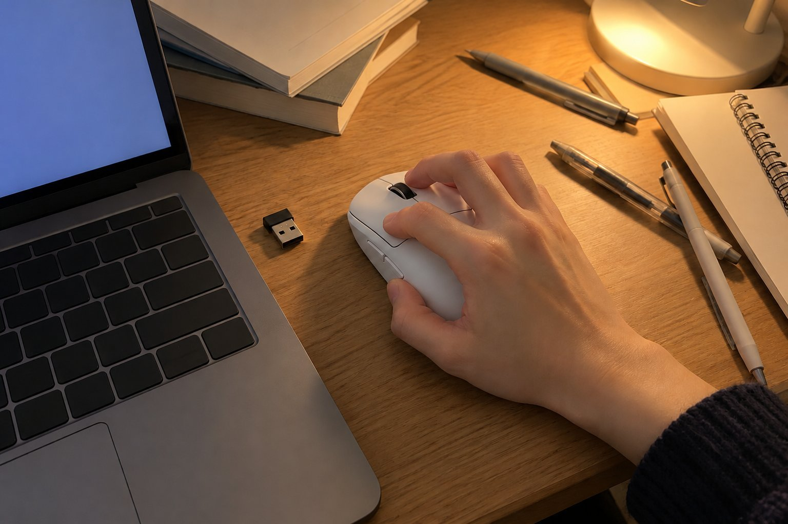

기숙사 2인실에서 과제를 하고, 남는 시간에 롤을 하루 네 시간쯤 하는 학생이에요. 손이 작은 편이고 클로로 쥐는데 감도를 높게 쓰는 편이에요. 책상이 좁아서 마우스 쓸 공간도 넉넉하지 않고, 룸메이트가 있어서 밤에는 조심해서 쓰는 편이에요. 9월 중순부터 3주 동안 G PRO X SUPERLIGHT 2를 썼습니다. 쓰던 마우스보다 훨씬 가벼워서 처음에는 손에 아무것도 안 쥔 것 같았어요.

| 크기 | 무게 | 연결 | 사용 기간 |
|---|---|---|---|
| 63.5 × 125 × 40 mm | 60 g | 무선(USB 수신기) · 유선 | 3주 · 과제 + 게임 |

## 작은 손에도 길이가 부담스럽지 않아요

125mm라서 큰 마우스일 줄 알았는데, 클로로 쥐니까 손끝이 버튼까지 무리 없이 닿았어요. 폭도 63.5mm라 손가락이 옆으로 벌어지지 않아서, 과제하면서 오래 잡고 있어도 손이 편했어요. 겉모양이 단순해서 좁은 책상에서도 눈에 거슬리지 않는 것도 좋았어요.

## 클릭 반응이 빨라요

롤에서 한타 중에 빠르게 연타할 때, 누른 만큼 바로 반응하는 느낌이 있었어요. 과제하면서 파일을 열고 닫을 때도 클릭이 경쾌해서 기분이 좋았고요. 무선인데 입력이 늦는다고 느낀 적은 없었어요. 선이 없으니 좁은 책상에서 선이 걸릴 일도 없어서 책상 정리가 훨씬 깔끔해졌어요.

## 고감도에서는 너무 가벼워서 커서가 흔들려요

아쉬웠던 점은 제가 쓰던 감도 그대로 쓰니까 가벼워서 커서가 살짝 흔들리는 것이었어요. 조금만 힘이 들어가도 화면이 많이 움직여서 첫 이틀은 조준이 계속 빗나갔어요. 감도를 한 단계 낮췄더니 일주일쯤 지나서 적응이 됐어요. 반대로 무거운 마우스를 오래 쓰던 사람이라면 적응하는 데 더 걸릴 수 있을 것 같아요.

그래도 장점이 더 컸어요. 수업이 있는 날에는 노트북과 같이 가방에 넣어 도서관에 가져가기도 했는데, 가벼워서 짐이 늘어난 느낌이 없었어요. 수신기를 노트북에 꽂으면 바로 연결돼서 자리를 옮겨도 번거롭지 않았고요. 예산이 넉넉하지 않아서 한참 고민하고 샀는데, 감도만 맞추면 후회는 없을 것 같아요. 과제 마감 전날 밤에 몇 시간씩 이어서 써도 손목이 뻐근하지 않았던 것도 기억에 남아요. 룸메이트도 마우스가 바뀐 줄 몰랐을 만큼 생활에 바로 녹아들었어요.

결론은 조건부 추천이에요. 가벼운 마우스가 처음이라면 감도를 낮출 각오를 하고 쓰면 좋고, 작은 손이어도 크기 때문에 걱정할 필요는 없었어요.
