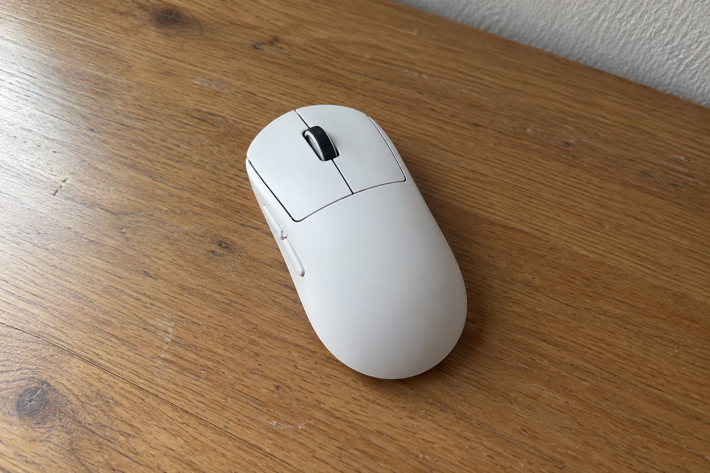

9월 초부터 5주 동안 G PRO X SUPERLIGHT 2를 썼습니다. 기존에 쓰던 마우스보다 확실히 가벼워서 처음 며칠은 힘 조절이 어색했습니다. 이후에는 이 무게가 기준이 되어서, 다른 마우스를 잡으면 무겁게 느껴집니다. 5주 동안 매일 쓴 느낌을 정리합니다.

| 크기 | 무게 | 연결 | 사용 기간 |
|---|---|---|---|
| 63.5 × 125 × 40 mm | 60 g | 무선(USB 수신기) · 유선 | 5주 |

## 가벼워서 팔이 덜 피곤합니다

오래 쓰면 팔과 손목 쪽에 쌓이는 피로가 확실히 줄었습니다. 이전 마우스는 몇 시간 쓰고 나면 팔 바깥쪽이 뻐근했는데, 이건 그런 일이 거의 없었습니다. 마우스를 들어서 옮기는 동작이 많을 때 이 차이가 더 커집니다. 클릭 반응도 빨라서 눌렀을 때 입력이 바로 들어갔습니다.

3주째쯤에는 무게가 더 이상 의식되지 않았습니다. 처음에는 마우스패드에서 살짝 밀기만 해도 커서가 멀리 갔는데, 힘을 빼고 쥐는 습관이 들자 이 가벼움이 오히려 정확하게 느껴졌습니다. 반대로 예전 마우스를 잠깐 다시 써 봤더니 팔이 금방 무거워져서 바로 돌아왔습니다.

## 무선인데 끊김이 없고 충전도 드뭅니다

5주 동안 연결이 끊긴 적이 없습니다. 수신기를 꽂아 두기만 하면 되고, 지연을 느낀 적도 없습니다. 배터리는 스펙상 최대 95시간인데, 충전 주기가 길어서 충전을 자주 하지 않았습니다. 겉모습은 장식이 없어서 어떤 책상에도 무난하게 어울립니다. 선이 없으니 책상 위가 비어 보이는 점도 마음에 듭니다.

## 클릭 소리가 또렷합니다

아쉬운 점은 클릭 소리입니다. 낮에는 괜찮은데 밤에는 소리가 또렷해서 신경이 쓰였습니다. 조용한 환경에서 쓸 분이라면 직접 확인해 보는 편이 좋겠습니다. 쥐는 방식이 다르면 크기나 높이에 대한 느낌이 달라질 수 있을 것 같습니다. 제 경우에는 특별히 불편한 점이 없었습니다.

처음 쓰는 분은 가벼움에 적응하는 시간이 필요합니다. 저는 일주일 정도 힘 조절이 어색했고, 클릭을 세게 누르는 버릇이 있어서 처음에는 마우스가 같이 밀리기도 했습니다. 익숙해진 뒤로는 책상 위에서 손이 더 자유롭게 움직였고, 이 점이 5주 동안 가장 크게 바뀐 부분입니다. 다시 고른다면 같은 제품을 고를 것 같습니다.

처음 일주일은 습관 때문에 마우스를 너무 세게 쥐곤 했는데, 힘을 빼고 나니 훨씬 편해졌습니다. 이제는 다른 마우스로 돌아가기가 어렵습니다.

결론은 추천입니다. 가벼움과 안정적인 연결이 가장 큰 장점이고, 소리만 감안하면 됩니다.
