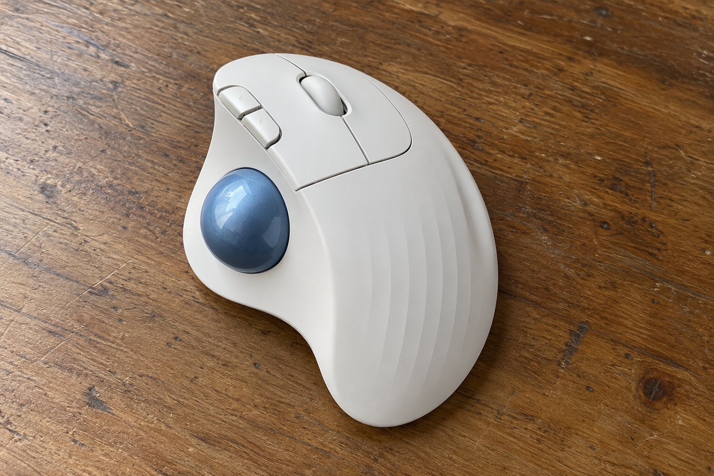

10월부터 3개월 동안 트랙볼인 ERGO M575S를 썼습니다. 기존에 쓰던 일반 마우스에서 바꿨는데, 처음에는 볼을 굴리는 방식이 낯설었습니다. 3개월 쓴 느낌을 정리합니다.

| 크기 | 무게 | 연결 | 사용 기간 |
|---|---|---|---|
| 100 × 134 × 48 mm | 145 g | 무선(USB 수신기, 블루투스) · AA 건전지 | 3개월 |

## 차트를 오래 볼 때 팔이 편합니다

가장 큰 장점은 팔이 편하다는 것입니다. 차트를 보면서 마우스를 오래 쥐고 있어야 하는 시간이 많은데, 트랙볼은 손만 올려 두면 되니 팔이 책상 위에서 쉬었습니다. 일반 마우스는 몇 시간 쓰고 나면 팔 바깥쪽이 뻐근했는데 이건 그런 일이 확실히 줄었습니다. 클릭 소리가 조용한 것도 좋았습니다.

## 엄지가 피곤합니다

아쉬운 점은 엄지입니다. 볼을 계속 엄지로 굴려야 하니 오래 쓰면 엄지 쪽이 피곤했습니다. 처음 2주는 엄지 아래쪽이 뻐근해서 쉬어 가며 써야 했습니다. 쓰면서 힘을 빼는 법을 익히니 좀 나아졌지만, 완전히 사라지지는 않았습니다. 겉모습은 크고 묵직해서 책상 위에서 존재감이 있었습니다.

## 세밀한 칸 선택이 느립니다

또 하나는 세밀한 선택입니다. 여러 칸이 붙어 있는 표에서 한 칸을 정확히 고를 때 볼을 조금씩 굴려야 해서 일반 마우스보다 느렸습니다. 큰 움직임은 쉬운데 작은 정밀 조작은 시간이 걸렸습니다. 손이 작은 분이라면 크기가 부담스러울 수 있을 것 같습니다.

3개월 동안 쓰면서 처음 사용 방식을 익히는 데 걸린 시간이 생각보다 길었습니다. 한 달쯤 지나서야 볼을 굴리는 감각이 손에 익어서 의식하지 않고도 움직일 수 있었습니다. 일반 마우스로 돌아가면 빠르기는 하지만 팔이 금방 지치는 것을 알기 때문에 계속 쓰고 있습니다. 크기가 커서 책상 위에서 자리를 차지하는 점은 감안해야 합니다. 큰 장점이 하나 있다면 책상 위에서 마우스를 움직일 공간이 필요 없다는 점입니다. 책상이 어수선해도 쓰는 데 지장이 없었습니다. 처음 적응 기간만 넘기면 만족스럽게 쓸 수 있는 마우스입니다. 연결은 수신기로 하든 블루투스로 하든 안정적이었고, 건전지도 오래 가서 운영하기가 편했습니다. 위치를 한 번 정하면 책상 정리를 할 때도 신경 쓸 부분이 적었습니다. 클릭이 조용한 점도 계속 마음에 들었습니다.

결론은 조건부 추천입니다. 팔 편안함은 확실하지만 엄지 피로와 정밀 조작이 걸리적거릴 수 있습니다.
