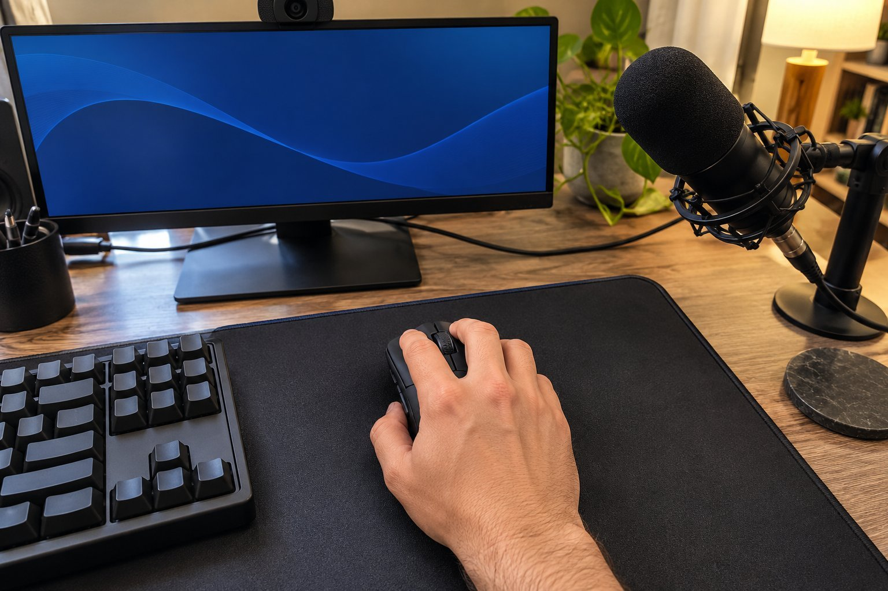

게임 방송을 하루 네 시간쯤 하는 사람이에요. 방송 중에는 마이크를 계속 켜 두기 때문에 마우스 소리도 같이 들어가는 환경이고, 손은 보통이며 클로 그립으로 쥡니다. 6주 정도 이 마우스로 방송을 해 봤고, 방송하는 입장에서 느낀 점을 적어 볼게요.

| 크기 | 무게 | 연결 | 사용 기간 |
|---|---|---|---|
| 61.7 × 127 × 42.7 mm | 103 g | 무선 USB 수신기 · 블루투스 | 6주 · 게임 방송 |

## 쥐는 느낌과 반응

쥐는 느낌은 마음에 들어요. 클로로 쥐어도 등이 손바닥 안쪽을 받쳐 줘서 손이 뜨지 않고, 옆면도 적당히 잡힙니다. 예전에 쓰던 유선 마우스는 선이 당겨져서 방송 중 큰 동작을 할 때마다 신경이 쓰였는데, 무선인 이 제품은 그런 불편이 없어요. 반응도 빨라서 교전 장면에서 조준이 늦는 느낌을 받은 적이 없습니다. 수신기로 연결하면 방송 중에 끊기는 일도 없었고요.

## 103g의 무게

아쉬운 건 무게예요. 103g이라 방송 네 시간을 이어서 하면 후반부에 팔이 묵직해집니다. 빠르게 마우스를 옮겨야 하는 장면에서는 가벼운 마우스보다 한 템포 느리게 느껴질 때도 있었어요. 건전지가 오래간다는 장점은 있지만, 무게 때문에 장시간 방송에서는 자세를 자주 고쳐 앉게 됩니다. 손목이 약한 분이라면 이 무게가 더 부담스러울 수 있을 것 같습니다.

## 클릭 소리와 마이크

가장 신경 쓰인 부분은 클릭 소리입니다. 클릭이 또렷해서 마이크를 켜 둔 방송 중에 딸깍 소리가 시청자에게 그대로 들어간다는 걸 채팅으로 알았어요. 채팅을 읽다가 가볍게 눌러도 소리가 나서, 마이크를 마우스에서 멀리 옮기고 나서야 조금 나아졌습니다. 마이크를 쓰지 않고 혼자 게임만 한다면 소리는 거의 문제가 되지 않을 거예요.

방송 중에 가장 많이 하는 동작은 짧은 연속 클릭과 큰 폭의 시점 이동인데, 시점 이동에서는 이 마우스가 안정적이었어요. 채팅창과 게임 화면을 번갈아 보며 클릭할 때도 의도하지 않은 입력이 나오지 않았고요. 처음 며칠은 클릭 소리가 마이크에 들어가는 줄 모르고 방송을 했는데, 시청자 한 분이 말해 줘서 알았어요. 그 뒤로는 평소보다 살살 누르는 습관이 생겼지만, 격한 교전 중에는 어쩔 수 없이 소리가 났습니다. 방송을 하지 않는 날에는 소리가 전혀 신경 쓰이지 않았으니, 방송 여부가 갈림길인 제품이에요.

정리하면 쥐는 맛과 반응은 좋지만, 방송처럼 마이크가 상시 켜져 있고 오래 쓰는 환경에서는 클릭 소리와 무게가 걸려서 저는 조건부로 추천합니다.
