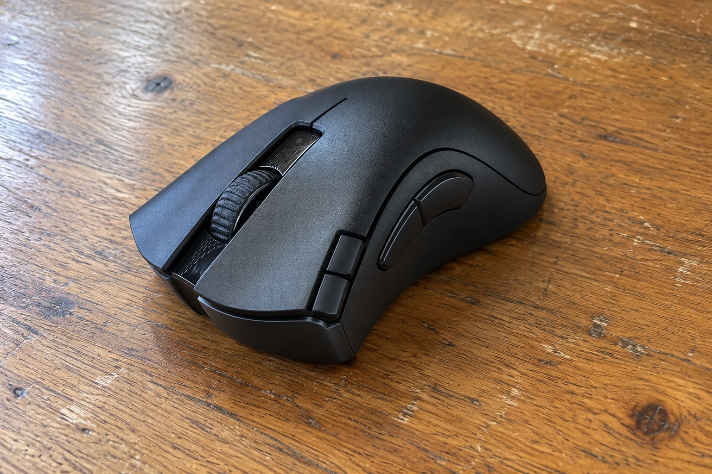

3개월 정도 쓴 DeathAdder V2 X HyperSpeed 사용기를 남겨요. 쓰면서 좋았던 점과 아쉬웠던 점을 솔직하게 적어 볼게요.

| 크기 | 무게 | 연결 | 사용 기간 |
|---|---|---|---|
| 61.7 × 127 × 42.7 mm | 103 g | 무선 USB 수신기 · 블루투스 | 3개월 |

## 쥐는 느낌

어른 손으로 쥐면 편해요. 등이 손바닥을 받쳐 주고 옆면이 적당히 잡혀서, 긴 글을 읽으며 스크롤하거나 화면을 오래 클릭할 때도 손이 덜 피곤했어요. 전에 쓰던 마우스는 납작해서 손바닥이 뜨곤 했는데 이 제품은 그런 느낌이 없습니다. 클릭할 때 손가락에 전해지는 감촉도 깔끔했어요. 버튼은 일곱 개인데 저는 앞뒤 이동 두 개만 쓰고, 나머지는 건드리지 않아서 크게 신경 쓰이지 않았어요.

## 건전지와 연결

건전지가 오래가요. 3개월 동안 거의 매일 썼는데 건전지를 자주 갈 일이 없어서 편했어요. 수신기를 꽂으면 바로 인식이 되고, 블루투스는 가끔 반응이 굼떠서 저는 수신기만 쓰고 있어요. 충전식이 아니라서 건전지를 미리 사 둬야 한다는 건 알고 쓰시면 좋겠어요.

## 아쉬운 점

겉모습은 깔끔하고 장식이 적어서 어디에 놓아도 어색하지 않았어요. 아쉬운 건 크기예요. 주변 아이에게 한번 쥐어 보라고 했더니 손이 마우스에 비해 작아서 버튼에 손가락이 닿지 않았어요. 어른 손 기준으로 만든 크기라는 느낌이에요. 손이 작은 어른이라면 비슷하게 크게 느낄 수도 있겠다고 생각해요. 무게도 103g이라 가벼운 마우스에 익숙한 분은 처음에 묵직하다고 느낄 수 있어요.

버튼이 많아서 처음에는 어느 것이 앞뒤 이동인지 헷갈렸지만 며칠 지나면 손이 익숙해져요. 휠을 굴릴 때 걸리는 느낌이 없어서 긴 글을 내리며 읽기에도 좋았고요. 무게는 손으로 들면 묵직하지만 쓰는 동안에는 책상에 놓인 채라서 크게 느끼지 못했어요. 처음 바꿨을 때는 손에 익을 때까지 며칠 걸렸지만 지금은 손에 잘 붙어요.

반대로 손이 큰 어른이라면 책상에 놓인 채 쓰는 동안 손바닥이 꽉 차서 오래 써도 부담이 없을 거예요. 저는 만족스럽게 쓰고 있고, 여럿이 함께 쓸 마우스를 찾는다면 쓰는 사람의 손 크기부터 확인해 보시길 권해요.

정리하면 어른이 쓰기에는 편하지만 아이처럼 손이 작은 사람에게는 커서, 누가 쓰는지에 따라 달라지는 마우스라서 저는 조건부로 추천해요. 건전지가 오래가고 클릭감이 깔끔해서 3개월 동안 마우스를 바꿔야겠다는 생각은 한 번도 들지 않았어요.
