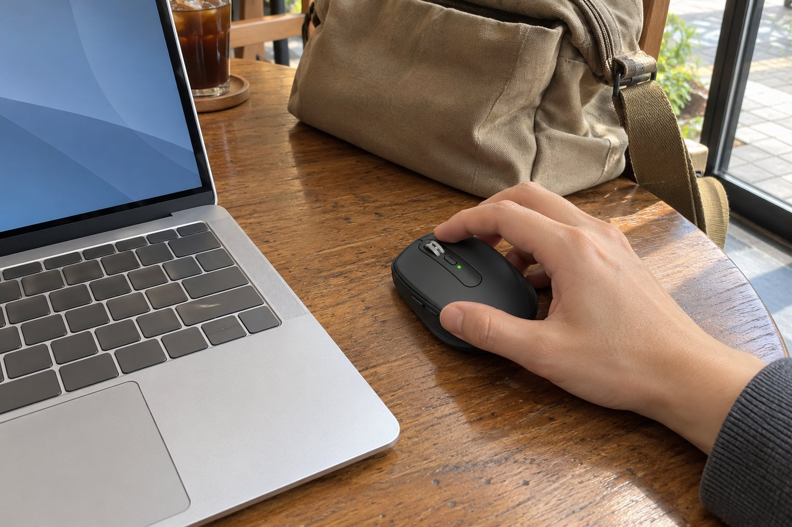

노트북으로 문서와 메일 작업을 하루 다섯 시간쯤 하는 사람입니다. 집보다는 카페나 공유 오피스에서 일하는 날이 많아서 마우스를 가방에 넣어 다니고, 조용한 곳에서 쓰는 만큼 소리와 무게가 중요합니다. 손은 작은 편이고 손끝으로 쥡니다. 6월 초부터 여름 내내 이 마우스를 들고 다녔고, 4개월 동안 쓴 느낌을 정리합니다.

| 크기 | 무게 | 연결 | 사용 기간 |
|---|---|---|---|
| 65 × 100.5 × 34.4 mm | 99 g | 무선 USB 수신기 · 블루투스 | 4개월 · 카페·공유 오피스 |

## 가방 속과 카페 탁자 위에서

가장 마음에 드는 건 크기입니다. 노트북 파우치 옆 작은 칸에 쏙 들어가서 따로 가방을 챙길 필요가 없습니다. 카페의 유리 탁자에서도 커서가 잘 움직여서, 마우스패드를 안 가지고 다녀도 됩니다. 전에 쓰던 일반 크기 무선 마우스는 가방에서 자리를 많이 차지해서 결국 두고 다니게 되었는데, 이 마우스는 매일 들고 나가게 됩니다. 블루투스로 노트북에 바로 연결되어 수신기를 꽂을 단자를 쓰지 않아도 되는 점도 좋았습니다.

## 조용한 클릭

클릭이 조용합니다. 공유 오피스에서 옆 사람과 거리가 가까운 날에도 눈치가 보이지 않았고, 카페에서 메일을 정리하며 연달아 클릭해도 주변에 거슬리는 소리가 나지 않았습니다. 겉모습도 얌전해서 노트북 옆에 두어도 튀지 않고 차분한 인상입니다. 충전 주기가 길어서 가방에 충전 케이블을 따로 챙기지 않아도 되는 날이 많았습니다.

## 아쉬운 점

아쉬운 건 휠 가운데 버튼입니다. 휠을 눌러서 쓰는 동작이 빡빡해서 손가락 끝으로 누르기 힘들 때가 있습니다. 99g이라는 무게는 가볍다고만은 못하지만 가방에 넣고 다니기에는 부담이 없습니다. 손이 큰 분이라면 오래 쓰기에는 작게 느껴질 수 있겠다는 생각이 듭니다. 손이 작아 손끝으로 쥐는 저에게는 크기가 딱 맞았습니다.

카페에서 노트북 옆에 마우스를 두고 쓰다 보면 팔꿈치가 탁자 끝에 걸리는 일이 많은데, 이 마우스는 작아서 놓을 자리가 좁아도 부담이 없습니다. 노트북 터치패드로 문서를 편집하던 때와 비교하면 손목 피로가 확실히 줄었습니다. 공유 오피스에서는 다른 사람의 시선이 부담스러운 날이 있는데, 조용한 클릭 덕분에 그런 걱정도 없었습니다. 메일을 정리하며 창을 오가는 동작이 많은 하루에도 손끝만으로 가볍게 조작이 되었습니다.

정리하면 휴대하며 조용한 곳에서 쓰는 사람에게는 추천합니다. 휠 버튼의 뻑뻑함만 감안하시면 됩니다.
