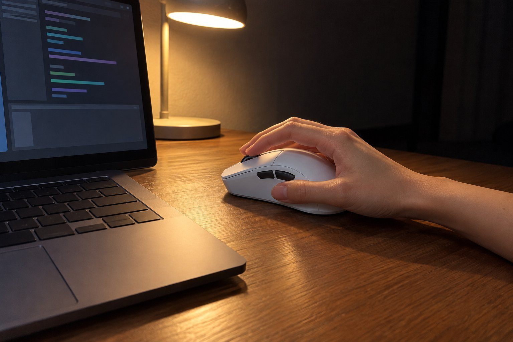

저는 손이 작은 편이고 마우스를 손끝으로 쥡니다. 글쓰기와 코딩을 하루 일곱 시간쯤 하고 저녁에 리듬 게임을 합니다. 밤에 작업하는 일이 많고 옆방에 가족이 있어서 소리에 민감합니다. 12월 하순부터 2주 동안 DeathAdder V3 Pro를 써 봤는데, 결과는 비추천입니다.

| 크기 | 무게 | 연결 | 사용 기간 |
|---|---|---|---|
| 68 × 128 × 44 mm | 64 g | 무선(USB 수신기) | 2주 · 문서·코딩 |

## 손끝으로 쥐기에는 길고 넓습니다

길이 128mm, 폭 68mm는 손끝으로 쥐는 저에게 너무 큽니다. 손바닥이 마우스 뒤쪽에 닿지 않고 손가락만 앞쪽에 얹게 되는데, 그러면 앞쪽 사이드 버튼이 엄지에 닿지 않았습니다. 코딩하다가 뒤로 가기를 쓰려고 할 때마다 손을 고쳐 잡아야 했습니다.

## 무게와 클릭 반응은 좋습니다

장점도 분명합니다. 64g이라 일곱 시간을 써도 팔이 지치지 않았고, 클릭 반응이 빨라서 리듬 게임에서 판정이 잘 나왔습니다. 무선 연결은 한 번도 끊기지 않았고, 배터리도 충전 걱정 없이 지나갔습니다. 겉모습도 깔끔해서 책상에 놓아 두면 보기 좋았습니다.

## 크기에서 막히면 장점을 못 씁니다

이전에 쓰던 작은 마우스는 손끝으로 쥐어도 사이드 버튼이 엄지에 자연스럽게 닿았습니다. 이쪽은 가벼움과 반응이 좋은데도 앞쪽 버튼에 손이 안 닿으니, 장점을 제대로 쓸 수가 없었습니다. 손이 큰 분이라면 크기가 오히려 장점이 될 것 같습니다. 작은 손은 구매 전에 가능하면 매장에서 쥐어 보시길 권합니다.

한 가지 더 적자면, 이전에 쓰던 마우스는 작은 손에 맞는 크기라 손끝으로 쥐어도 사이드 버튼이 엄지 바로 앞에 있었습니다. 그 습관 때문에 이쪽의 앞쪽 버튼을 누르려고 할 때마다 손이 허공을 헤맸습니다. 2주 동안 일부러 손을 앞으로 당겨 쥐어 보기도 했지만 손바닥이 마우스 뒤쪽에 닿으면 그때는 손끝이 둔해졌습니다. 밤에 코딩하다가 손이 지쳐서 일찍 접은 날도 있었습니다. 새로 산 마우스라 최대한 맞춰 보려고 했지만 작은 손에는 한계가 분명했습니다. 크기가 작은 모델을 알아봐야겠다고 생각했고, 이 제품이 필요한 사람은 따로 있다는 것을 분명히 느꼈습니다. 받은 날 상자를 열고 쥐었을 때 처음 든 생각이 크다는 것이었는데, 며칠 써 보면 익숙해질 거라고 믿었습니다. 결국 2주가 지나도 익숙해지지 않아서 크기가 문제라는 걸 인정하게 되었습니다.

정리하면 마우스가 나쁜 것이 아니라 제 손에 맞지 않았습니다. 손끝으로 쥐는 작은 손에는 권하지 않습니다.
