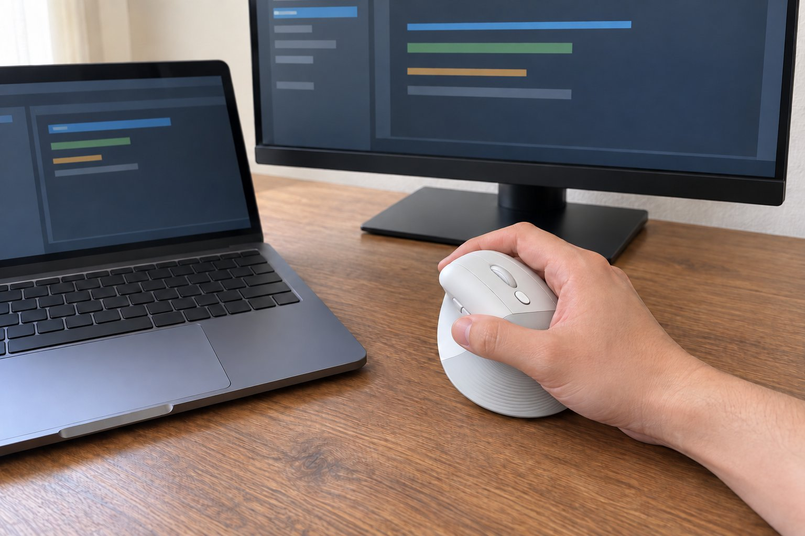

재택으로 개발을 하루 아홉 시간쯤 하고, 화상 회의가 하루 두세 번 있습니다. 손은 보통 크기이고 손바닥으로 쥡니다. 손목 통증이 있어서 5월부터 2개월 동안 버티컬 마우스인 Lift를 썼습니다. 그 전에 MX Vertical을 6주 정도 써 봤는데 그건 제 손에 조금 컸고, 이번에는 한 단계 작은 이쪽을 골랐습니다.

| 크기 | 무게 | 연결 | 사용 기간 |
|---|---|---|---|
| 70 × 108 × 71 mm | 125 g | 무선(USB 수신기, 블루투스) · AA 건전지 | 2개월 · 개발 + 회의 |

## 손목이 꺾이지 않아 오후 통증이 줄었다

버티컬은 손을 악수하는 각도로 세워서 쥐는 구조라서, 일반 마우스처럼 손목을 안쪽으로 비틀 필요가 없습니다. 쓰기 시작한 지 2주쯤 지나서부터 오후에 올라오던 손목 통증이 눈에 띄게 줄었습니다. 겉모습은 단순한 곡선이라 책상 위에서 어색하지 않았고, 만듦새도 가볍다는 느낌은 있었지만 허술하지는 않았습니다.

## 일주일이면 적응하고 클릭은 조용하다

처음 며칠은 손을 세워서 쥐는 느낌이 낯설어서 커서가 목표를 지나치는 일이 잦았습니다. 일주일쯤 지나자 손이 알아서 움직였습니다. 화상 회의 중에 클릭해도 소리가 거의 안 들어가서 마이크를 켠 채 쓰기에도 좋았습니다. 건전지 하나로 오래 간다고 하는데, 2개월 동안 교체할 일이 없었습니다.

## 정밀한 드래그는 일반 마우스보다 느리다

아쉬운 점은 정밀한 작업입니다. 코드에서 글자 몇 개를 정확히 드래그해 선택하거나 화면 캡처에서 영역을 잡을 때는 일반 마우스보다 느리고 어긋났습니다. 이런 작업이 많은 분이라면 아쉬울 수 있을 것 같습니다. 저는 키보드 단축키로 대신하는 습관을 들였습니다.

한 가지 팁을 적자면, 처음 일주일은 일부러 마우스를 평소보다 느리게 움직이는 편이 낫습니다. 빠르게 움직이면 손이 세워진 각도 때문에 커서가 튀었고, 익숙해지면서 자연스럽게 속도가 올라왔습니다. 건전지가 AA 하나라 무게가 약간 나가는 점이 있지만 125g인데도 오후에 팔이 무겁다는 느낌은 없었습니다. 회의가 끝나고 손목을 확인해 보면 이전보다 훨씬 덜 뻐근했습니다. 마우스를 잡는 방식 하나만 바뀌었을 뿐인데 하루 컨디션이 달라지는 걸 보고 놀랐습니다. 비슷한 증상이 있는 분께 한 번쯤 써 볼 만하다고 권하고 싶습니다.

결론은 추천입니다. 손목 통증이 있는 분이 일반 마우스에서 넘어오기에 좋았고, MX Vertical보다 작아서 제 손에는 더 맞았습니다.
