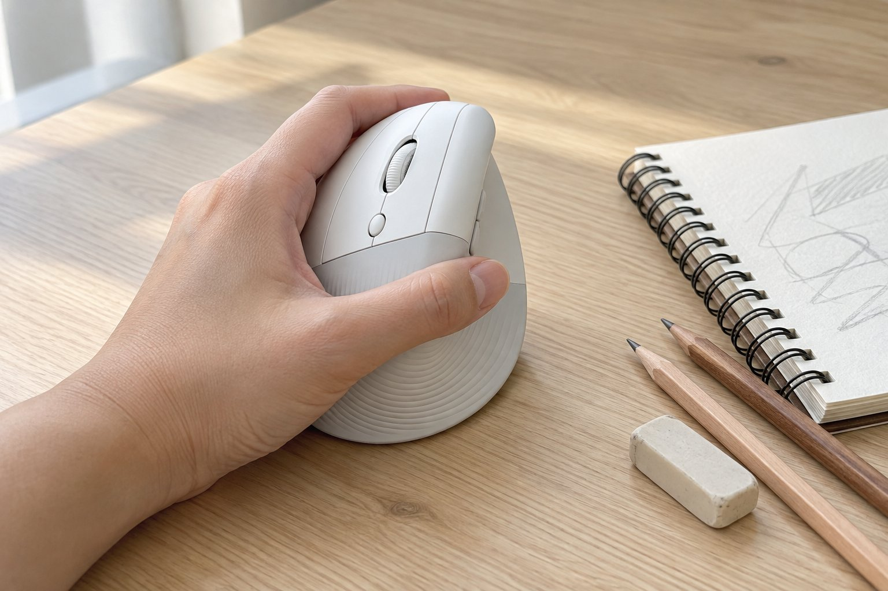

일러스트와 화면 디자인을 하루 일곱 시간쯤 하는 왼손잡이입니다. 손은 보통 크기이고 마우스를 왼손으로 씁니다. 조용한 사무실에서 일하다 보니 소리가 큰 기기는 눈치가 보입니다. 4월 말부터 6주 동안 Lift 왼손용을 썼습니다. 이전에는 좌우 대칭형 마우스를 왼손으로 쓰고 있었는데 손목이 자꾸 아팠습니다.

| 크기 | 무게 | 연결 | 사용 기간 |
|---|---|---|---|
| 70 × 108 × 71 mm | 125 g | 무선(USB 수신기, 블루투스) · AA 건전지 | 6주 · 디자인 작업 |

## 왼손용 모델이 따로 있어서 골랐다

버티컬 마우스는 대부분 오른손용이고, 왼손용이 있어도 선택지가 적습니다. Lift는 왼손용 모델이 따로 나와 있어서 고민 없이 골랐습니다. 왼손으로 쥐었을 때 엄지가 닿는 위치에 버튼이 있어서, 좌우만 뒤집은 것이 아니라 제대로 만든 제품이라는 인상을 받았습니다. 겉모습도 단정해서 책상에 두면 깔끔했습니다.

## 손목이 편하고 클릭이 조용하다

손을 세워서 쥐니까 손목이 비틀리지 않아서, 저녁이 되어도 손목이 뻐근하지 않았습니다. 조용한 사무실에서 클릭 소리가 거의 안 나서 주변 눈치를 볼 일이 없었고, 하루 일곱 시간을 써도 손에 쥐가 나는 일은 없었습니다. 처음 일주일 정도는 어색했지만 곧 익숙해졌습니다.

## 세밀한 선 작업은 느리다

아쉬운 점은 세밀한 작업입니다. 일러스트에서 가는 선을 그리거나 작은 점을 정확히 찍을 때는 마우스가 손목이 아니라 손 전체로 움직이는 느낌이라 느립니다. 그런 작업은 펜 태블릿을 따로 쓰고, 이 마우스는 레이아웃을 잡거나 메뉴를 다룰 때 씁니다. 손이 큰 분이라면 길이 108mm가 짧게 느껴질 수 있을 것 같습니다.

왼손용 모델을 쓰고 나서야 지금까지 오른손용을 뒤집어 쓰는 것이 얼마나 어색했는지 알게 되었습니다. 버튼이 엄지 쪽에 제대로 있고, 손을 얹었을 때 손가락 위치가 자연스러워서 작업 중에 손이 마우스에 맞춰 움직이는 것이 아니라 마우스가 손에 맞춰 있다는 느낌이었습니다. 회의 자료를 만들다가 마우스를 바꿔 쥐는 일도 사라졌습니다. 작업 중에 마우스를 세워 쥔 상태에서 단축키와 함께 쓰는 일이 많은데, 손목의 각도 때문에 키보드로 손을 옮기는 동작도 부드러워졌습니다. 레이아웃 작업 속도가 눈에 띄게 빨라지지는 않았지만 피로가 줄어서 오후에도 집중이 유지되었습니다.

결론은 추천입니다. 왼손잡이에게는 선택지 자체가 귀한데, 손목이 편하고 조용해서 사무용으로 만족스럽습니다.
