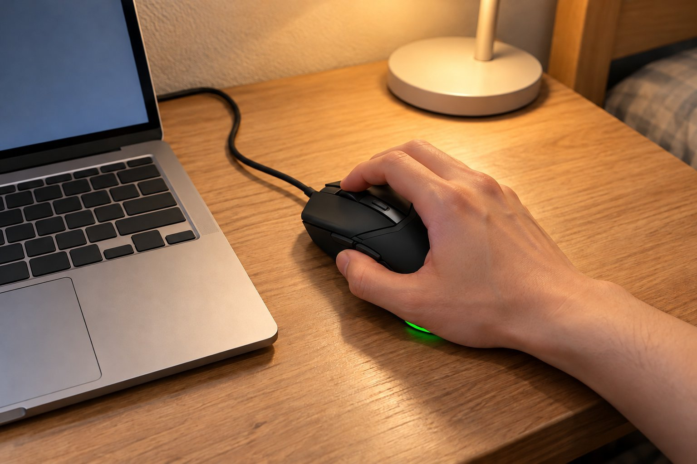

기숙사 2인실에서 과제를 하고, 남는 시간에 롤을 하루 네 시간쯤 하는 학생이에요. 손이 작은 편이고 클로로 쥐고 감도는 높게 써요. 책상이 좁고 룸메이트가 있어서 밤에는 조심해서 써요. 5월 초부터 4주 동안 Cobra를 썼는데, 그 전에는 G304를 3개월 정도 썼어요. 무선에서 유선으로 돌아왔는데 후회가 없었어요.

| 크기 | 무게 | 연결 | 사용 기간 |
|---|---|---|---|
| 62.5 × 119.6 × 38.3 mm | 58 g | 유선(USB) | 4주 · 과제 + 게임 |

## 작은 손 클로에 딱 맞아요

길이가 119.6mm라서 손가락 끝이 버튼에 자연스럽게 닿아요. G304도 작은 편이었는데 이쪽이 조금 더 얇아서 손 안에 쏙 들어와요. 클로로 쥐면 손바닥 뒤쪽이 마우스에 살짝 걸쳐지는 정도라 손이 편하고요. 겉모습은 단순하고 작아서 좁은 책상 위에서도 눈에 띄지 않아서 마음에 들어요.

## 58g이라 팔이 안 지쳐요

G304는 건전지가 들어가서 뒤쪽이 무겁게 느껴졌는데, 이건 58g이라 팔을 움직이기가 한결 가벼워요. 롤에서 한타 중에 마우스를 빠르게 돌려도 손목이 피곤하지 않았고, 과제하면서 몇 시간 잡고 있어도 손이 편했어요. 클릭 반응도 빠르다고 느꼈어요.

## 선이 부드러워서 걸림이 적어요

유선이라 선이 걸릴까 걱정했는데, 선이 부드럽게 휘어서 책상 위에서 걸리적거리는 일이 적었어요. 다만 좁은 책상이라 선이 책상 가장자리에서 흘러내리지 않게 정리를 해야 했어요. 책상 구석에 선 정리 클립을 붙였더니 해결됐어요. 손이 큰 사람은 작게 느낄 수 있을 것 같아요.

롤을 하다 보면 마우스를 책상 끝으로 던지듯 옮기는 일이 있는데, 선이 부드러워서 그럴 때도 걸리는 일이 적었어요. 이전에 쓰던 G304는 수신기를 꽂는 자리가 깔끔하지 않았는데 이쪽은 선 하나만 꽂으면 되니 훨씬 간단해요. 룸메이트가 자는 밤에도 조용히 클릭할 수 있게 마우스를 살짝 들어서 쓰곤 했어요. 작은 마우스는 클릭이 가볍지 않을까 싶었는데 오히려 클릭이 또렷해서 손끝에 감각이 잘 전해졌어요. 기숙사에서 쓰는 책상 위가 작아도 걸리적거리지 않고, 짐을 쌀 때도 가방에 쏙 들어가서 방학 때 집에 가져가기도 편했어요. 한 달 동안 쓰는 동안 마우스 때문에 신경 쓰인 적이 거의 없었다는 점이 가장 큰 만족이에요. 과제하다가 롤을 켜도 그대로 쓸 수 있어서 따로 바꿀 필요가 없었어요.

결론은 추천이에요. 작은 손이고 가벼운 마우스를 찾는다면 무선이 아니어도 만족스러웠어요.
