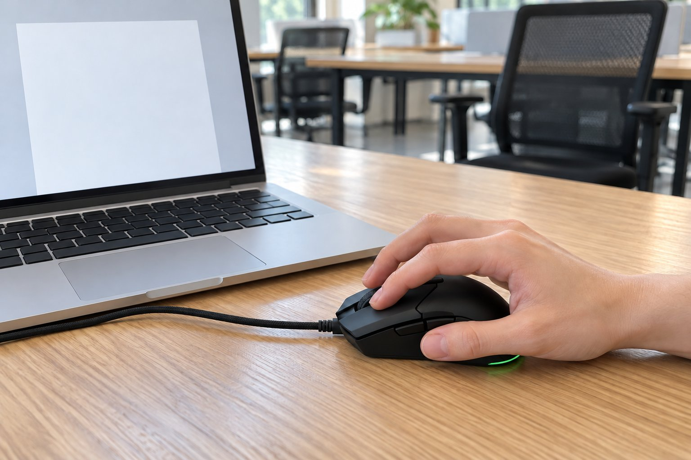

저는 손이 아주 작은 편이고 손끝으로 마우스를 쥡니다. 공유 사무실에서 엑셀과 문서 작업을 하루 여덟 시간 하고, 숫자 입력이 많습니다. 8월 초부터 3주 동안 Cobra를 썼습니다. 직전에는 MX Master 3S를 쓰다가 너무 커서 포기했기 때문에, 작고 가벼운 마우스를 찾은 결과입니다.

| 크기 | 무게 | 연결 | 사용 기간 |
|---|---|---|---|
| 62.5 × 119.6 × 38.3 mm | 58 g | 유선(USB) | 3주 · 엑셀·문서 |

## 손끝 조작이 쉽습니다

MX Master 3S는 손끝으로 쥐면 버튼에 손이 안 닿았는데, 이건 길이 119.6mm라 손끝으로 쥐어도 버튼이 닿습니다. 엑셀에서 셀을 이동하거나 드래그할 때 마우스가 손끝에서 자연스럽게 움직였습니다. 겉모습은 작고 단정해서 업무용 책상에 두어도 어색하지 않았습니다.

## 가벼워서 오래 써도 피곤하지 않습니다

58g이라 팔 전체를 쓰지 않아도 손끝만으로 움직였고, 오후가 되어도 어깨가 뻐근하지 않았습니다. 유선이라 연결이 끊길 일이 없는 점도 사무용으로는 마음이 놓였습니다. 이전에 쓰던 큰 마우스와 비교하면 하루 끝의 피로가 확실히 달랐습니다.

## 클릭 소리가 또렷해 눈치가 보입니다

아쉬운 점은 클릭 소리입니다. 조용한 사무실에서 클릭하면 소리가 또렷하게 들려서 옆자리에서 쳐다보는 듯한 기분이 들었습니다. 저소음 클릭이 적용된 MX Master 3S와 비교하면 차이가 확실히 났습니다. 클릭을 조심스럽게 눌러 보았지만 소리 자체가 줄지는 않았습니다.

하루 여덟 시간 중 마우스를 쓰는 시간이 길어서 가벼움의 효과는 오후에 확실히 나타났습니다. 이전 마우스는 오후가 되면 손목이 굳는 느낌이었는데, 이쪽은 같은 시간이 지나도 손이 가벼웠습니다. 클릭 소리만 아니었다면 계속 쓰고 싶은 마우스였습니다. 소리가 문제가 되지 않는 환경이라면 바로 추천할 수 있습니다. 한 가지 팁은, 클릭 소리가 신경 쓰이는 분이라면 마우스 패드를 푹신한 것으로 바꾸는 것도 방법이라는 점입니다. 저는 그래도 소리가 조금 줄어드는 정도였지만, 사무실 분위기에 따라 충분히 해결될 수도 있을 것 같습니다. 하루 일과 중에 마우스를 쥐고 있는 시간이 길어서 이런 작은 차이가 쌓이면 크다고 생각합니다. 소리 문제만 해결된다면 사무용으로도 충분히 쓸 만한 마우스입니다.

결론은 조건부 추천입니다. 크기와 무게는 만족스럽지만, 조용해야 하는 사무실에서는 소리를 감안해야 합니다.
