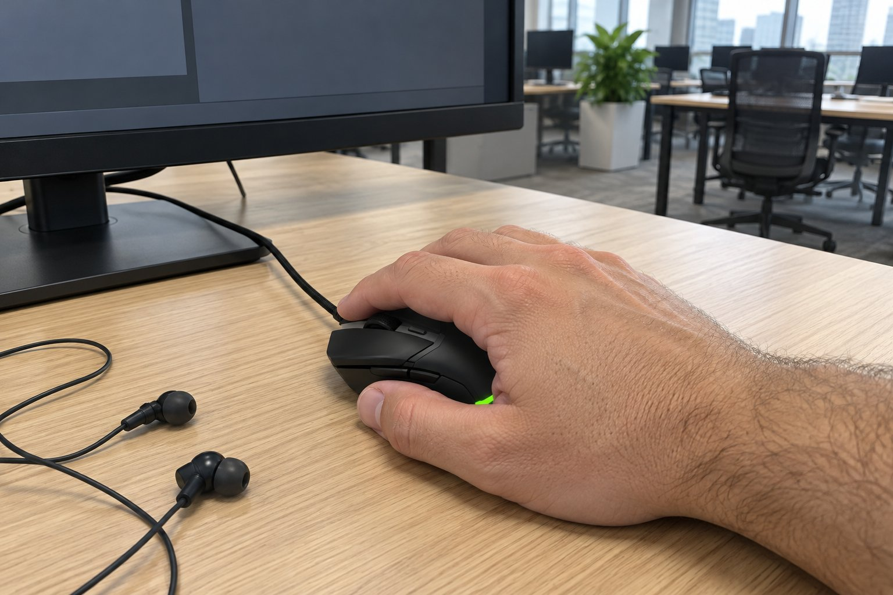

저는 손이 아주 큰 편입니다. 마우스는 손바닥 전체로 쥐고, 칸막이 없는 사무실에서 개발을 하루 열 시간쯤 합니다. 이어폰을 끼고 일하는 편이라 소리 환경은 크게 문제가 없습니다. 가벼운 마우스가 궁금해서 11월 하순에 1주일 동안 Cobra를 써 봤습니다. 지금 쓰는 MX Vertical과 비교하면서 적습니다.

| 크기 | 무게 | 연결 | 사용 기간 |
|---|---|---|---|
| 62.5 × 119.6 × 38.3 mm | 58 g | 유선(USB) | 1주 · 개발 |

## 손바닥 절반이 마우스 밖으로 뜹니다

MX Vertical은 폭 79mm에 길이 120mm지만, 높이 78.5mm가 있어서 손바닥 전체가 얹힙니다. Cobra는 길이는 비슷한데 폭이 62.5mm밖에 안 돼서, 손바닥 절반이 마우스 밖으로 나가 버렸습니다. 손가락만 마우스 위에 걸쳐 둔 느낌이라 쥐는 안정감이 전혀 없었습니다.

## 높이가 낮아서 손목이 꺾입니다

높이가 38.3mm밖에 안 돼서 손바닥과 책상 사이가 너무 가깝습니다. 그러면 손목이 아래로 꺾이는데, 개발하는 동안 손목이 계속 아파서 일주일이 끝나자마자 원래 쓰던 마우스로 돌아갔습니다. 손목이 꺾이는 것을 줄이려고 버티컬을 쓰는 사람에게 이 높이는 정반대입니다.

## 반응은 좋았습니다

장점도 하나는 있습니다. 클릭 반응이 빨라서 눌렀을 때 입력이 바로 들어가는 느낌이었습니다. 유선이라 연결에 신경 쓸 일이 없었던 것도 좋았습니다. 겉모습은 단순하고 가벼워 보이는 인상이었습니다. 손이 작거나 보통인 분이라면 좋은 마우스일 수 있을 것 같습니다.

버티컬에서 넘어와서 그런지 모든 면이 정반대로 느껴졌습니다. MX Vertical은 손목을 세우고 손바닥 전체를 얹는 방식인데, Cobra는 손목이 책상에 눕고 손가락만 앞으로 나가는 방식이어서 손목의 각도가 완전히 달랐습니다. 개발 중에 코드를 오래 읽다 보면 마우스에 손을 올려 두는 시간이 길어지는데, 그때 손목이 점점 눌려서 불편했습니다. 이 마우스는 크기가 작고 가벼운 대신 손바닥으로 쥐는 사람과는 맞지 않는다는 점이 분명했습니다. 클릭 반응이 빠르다는 점은 인상적이었고, 손이 작은 사람에게는 정말 좋은 마우스일 것입니다. 일주일 만에 평가를 끝내기는 아쉬웠지만 손목이 계속 불편한 상태에서 더 쓰는 것은 의미가 없다고 판단했습니다. 같은 모델이라도 손 크기에 따라 평가가 완전히 갈릴 수 있다고 생각합니다.

정리하면 제품이 나쁜 것이 아니라 손 크기가 맞지 않았습니다. 손이 아주 큰 분께는 권하지 않습니다.
