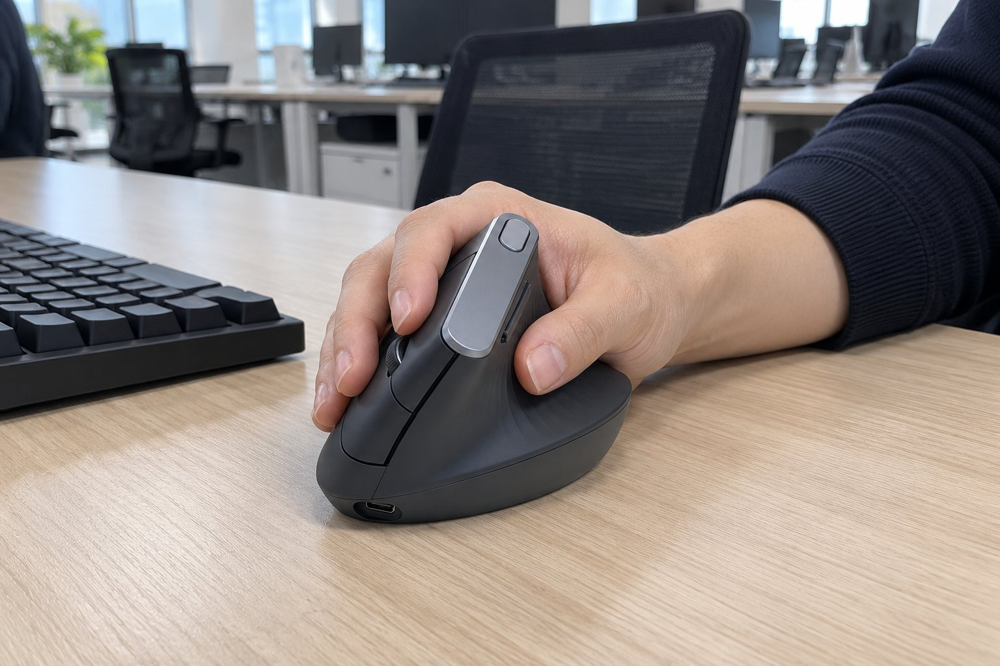

저는 손이 아주 큰 편이고, 마우스는 손바닥 전체로 쥡니다. 칸막이 없는 사무실에서 개발을 하루 열 시간쯤 하고, 키보드는 텐키리스를 씁니다. 8월부터 3개월 동안 MX Vertical을 써 왔습니다. 일반 마우스를 쓸 때는 오후에 손목이 꺾이는 느낌이 있어서 버티컬로 바꿨습니다.

| 크기 | 무게 | 연결 | 사용 기간 |
|---|---|---|---|
| 79 × 120 × 78.5 mm | 125 g | 무선(USB 수신기, 블루투스) · USB-C 충전식 | 3개월 · 개발 |

## 큰 손에도 손바닥이 다 얹힌다

버티컬 마우스는 대체로 작아서 큰 손에는 손바닥 아랫부분이 남는데, 이건 높이가 78.5mm나 돼서 손바닥 전체가 편하게 얹힙니다. 손가락을 뻗어도 버튼에 닿고, 새끼손가락이 바닥에 끌리지도 않았습니다. 겉모습은 단단한 구조물처럼 보여서 책상에서 존재감이 있었고, 만듦새도 튼튼하다고 느꼈습니다.

## 손목이 꺾이지 않는다

손을 세워 쥐는 구조라 손목이 비틀리지 않아서, 하루 열 시간 개발을 해도 오후 통증이 줄었습니다. 쓰기 시작하고 2주쯤 지나서 확실히 차이가 났습니다. 충전식인데 한 번 충전하면 몇 달 갔고, 3개월 동안 충전은 한 번밖에 하지 않았습니다. 이전 일반 마우스는 건전지를 두 달에 한 번 갈았는데 그에 비하면 신경 쓸 일이 거의 없었습니다.

## 높이가 있어서 키보드와 오갈 때 건드린다

아쉬운 점은 높이입니다. 78.5mm나 되다 보니 키보드에서 손을 옮길 때 마우스를 자주 건드립니다. 개발하면서 키보드와 마우스를 계속 오가는데, 처음에는 마우스가 의도치 않게 밀려서 커서가 튀었습니다. 마우스를 키보드에서 조금 더 멀리 두는 식으로 위치를 바꿔서 해결했습니다.

3개월 동안 느낀 것은 마우스가 바뀌면 자세가 바뀐다는 점입니다. 이전에는 팔을 책상에 얹고 손목만 꺾어 쓰던 습관이 있었는데, 버티컬로 바꾸고 나서는 손목이 자연스럽게 펴진 상태로 팔 전체를 움직이게 되었습니다. 이 변화가 오후의 피로를 줄여 준 가장 큰 이유라고 생각합니다. 손이 작은 분이라면 크기가 부담스러울 수 있을 것 같습니다. 책상 위 마우스 위치를 한 번 정하고 나서는 손이 알아서 그 자리로 갑니다. 처음 일주일은 의식적으로 맞춰야 했지만 지금은 눈을 감고도 찾을 수 있을 만큼 몸에 익었습니다. 높이가 높은 만큼 손바닥이 편하게 받쳐진다는 점은 이 제품의 장점이자 단점입니다.

결론은 추천입니다. 손이 크고 손목이 불편한 분께는 버티컬 중에서도 가장 맞는 크기였습니다.
