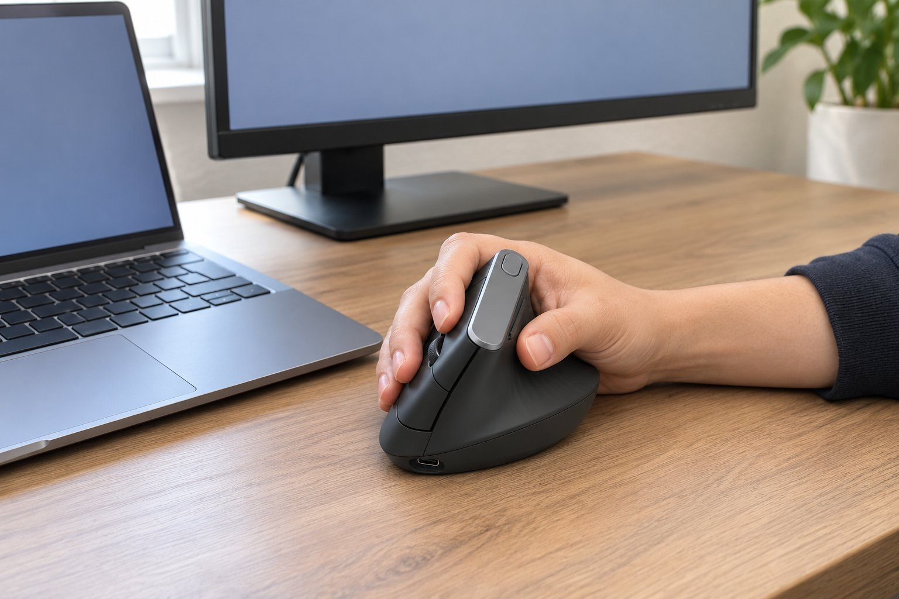

재택으로 개발을 하루 아홉 시간쯤 하고, 화상 회의가 하루 두세 번 있습니다. 손은 보통 크기이고 손바닥으로 쥡니다. 손목 통증이 있어서 3월 중순부터 6주 동안 버티컬 마우스인 MX Vertical을 썼습니다. 그 전에 트랙볼인 ERGO M575S를 두 달쯤 써서, 손목을 움직이지 않는 방식과 비교하면서 적습니다.

| 크기 | 무게 | 연결 | 사용 기간 |
|---|---|---|---|
| 79 × 120 × 78.5 mm | 125 g | 무선(USB 수신기, 블루투스) · USB-C 충전식 | 6주 · 개발 + 회의 |

## 손목은 확실히 편합니다

손을 세워서 쥐니까 손목이 꺾이지 않아서, 오후에 올라오던 통증이 줄었습니다. 마우스가 책상 위를 움직이는 방식이라 트랙볼과 달리 팔도 쓰지만, 손목은 비틀리지 않아서 부담이 덜했습니다. 충전식이라 충전을 한 번도 안 하고 6주를 넘겼습니다. 겉모습은 높고 단단한 인상이라 책상에서 눈에 띄었습니다.

## 손끝이 버튼에 겨우 닿습니다

아쉬운 점은 크기입니다. 트랙볼은 손을 올려 두고 엄지로 굴리기만 하니 버튼이 늘 가까이 있었는데, 이쪽은 손을 움직여야 해서 손끝이 버튼에 겨우 닿는 거리가 됐습니다. 높이 78.5mm가 손바닥에 비해 높아서 손가락을 뻗어야 앞쪽 버튼이 눌렸고, 하루 종일 쓰면 손가락이 지쳤습니다.

## 버튼 4개는 단순해서 오히려 편하다

버튼이 4개뿐이라 단순한 점은 좋았습니다. 복잡한 설정 없이 앞으로 가기, 뒤로 가기만 쓰면 되어서 개발 중에 눌러야 할 것이 적었습니다. 화상 회의 중에는 클릭 소리가 마이크에 크게 들어가지 않았습니다. 손이 조금 더 크다면 이 크기가 오히려 편했을 것 같습니다.

6주 동안 매일 이 마우스를 쓰면서 마우스의 위치를 키보드에서 얼마나 떨어뜨려야 하는지 계속 조정했습니다. 높이 때문에 키보드를 오갈 때 가까이 두면 손등에 마우스가 닿았고, 너무 멀면 팔을 뻗어야 했습니다. 결국 손목은 편해졌지만 어깨가 약간 뻐근해지는 대가가 있었습니다. 같은 증상이 있는 분이라면 설치 위치를 먼저 확인해 보시길 권합니다. 마우스 위치를 정리하고 나서는 불편이 줄었지만 완전히 사라지지는 않았습니다. 트랙볼과 버티컬 중에서 고르라면 저는 트랙볼 쪽이 손에 더 맞았습니다. 손목 통증을 겪는 분들이 비교하실 때 도움이 되었으면 해서, 쓰면서 느낀 불편한 점도 빠짐없이 적었습니다. 개인 차이가 크다는 점은 분명히 기억해 두시면 좋겠습니다.

결론은 조건부 추천입니다. 손목 편함은 만족스러웠지만 제 손에는 약간 큰 편이었습니다.
