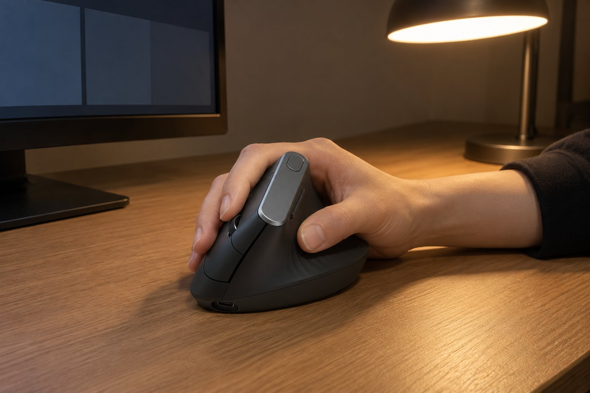

저는 손이 작은 편이고 마우스를 손끝으로 쥡니다. 글쓰기와 코딩을 하루 일곱 시간쯤 하고 저녁에 리듬 게임을 합니다. 밤에 작업하는 일이 많고 옆방에 가족이 있어서 소리에 민감합니다. 2월 초부터 2주 동안 버티컬 마우스인 MX Vertical을 썼는데, 제 손에는 맞지 않았습니다.

| 크기 | 무게 | 연결 | 사용 기간 |
|---|---|---|---|
| 79 × 120 × 78.5 mm | 125 g | 무선(USB 수신기, 블루투스) · USB-C 충전식 | 2주 · 문서·코딩 |

## 손목 각도는 좋았습니다

장점부터 적으면, 손을 세워서 쥐니 손목의 각도가 편했습니다. 이전에 쓰던 일반 마우스는 손목이 안쪽으로 꺾여서 저녁이면 뻐근했는데, 이쪽은 그런 느낌이 줄었습니다. USB-C 충전식이라 건전지를 갈 필요도 없었고, 충전도 2주 동안 신경 쓰지 않았습니다. 겉모습은 독특하고 존재감이 있는 형태였습니다.

## 손바닥이 미끄러져 내려옵니다

문제는 크기입니다. 높이 78.5mm가 제 손에는 너무 높아서, 손바닥을 마우스 옆면에 올려도 자꾸 미끄러져 내려왔습니다. 손끝으로 쥐려고 하면 손바닥이 공중에 떠서 손목에 힘이 들어갔습니다. 마우스를 잡고 있는 내내 손이 불안정해서 코딩이 길어질수록 어깨가 굳었습니다.

## 버튼이 멀어서 손을 옮겨야 합니다

옆쪽 버튼은 엄지로 눌러야 하는데, 손이 작으면 엄지가 그 위치까지 닿지 않았습니다. 앞으로 가기를 누를 때마다 손을 고쳐 잡아야 했습니다. 손이 크고 손바닥으로 쥐는 분이라면 이 크기가 안정감을 줄 수 있을 것 같습니다.

2주 동안 손바닥이 미끄러지는 것을 막으려고 손을 마우스 옆면에 더 단단히 눌러 보았지만, 그러면 손목에 힘이 들어가서 의미가 없었습니다. 작은 손에 맞는 버티컬이 있다면 다시 도전해 볼 의향은 있습니다. 하지만 이 제품은 크기 때문에 좋은 점이 모두 상쇄되었습니다. 다만 손목 각도라는 아이디어 자체는 맞는 방향이라고 생각합니다. 충전식이라는 점은 마음에 들었습니다. 건전지를 따로 사서 갈아 끼울 필요가 없고, 책상에 USB 선만 있으면 충전할 수 있어서 관리가 간단했습니다. 크기만 맞았다면 계속 썼을 것입니다. 다른 사람이 쓰는 것을 보면 편해 보였기 때문에 제품이 나쁘다고는 생각하지 않습니다. 손 크기에 맞는 버티컬을 만나면 다시 도전해 보고 싶습니다.

정리하면 손목 각도는 좋지만 크기가 너무 컸습니다. 손이 작은 분께는 권하지 않습니다.
