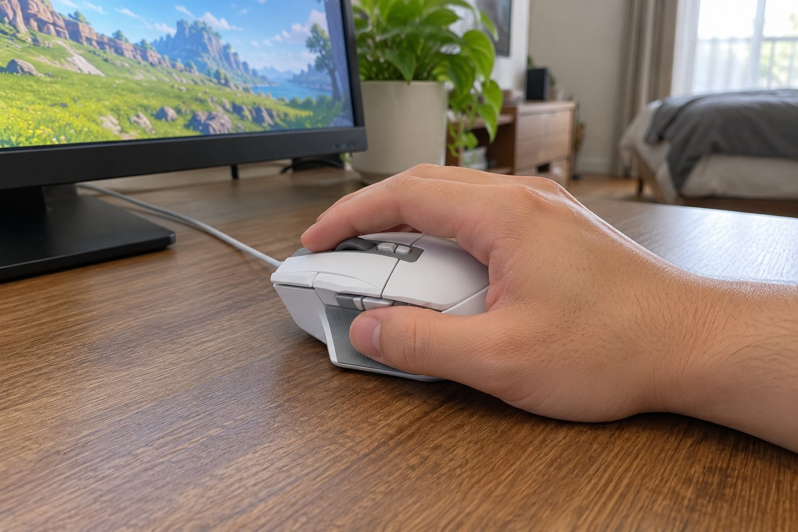

저는 손이 큰 편입니다. 장갑은 XL을 끼고, 마우스는 손바닥 전체로 쥡니다. 혼자 사는 원룸에서 RPG와 MMO를 하루 서너 시간 하고 영상도 자주 봅니다. 평소에는 DeathAdder V3 Pro를 메인으로 쓰고, 스킬 버튼이 많은 게임을 할 때만 11월부터 2개월 동안 G502 X로 바꿔서 썼습니다.

| 크기 | 무게 | 연결 | 사용 기간 |
|---|---|---|---|
| 79.2 × 131.4 × 41.1 mm | 89 g | 유선(USB) | 2개월 · 스킬 버튼 많은 게임 |

## 버튼 11개에 스킬을 배치했다

MMO는 스킬이 많아서 키보드만으로는 손이 모자란데, 이 마우스는 버튼이 11개라 자주 쓰는 스킬 몇 개를 옆과 위쪽 버튼에 지정해 두었습니다. 레이드에서 키보드를 두드리는 사이에 엄지로 스킬을 하나 더 누를 수 있으니 확실히 편했습니다. 겉모습은 버튼이 많아서 복잡해 보이지만 만듦새는 단단하다고 느꼈습니다.

## 큰 손에 길이 131mm가 맞는다

DeathAdder V3 Pro는 128mm인데 이건 131.4mm로 더 깁니다. 손바닥으로 쥐면 손이 마우스 뒤쪽까지 자연스럽게 닿고, 엄지를 얹는 자리가 있어서 사이드 버튼을 누르기 편했습니다. 무게는 89g으로 가볍지는 않지만 중간 정도라서 레이드 중에도 안정감이 있었습니다.

## 유선이라 선이 걸린다

아쉬운 점은 유선이라는 것입니다. DeathAdder는 무선이라 선 걱정이 없었는데, 이쪽은 책상 위에서 마우스를 크게 움직이면 선이 책상 모서리에 걸렸습니다. 선을 책상 뒤쪽으로 돌려서 정리한 뒤에는 나아졌지만, 처음에는 신경이 쓰였습니다. 손이 작은 분이라면 131mm가 부담스러울 수 있을 것 같습니다.

메인 마우스 대신 G502 X를 꺼내 쓰는 날을 정해 두었더니 두 마우스의 장단점이 분명해졌습니다. 스킬이 많은 게임을 할 때는 버튼이 많은 이쪽이 이기고, 영상을 보거나 가볍게 웹을 볼 때는 DeathAdder가 낫습니다. 이쪽은 무게가 89g이라 오래 쥐고 있으면 손에 힘이 약간 더 들어갔습니다. 용도에 맞춰 바꿔 쓰는 방식이 저에게는 가장 만족스러웠습니다. 유선이라 선이 거슬리는 것만 빼면 버튼이 많은 게임에서는 확실히 도움이 됩니다. 다시 구매할 의향이 있습니다. 서브 마우스로 책상 서랍에 두고 필요할 때만 꺼내 쓰기에도 좋습니다. 마우스를 바꿔 쓰는 번거로움은 있었지만 버튼이 많은 게임을 할 때는 확실히 이쪽이 더 편했습니다. 평소에 쓰는 마우스와 용도를 나누어 쓰면 만족도가 높습니다.

결론은 추천입니다. 버튼을 많이 쓰는 게임용 서브 마우스로는 좋았습니다.
