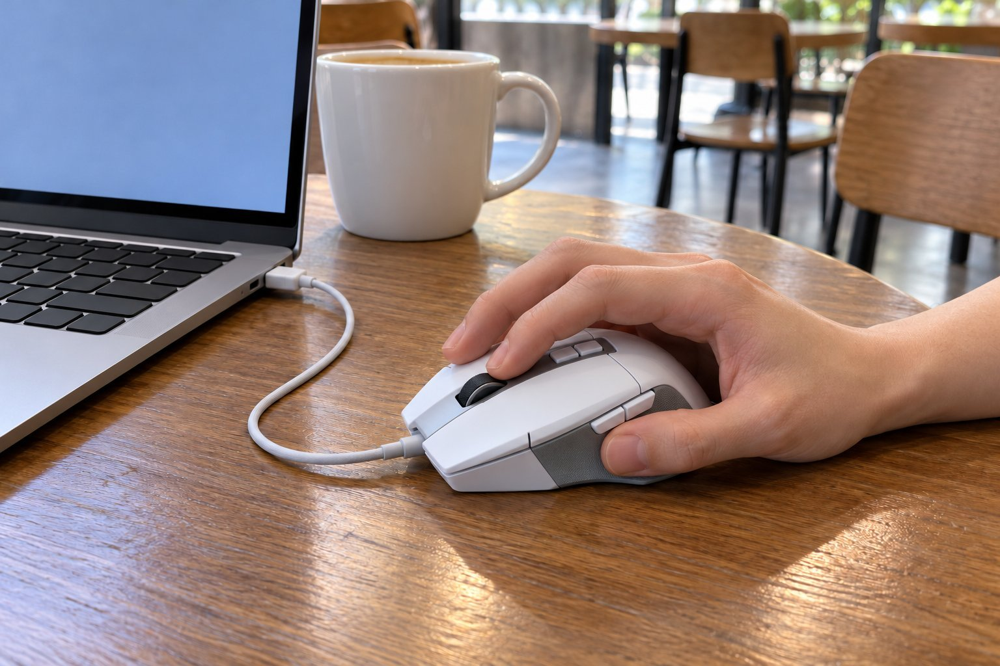

저는 손이 작은 편이고 손끝으로 마우스를 쥐어요. 노트북으로 문서와 메일을 하루 다섯 시간쯤 하고, 카페나 공유 오피스에서 일할 때가 많아서 조용하고 가벼운 걸 찾아요. 8월 초부터 2주 동안 G502 X를 써 봤는데, 결과는 비추천이에요. 전에 쓰던 G304와 비교하면서 적어요.

| 크기 | 무게 | 연결 | 사용 기간 |
|---|---|---|---|
| 79.2 × 131.4 × 41.1 mm | 89 g | 유선(USB) | 2주 · 노트북 + 외근 |

## 길고 넓어서 손끝으로 쥘 수 없어요

길이 131.4mm에 폭 79.2mm라서 손끝으로 쥐면 손가락이 마우스 앞쪽에 겨우 닿아요. 쥔다기보다 손가락 끝에 올려 두는 느낌이에요. G304는 길이가 116.6mm라서 손끝으로 자연스럽게 쥐어졌는데, 15mm 차이가 이렇게 크게 느껴질 줄 몰랐어요. 겉모습은 버튼이 많아 복잡해 보이고 무게감이 있어 보였어요.

## 옆 버튼에 엄지가 닿지 않아요

버튼이 11개인데 옆쪽 버튼에 엄지가 닿지 않아서 뒤로 가기도 손을 고쳐 잡아야 눌렸어요. 버튼이 많은 장점을 하나도 못 쓴 셈이에요. 클릭감은 좋았어요. 누르는 맛이 분명해서 손에 피드백이 확실하게 왔어요.

## 선이 있어서 들고 다니기 불편해요

유선이라 카페에 들고 가서 쓰려면 선을 감아서 넣어야 하고, 노트북 옆에서 선이 길게 늘어져서 번거로웠어요. 노트북에 꽂고 나면 선이 테이블 위에서 걸리적거리고, 크기도 커서 가방 안에서 자리를 많이 차지했어요. 집 책상에만 두고 쓴다면 괜찮을 것 같아요.

2주 동안 가방에 넣어 다니며 써 봤는데 크기가 계속 부담이었어요. 가방에 넣으면 노트북 옆에서 자리를 많이 차지했고, 꺼냈다 넣었다 하기가 번거로워서 결국 쓰던 G304를 가방에 도로 넣고 다녔어요. 게임을 많이 하거나 집에서만 쓰는 분이라면 버튼이 많은 장점이 크게 와닿을 것 같아요. 카페에서 쓰기에는 어려웠지만 집이라면 사정이 다를 것 같아요. 평소에 가볍고 작은 마우스를 쓰는 분이라면 이 제품의 크기가 처음에는 다소 어색할 수 있을 것 같아요. 다음에는 크기가 작은 유선 마우스나 작은 무선 마우스를 알아볼 생각이에요. 이번 경험으로 제게 필요한 조건이 더 분명해졌어요. 버튼이 많은 마우스가 필요 없다는 것도 알게 되었어요. 사무용으로 쓰는 노트북 환경이라면 작고 가벼운 쪽이 훨씬 편할 거라는 걸 이번에 확인했어요.

정리하면 제품이 나쁜 게 아니라 제 용도와 맞지 않았어요. 손이 작고 들고 다니는 분께는 권하지 않아요.
