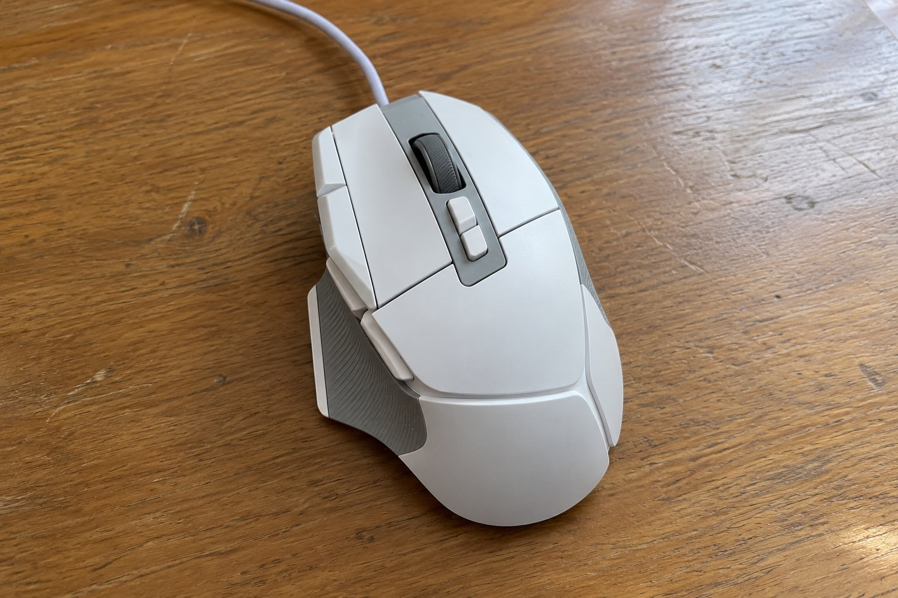

3월 중순부터 한 달 동안 G502 X를 썼습니다. 직전에 쓰던 무선 마우스인 DeathAdder V2 X HyperSpeed에서 버튼이 더 많은 걸 찾아서 바꿨습니다. 한 달 쓰면서 편했던 점과 아쉬웠던 점을 적습니다.

| 크기 | 무게 | 연결 | 사용 기간 |
|---|---|---|---|
| 79.2 × 131.4 × 41.1 mm | 89 g | 유선(USB) | 1개월 |

## 버튼이 많아서 장면 전환에 유용합니다

버튼이 11개라 자주 쓰는 동작을 마우스에 지정해 두면 편합니다. 방송 장면 전환을 키보드로 하다가 마우스 버튼에 넣었더니 손을 옮기지 않고도 바로 바뀌어서 확실히 유용했습니다. 겉모습은 버튼이 많아 복잡해 보이지만, 책상에 놓았을 때 존재감이 있고 만듦새도 단단했습니다.

## 선이 걸리적거립니다

아쉬운 점은 유선이라는 것입니다. 이전 무선 마우스를 쓰다가 오니 선이 책상 위에서 걸리는 것이 상당히 거슬렸습니다. 마우스를 크게 움직이면 선이 책상 모서리에 끌려서 조준이 틀어졌습니다. 선 정리 장치를 달고 나서야 겨우 참을 만해졌습니다. 클릭의 반응과 느낌은 좋았습니다.

## 클릭 소리가 마이크에 들어갑니다

또 하나 아쉬운 점은 클릭 소리입니다. 마이크를 켠 상태에서 클릭하면 소리가 또렷해서 마이크에 그대로 들어갔습니다. 방송 중에 클릭할 때마다 소리가 들려서 마이크 위치를 옮겨야 했습니다. 소리에 민감한 환경이라면 다른 선택지를 생각해 볼 것 같습니다.

한 달 동안 마우스를 쓰면서 선을 어떻게 정리하느냐가 만족도를 크게 좌우한다는 걸 알았습니다. 선이 걸리지 않는 위치를 찾고 나서는 불편이 줄어서 버튼이 많은 장점이 보이기 시작했습니다. 다만 무선에 익숙해진 뒤라 선이 있다는 사실이 늘 마음에 걸렸습니다. 버튼 구성은 마음에 들어서 선만 없다면 계속 썼을 것 같습니다. 클릭 소리 문제는 마이크를 마우스에서 멀리 두는 것으로 어느 정도 해결할 수 있었습니다. 다만 매번 마이크 위치를 신경 써야 한다는 점이 번거로웠습니다. 조용한 환경에서 쓰는 분이라면 이 점이 크게 문제가 되지 않을 것 같습니다. 한 달 쓰고 나서 결론을 내려 보면 무선에 익숙한 사람에게는 선이 가장 큰 단점이 됩니다. 버튼 수는 만족스러웠기 때문에 선을 감수할 수 있는지가 선택의 기준이 될 것 같습니다. 선을 책상 아래로 돌려서 고정하는 방법도 시도해 봤지만 완전히 해결되지는 않았습니다.

결론은 조건부 추천입니다. 버튼이 많아서 유용하지만, 선과 클릭 소리를 감안해야 합니다.
