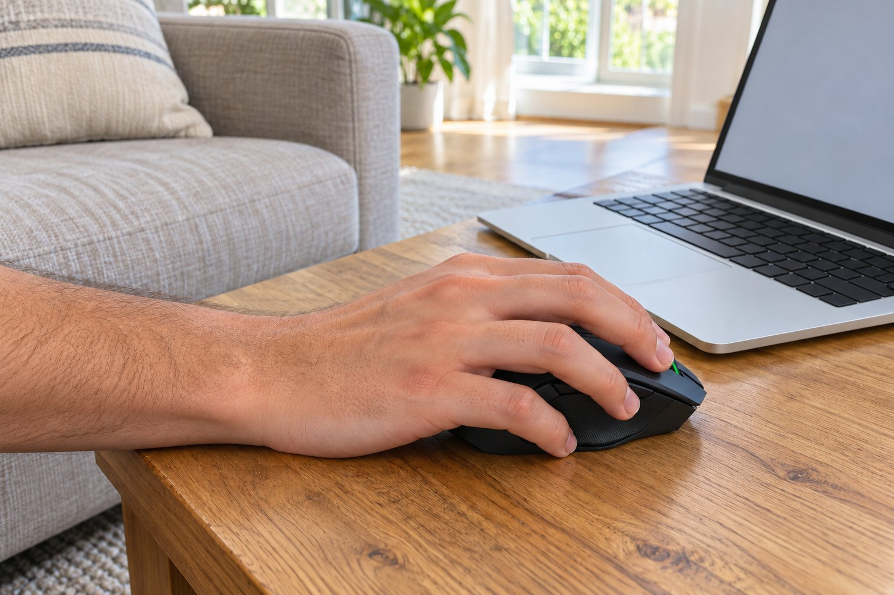

저는 손이 큰 편이고 마우스를 손바닥으로 쥡니다. 넓은 거실에서 영화를 보고 음악을 듣고 가벼운 게임을 하루 세 시간쯤 합니다. 컴퓨터를 소파 옆 탁자에 두고 쓰기도 해서 선이 없는 마우스를 찾았습니다. 9월부터 3개월 동안 Basilisk V3 X HyperSpeed를 써 왔습니다.

| 크기 | 무게 | 연결 | 사용 기간 |
|---|---|---|---|
| 75 × 130 × 42 mm | 106 g | 무선(USB 수신기, 블루투스) · 건전지 | 3개월 · 영화·음악·게임 |

## 손에 꽉 찬다

길이 130mm에 폭 75mm가 제 손에는 꽉 차는 크기입니다. 이전에 쓰던 마우스는 작아서 손가락이 모자랐는데, 이건 손바닥 전체가 편하게 얹히고 엄지를 받쳐 주는 자리도 있어서 쥐었을 때 안정감이 있었습니다. 겉모습은 단단하고 무게감 있는 인상이라 거실 탁자 위에서도 어울렸습니다.

## 소파 옆 탁자에서도 끊김이 없다

가장 만족한 점은 연결입니다. 소파에서 탁자 위에 놓고 쓰면 컴퓨터와 거리가 있는데도 입력이 끊기거나 느려진 적이 없었습니다. 영화를 보다가 일시정지를 누르거나 음악을 바꿀 때 바로 반응해서 답답한 일이 없었습니다. 건전지가 오래가서 3개월 동안 두 번밖에 갈지 않았습니다.

## 휠을 빠르게 돌리면 가끔 덜 넘어간다

아쉬운 점은 휠입니다. 긴 목록을 빠르게 넘기려고 휠을 세게 돌리면 가끔 몇 칸이 덜 넘어갔습니다. 천천히 돌릴 때는 문제가 없고, 한두 번 더 돌리면 되니까 큰 불편은 아니었습니다. 휠을 많이 쓰는 작업이라면 더 신경 쓰일 수 있을 것 같습니다.

소파에 기대어 마우스를 무릎 위 쿠션에 올려 두고 쓰기도 했는데, 그런 자세에서도 엄지가 받쳐지는 자리가 있어서 안정감이 있었습니다. 영화를 틀어 놓고 가끔 마우스를 움직이는 정도라 하루 사용량은 적었지만, 오래 두었다가 다시 움직여도 바로 반응했습니다. 휠만 조금 아쉽고, 나머지는 거실에서 쓰기에 만족스러웠습니다. 처음에는 소파 옆에서 쓰다 보면 선이 걸려서 불편했는데 무선으로 바꾸고 나서 그런 불편이 사라졌습니다. 건전지를 갈 때도 커버를 열기만 하면 되어서 간단했습니다. 영화나 음악을 즐기는 시간을 방해받지 않아서 만족스럽습니다. 집에서 쓰는 마우스는 눈에 거슬리지 않고 자리를 잘 잡아 주는 것이 좋다고 생각합니다. 이 마우스는 그런 면에서 거실의 분위기를 해치지 않아서 만족합니다. 3개월 동안 쓰면서 한 번도 다른 마우스로 바꾸고 싶다는 생각이 들지 않았습니다.

결론은 추천입니다. 손이 크고 거실에서 마우스를 쓰는 분께 잘 맞았고, 연결이 안정적이라 만족합니다.
