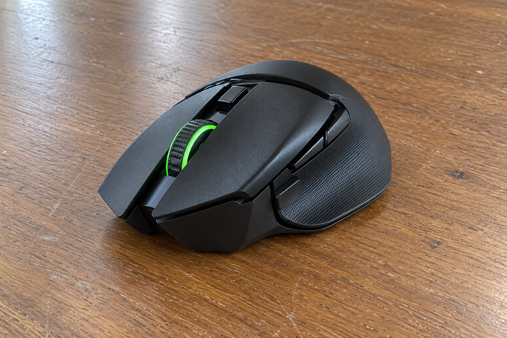

9월부터 2개월 동안 Basilisk V3 X HyperSpeed를 썼습니다. 기존에 쓰던 마우스보다 크기가 커서 처음에는 낯설었지만 쓸수록 손에 익었습니다. 2개월 쓰면서 느낀 점을 간단히 적습니다.

| 크기 | 무게 | 연결 | 사용 기간 |
|---|---|---|---|
| 75 × 130 × 42 mm | 106 g | 무선(USB 수신기, 블루투스) · 건전지 | 2개월 |

## 건전지 하나로 오래 씁니다

가장 좋았던 점은 건전지입니다. 하나로 2개월 동안 교체 없이 계속 썼고, 배터리가 떨어질 걱정을 하지 않아도 됐습니다. 스펙상 수신기로 연결하면 최대 285시간, 블루투스로 연결하면 최대 535시간이라고 하는데, 실제로도 오래간다는 느낌이었습니다. 연결도 끊김 없이 안정적이었습니다.

## 손에 편합니다

쥐었을 때 손에 편하게 얹혔습니다. 폭이 75mm여서 손바닥이 마우스에 닿는 면적이 넓었고, 엄지를 올려 두는 자리도 편했습니다. 106g이라 가볍지는 않지만 책상 위에서 밀어 쓰기에는 안정감이 있었습니다. 겉모습은 단정하고 무난한 인상이라 어느 책상에도 어울렸습니다.

## 충전식이 아니라 건전지를 준비해야 합니다

아쉬운 점은 충전식이 아니라는 것입니다. 건전지가 다 떨어지면 새 건전지를 구해서 갈아야 하는데, 마침 건전지가 없을 때 떨어지면 난감합니다. 충전식 마우스는 책상 위에서 충전하면 되니 이 점이 번거롭게 느껴졌습니다. 다른 마우스와 비교하면 이 점만 감안하면 됩니다.

2개월 쓰면서 가장 안심이 되었던 것은 배터리가 얼마나 남았는지를 신경 쓰지 않아도 된다는 점입니다. 전원을 켜 둔 채로 두어도 건전지가 오래 버텨서 충전 선을 챙길 일이 없었습니다. 처음 샀을 때 넣어 둔 건전지를 아직 그대로 쓰고 있고, 여분을 하나 사 두었습니다. 수신기와 블루투스 전환 버튼도 손에 닿는 곳에 있어서 편했습니다. 충전식이 아니라는 점은 처음부터 알고 샀기 때문에 크게 실망하지는 않았습니다. 건전지로 오래 쓸 수 있다는 점이 오히려 장점이라고 생각합니다. 여분의 건전지를 서랍에 두는 것으로 문제를 해결했습니다. 처음 샀을 때는 건전지 때문에 망설였지만 2개월을 쓰고 나니 이 점이 크게 중요하지 않다는 걸 알았습니다. 오히려 충전 선이 없어서 책상 위가 단정해졌습니다. 이 정도라면 건전지를 쓰는 마우스도 충분히 편하다는 것을 이번에 알았습니다. 다시 구매할 의향이 있습니다.

결론은 추천입니다. 건전지가 오래가고 손에 편해서 2개월 동안 만족스럽게 썼습니다.
