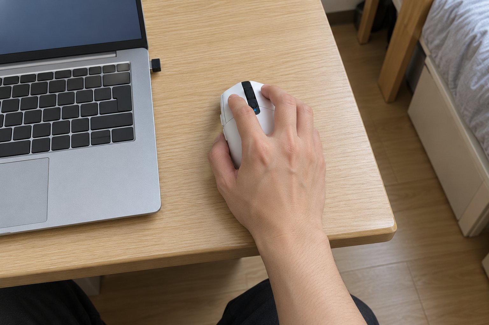

기숙사 2인실에서 과제를 하고, 남는 시간에 롤을 하루 네 시간쯤 하는 학생이에요. 손이 작은 편이고 클로로 쥐고 감도는 높게 써요. 책상이 좁고 룸메이트가 있어서 소리에 신경이 쓰여요. 9월부터 3개월 동안 G304를 썼어요. 이전에는 유선 마우스를 썼는데, 선이 책상 가장자리에 자꾸 걸려서 무선으로 바꿨어요.

| 크기 | 무게 | 연결 | 사용 기간 |
|---|---|---|---|
| 62.1 × 116.6 × 38.2 mm | 99 g | 무선(USB 수신기) · AA 건전지 | 3개월 · 과제 + 게임 |

## 작은 손에 딱 맞는 크기예요

길이가 116.6mm, 폭이 62.1mm라서 작은 손으로 쥐어도 손에 쏙 들어와요. 클로로 쥐면 손가락 끝이 버튼에 자연스럽게 닿아요. 이전 유선 마우스는 손에 비해 커서 손가락을 뻗어야 했는데, 그런 일이 없어져서 편했어요. 겉모습은 작고 단순해서 좁은 책상에서도 자리를 덜 차지해요.

## 선이 없어서 좁은 책상이 깔끔해져요

무선이라 선이 책상 위에서 걸릴 일이 없어서 마우스를 움직일 공간이 넓어진 느낌이에요. 책상이 좁아서 키보드 옆에 마우스 패드를 겨우 올려 두는데, 선이 없으니 정리가 훨씬 깔끔했어요. 건전지도 하나로 오래가서 3개월 동안 한 번만 갈았어요. 롤 한타 중에도 입력이 끊긴 적이 없었어요.

## 건전지 때문에 뒤쪽이 무겁게 느껴져요

아쉬운 점은 무게 균형이에요. 건전지가 뒤쪽에 들어가서 마우스 뒤쪽이 묵직하게 느껴져요. 99g이라 아주 무거운 건 아닌데, 클로로 쥐면 앞이 가볍고 뒤가 무거운 느낌이라 처음에는 적응이 필요했어요. 며칠 지나니까 괜찮아졌어요. 더 가벼운 마우스에 익숙한 분이라면 더 무겁게 느낄 수 있을 것 같아요.

무선인데도 입력이 늦는다는 느낌은 한 번도 못 받았어요. 한타에서 클릭을 연속으로 눌러도 반응이 똑같았고, 책상이 좁아서 마우스를 조금만 움직이는데도 정밀하게 따라와 줬어요. 룸메이트가 자고 있는 밤에는 클릭을 조용히 누르려고 신경 썼고, 선이 없어서 책상을 정리하는 시간도 줄었어요. 기숙사 책상이 좁아서 마우스를 쓰다가 팔이 벽에 닿기도 했는데, 이 마우스는 크기가 작아서 그런 일이 줄었어요. 무선이라 정리가 쉬워서 방 청소할 때도 마우스만 들면 돼서 편했어요. 한 가지 팁은 건전지를 갈 때 새 건전지를 미리 준비해 두면 마우스가 갑자기 꺼져도 당황하지 않는다는 것이에요. 저는 서랍에 하나 넣어 두고 있어요.

결론은 추천이에요. 작은 손에 선 없는 마우스를 찾는 분께 잘 맞았어요.
