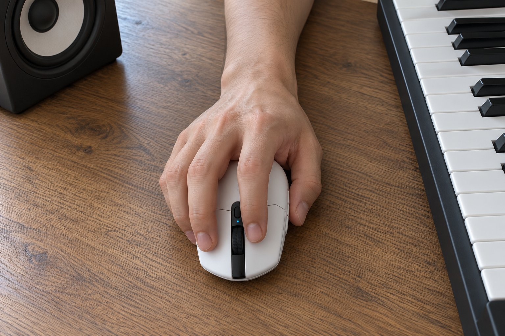

저는 손이 큰 편이고 마우스는 손바닥 전체로 쥡니다. 조용한 방에서 음악을 만들고 듣는 일을 하루 다섯 시간쯤 합니다. 무선이고 가벼운 마우스가 궁금해서 1월 초에 1주일 동안 G304를 써 봤는데, 결과는 비추천입니다.

| 크기 | 무게 | 연결 | 사용 기간 |
|---|---|---|---|
| 62.1 × 116.6 × 38.2 mm | 99 g | 무선(USB 수신기) · AA 건전지 | 1주 · 음악 작업 |

## 연결이 간단합니다

장점부터 적으면 연결이 아주 간단했습니다. 수신기를 꽂으면 바로 인식되었고, 프로그램을 따로 설치하지 않아도 바로 쓸 수 있었습니다. 건전지만 넣으면 되니 초기 설정이 필요 없어서 마음이 편했습니다. 겉모습은 작고 단순한 인상이었습니다.

## 손바닥이 뜹니다

문제는 크기입니다. 길이 116.6mm, 폭 62.1mm는 제 손에는 너무 작아서 손바닥이 마우스 위에 얹히지 않고 떴습니다. 손바닥 아랫부분이 책상에 닿아서 마우스를 쥔다기보다 손가락으로 집는 느낌이었습니다. 음악 작업에서 파형을 정밀하게 움직여야 하는데, 손이 불안정해서 오히려 작업이 어려웠습니다.

## 하루 쓰고 나면 손가락이 피곤합니다

작은 마우스를 큰 손으로 쥐려니 손가락에 힘이 들어가서, 하루만 써도 엄지와 새끼손가락 사이가 뻐근했습니다. 이전에 쓰던 마우스는 손바닥 전체가 얹혀서 힘을 뺄 수 있었는데, 이쪽은 계속 손가락으로 버텨야 했습니다. 손이 작은 분이라면 크기가 오히려 장점일 것 같습니다.

1주 동안 쓰면서 손이 마우스에 적응하지 못하고 계속 자세를 바꾸게 되었습니다. 손바닥을 책상에 눌러 두고 손가락만 쓰는 방식은 오래 가지 못했습니다. 작업이 길어질수록 어깨와 손가락 사이가 굳어서 쉬는 시간이 늘었습니다. 크기가 작은 만큼 가방에 넣어 다니는 용도로는 좋을 것 같습니다. 작은 손에는 아주 좋은 마우스일 거라는 생각이 들었습니다. 저처럼 손이 큰 사람은 한 단계 더 큰 모델을 찾는 것이 좋겠습니다. 가볍고 간편한 점은 마음에 들었습니다. 1주 동안 쓰면서 이 마우스가 어떤 사람에게 맞을지 계속 생각했습니다. 작은 손으로 가방에 넣어 다니며 쓰는 사람이라면 아주 좋을 것 같습니다. 저는 맞지 않았지만 제품 자체는 완성도가 있다고 느꼈습니다. 다음에 마우스를 고를 때는 길이가 130mm가 넘는 모델 위주로 알아볼 생각입니다. 큰 손이라면 크기를 꼭 확인하세요.

정리하면 제품이 나쁜 것이 아니라 손에 맞지 않았습니다. 손이 큰 분께는 권하지 않습니다.
