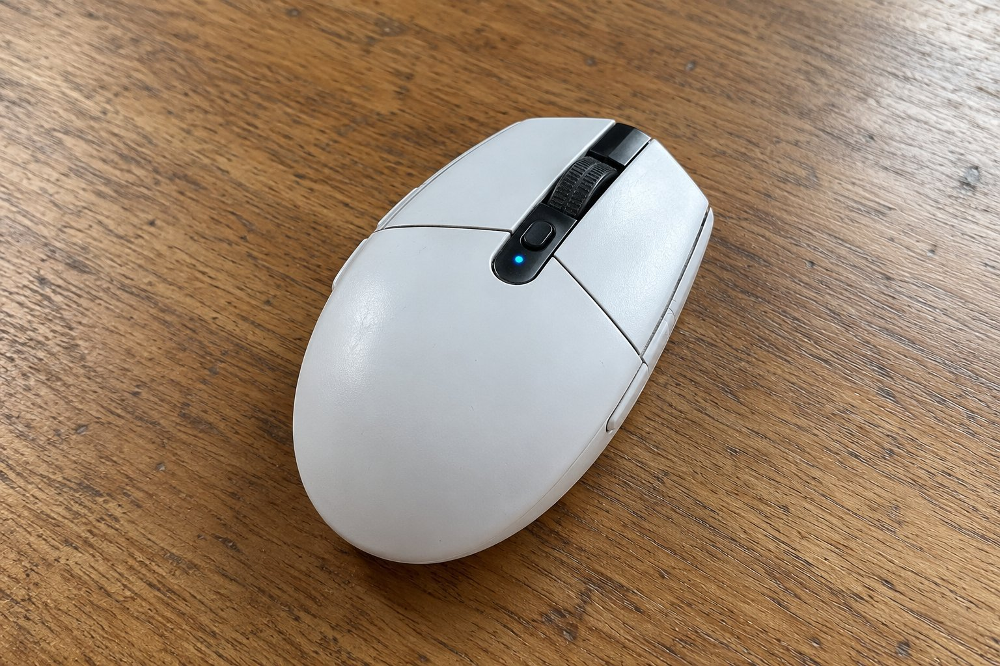

작년 9월부터 6개월 동안 G304를 썼어요. 무선 마우스를 처음 써 봤는데 선이 없으니 책상이 깔끔해져서 좋았어요. 6개월 쓰면서 느낀 점을 적어요.

| 크기 | 무게 | 연결 | 사용 기간 |
|---|---|---|---|
| 62.1 × 116.6 × 38.2 mm | 99 g | 무선(USB 수신기) · AA 건전지 | 6개월 |

## 반년 동안 문제없이 썼어요

6개월 동안 연결이 끊기거나 이상이 생긴 적이 한 번도 없었어요. 수신기를 꽂아 두기만 하면 바로 연결되고, 사용하는 내내 입력도 부드러웠어요. 겉모습이 단순하고 작아서 어디에 놓아도 잘 어울렸어요. 처음 샀을 때와 별 차이 없이 쓰고 있어요.

## 아이도 편하게 써요

크기가 작아서 어른도 쓰기 편하고, 아이도 쥐었을 때 부담이 없었어요. 가끔 아이가 쓸 때가 있는데 크기가 맞아서 불편해하지 않았어요. 버튼도 헷갈리지 않아서 설명하지 않아도 금방 익숙해졌어요. 99g이라 아이에게는 조금 묵직할 수 있을 것 같은데 그래도 잘 쓰더라고요.

## 건전지 교체가 번거로워요

아쉬운 점은 건전지예요. 6개월 동안 한 번 갈았는데, 건전지가 떨어지려 할 때 알림이 따로 없어서 갑자기 안 움직이면 그제서야 알았어요. 집에 건전지를 미리 사 둬야 해서 챙기는 게 번거로웠어요. 충전식이었다면 더 편했을 것 같아요.

6개월 동안 마우스를 바꾸지 않고 쓰다 보니 어느새 손에 익어서 없으면 허전한 마우스가 되었어요. 처음에는 건전지 때문에 약간 무겁게 느껴졌지만 지금은 그 무게가 오히려 안정감이 있어요. 선이 없어서 책상 위가 깔끔하고, 청소할 때도 마우스만 들어서 닦으면 돼서 편해요. 처음에 샀을 때 기대했던 것 이상으로 안정적이어서 크기도 부담이 없고 쓰기 편해서 주변 사람들에게도 추천하고 있어요. 일주일에 몇 번씩 쓰는 마우스라서 이상이 있으면 바로 알아챌 텐데, 6개월 동안 한 번도 불편한 일이 없었어요. 크기가 작아서 손이 큰 어른이 쓰기에는 작을 수 있을 것 같지만, 저는 불편함 없이 잘 쓰고 있어요. 선이 없어서 아이가 책상에서 마우스를 쓰다가 선에 걸려 넘어질 걱정도 없어서 마음이 놓여요. 앞으로도 계속 쓸 생각이에요. 마우스가 말썽을 부리지 않으니 아이도 컴퓨터를 켜는 일이 훨씬 즐거운 것 같아요. 이런 것이 일상에서 느끼는 작지만 큰 만족이라고 생각해요.

결론은 추천이에요. 크기가 작아서 어른과 아이가 같이 쓰기에 좋았고, 건전지만 미리 챙겨 두면 문제가 없었어요.
