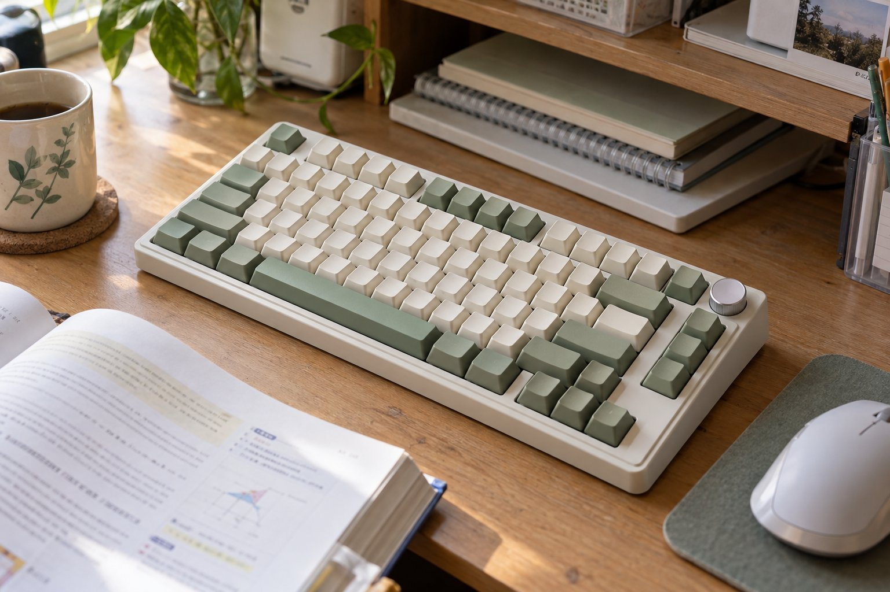

> 가상 예시 사용기입니다. 실제 구매자가 작성한 후기가 아닙니다.

기숙사 책상에서 과제를 하다가 저녁에는 게임도 합니다. AULA F75 Crescent 축을 3주 써 보니 작은 책상에 마우스와 교재를 같이 올려놓기 수월했습니다. 다만 룸메이트가 있는 방이라 타건음은 낮과 밤에 다르게 느껴졌습니다.

| 연결 | 스위치 | 무게 | 사용 기간 |
|---|---|---|---|
| USB·USB 수신기·Bluetooth | Crescent | 975g | 3주 |

## 책상에서 얻는 자리

키보드를 가운데 두고 오른쪽에 마우스를 놓으니 팔을 옆으로 크게 벌리지 않아도 됐습니다. 과제 자료를 프린트해 옆에 놓을 때도 책상 한쪽에 여유가 생깁니다. 전에 쓰던 더 긴 키보드에서는 교재와 마우스 패드를 함께 놓느라 물건을 자꾸 밀어야 했습니다. 게임 중 마우스를 움직일 때 책상 가장자리에 닿는 일이 줄어든다는 점도 이 환경에선 장점입니다. 다만 숫자 입력을 자주 한다면 이 공간 이점이 동일한 만족으로 이어지지는 않을 수 있습니다.

## 타건감과 밤의 소리

Crescent 축은 과제 문장을 길게 입력할 때 흐름이 끊기지 않는 느낌이었습니다. 키를 연속해서 눌러도 거친 울림보다는 비교적 차분한 인상을 주지만, 그 표현이 곧 무소음을 뜻하지는 않습니다. 낮에는 작은 소리라고 여겼던 타건음이 불을 끈 뒤에는 룸메이트에게 들릴 수 있습니다. 특히 마감 전날 밤 문장을 빠르게 고치는 동안에는 짧은 입력보다 연속된 소리가 더 신경 쓰입니다. 룸메이트가 소리를 이야기한 뒤로는 늦은 시간에 입력 속도를 늦추거나 자리를 옮겼습니다. 소음의 허용 기준은 제품보다 함께 쓰는 공간에서 먼저 정해집니다.

## 조건부 추천인 이유

과제 마감 전날에는 교재를 왼쪽에 펴고 노트북을 뒤로 밀어 놓았습니다. F75가 자리를 덜 차지해 마우스 패드를 옮기지 않아도 됐지만, 늦은 밤에는 키를 빠르게 치는 소리가 생각보다 길게 이어졌습니다. 룸메이트가 쉬는 시간에는 짧은 메모만 하고 긴 문장은 낮에 입력하는 편이 서로 편했습니다. 혼자 있는 낮에는 소리가 크게 거슬리지 않아 같은 키보드도 시간대에 따라 평가가 달라졌습니다.

USB 수신기와 Bluetooth를 고를 수 있어 노트북을 정리할 때 선이 줄어드는 점은 좋습니다. 반대로 975g 본체를 강의실까지 매일 들고 다니는 키보드로 생각하지는 않았습니다. 저는 이 키보드를 작은 책상에 놓고 쓰는 편입니다. 방을 혼자 쓰는 사람이라면 소리의 아쉬움은 훨씬 줄어들 수 있지만, 그 역시 다른 조건에 대한 추정일 뿐입니다. 좁은 책상에서 자리 확보와 타건감을 우선한다면 추천할 만하고, 밤에 옆 사람을 깨우지 않아야 한다면 먼저 실제 타건음을 확인하자는 결론입니다.
