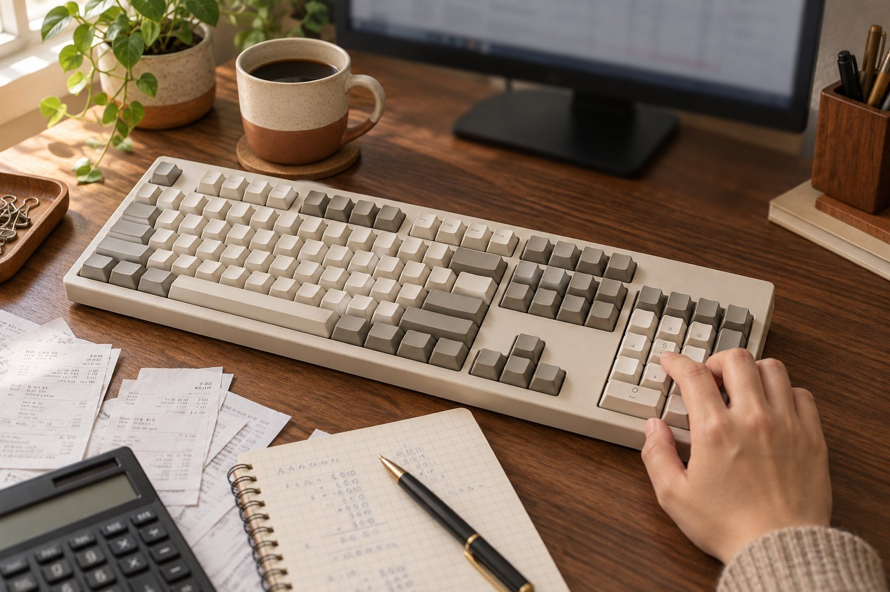

> 가상 예시 사용기입니다. 실제 구매자가 작성한 후기가 아닙니다.

엑셀과 문서를 오래 다루며 한성 GK898B PRO NIZ EC 35g을 석 달 써 봤습니다. 정전용량 무접점 방식의 가벼운 입력은 반복 작업에 잘 맞았고, 숫자 키패드도 유용했습니다. 처음엔 손끝이 너무 가볍게 느껴지는 순간이 있어 적응이 필요했습니다.

| 연결 | 스위치 방식 | 무게 | 사용 기간 |
|---|---|---|---|
| USB·Bluetooth | 정전용량 무접점(NIZ EC 35g) | 1,097g | 3개월 |

## 숫자 입력의 반복

풀배열의 키가 가지런히 이어진 외형은 문서 작업 책상에 무난하게 어울립니다. 겉모습은 단정하다는 인상이지만 그것만으로 가벼운 키압이 손에 맞는지는 알 수 없습니다.

표의 수량을 연달아 입력한 뒤 설명 문장을 쓸 때 숫자 키패드가 편했습니다. 전에 쓰던 작은 키보드에서는 위쪽 숫자 줄을 다시 찾아야 했습니다. 가벼운 키압을 좋아하는 제게 35g 표기는 관심이 가는 조건이었습니다. 긴 업무 시간에는 손가락에 힘을 덜 주는 느낌이었지만, 실제 피로 감소를 측정한 건 아닙니다. 숫자 입력을 거의 하지 않는 사용자라면 풀배열의 가치가 작아질 수 있습니다.

## 조용한 자리에서의 감각

회의실 근처에서 짧은 메모를 적을 때도 소리가 크게 튀지 않는 편이었습니다. 가벼운 입력은 손을 빨리 옮기기 좋지만 처음에는 손가락을 키 위에 얹은 채 생각하다 원치 않는 글자가 들어갈 수 있습니다. 며칠 동안 손을 얹어 두는 위치를 바꿔 봤습니다. 제품 결함보다는 제가 가벼운 키압에 적응하는 과정에 가까웠습니다. 타건음을 재 보지는 않았으니 무소음이라고 말할 수는 없습니다.

## 좋은 점과 적응 비용

가벼운 입력이 좋았어도 작은 실수 입력까지 없었던 것처럼 말하기는 어렵습니다. 숫자 입력이 많고 가벼운 키압을 좋아하는 제 기준에서는 추천할 만합니다. 같은 35g이라도 누군가에게는 지나치게 가볍게 느껴질 수 있으니 키감은 직접 확인하는 편이 좋겠습니다. 같은 가벼운 키라도 손을 얹는 습관에 따라 평가가 달라질 수 있습니다.

숫자 열을 고친 뒤 바로 설명 문장을 써야 할 때 손의 움직임이 자연스러웠습니다. 반대로 손을 키 위에 오래 얹어 놓으면 생각보다 가볍게 눌려 자세를 다시 고쳐 앉게 됐습니다. 제게는 가벼운 키의 이점이 컸지만, 오타가 전혀 없었다는 뜻은 아닙니다.

USB와 Bluetooth 선택지는 책상 배치에 맞춰 연결을 고를 수 있게 합니다. 다만 1,097g 본체는 자주 들고 옮기는 장면과는 잘 맞지 않습니다. 묵직한 키를 좋아하는 분에게는 제가 장점으로 꼽은 가벼움이 오히려 아쉬울 수도 있겠습니다. 저처럼 숫자 입력이 많고 가벼운 키압을 원한다면 추천합니다. 다른 사용자들의 장기 사용 평가는 확인하지 못했으니 제 짧은 사용감만으로 내구성까지 판단하긴 어렵습니다.
