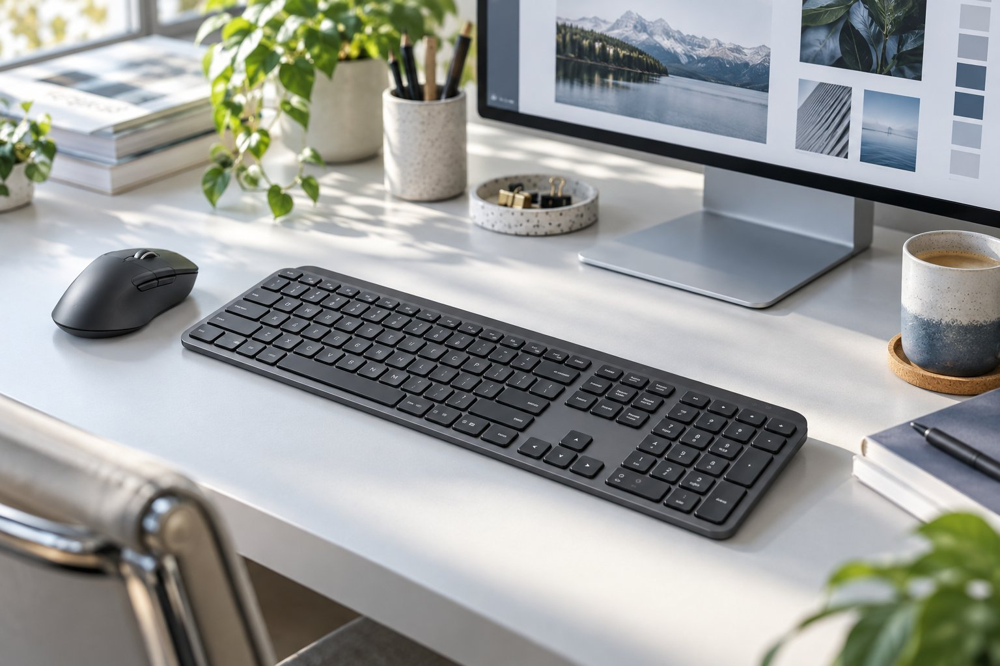

> 가상 예시 사용기입니다. 실제 구매자가 작성한 후기가 아닙니다.

디자인 작업을 할 때 마우스를 왼손에 놓고 Logitech MX Keys S를 석 달 써 봤습니다. 풀배열이라 책상 폭을 많이 차지할 줄 알았는데, 숫자 키패드가 오른쪽에 있어서 왼쪽 마우스 자리와는 크게 부딪히지 않았습니다. 조용한 사무실에서는 키감과 설정 프로그램을 따로 평가하게 됐습니다.

| 연결 | 스위치 방식 | 크기 | 사용 기간 |
|---|---|---|---|
| USB 수신기·Bluetooth | 팬터그래프 | 430.2 × 131.63 × 26.1mm | 3개월 |

## 왼쪽 마우스 자리

키보드 오른쪽에 숫자 키패드가 있어도 왼손 마우스가 놓인 쪽과 직접 겹치지 않습니다. 화면 요소의 간격을 조정하고 숫자를 입력할 때 오른손은 키보드, 왼손은 마우스에 둘 수 있습니다. 이전에는 작은 키보드를 썼지만 숫자를 여러 개 넣는 작업에서 위쪽 숫자 줄을 반복해서 찾아야 했습니다. 풀배열의 폭이 모든 사용자에게 같은 손해가 아니라는 점이 여기서 드러납니다. 다만 책상 전체가 좁다면 왼쪽 배치라도 여유가 없을 수 있으므로 치수는 확인해야 합니다.

## 조용하고 얕은 입력

레이어 이름을 바꾸거나 단축키를 반복할 때 얕은 팬터그래프 키가 손에 잘 맞았습니다. 낮은 키를 선호하는 사용자에게는 손을 크게 들어 올리지 않고 다음 키로 옮기는 흐름이 자연스럽습니다. 옆자리에서 회의가 시작돼도 소리 때문에 입력을 멈추지는 않았습니다. 그렇지만 기계식 키의 선명한 반발감을 좋아하는 사람이라면 같은 감각을 밋밋하게 느낄 수 있습니다. 소리와 키감은 분리해서 평가해야 합니다.

## 프로그램은 별도 문제

저는 마우스를 왼손에 놓고 씁니다. 같은 공간에서 오른손으로 마우스를 쓰는 사람은 키보드의 폭을 전혀 다르게 느낄 수 있습니다. 그래서 풀배열이 공간을 차지하지 않는다고 일반화하지 않았습니다. 키보드와 마우스 위치를 함께 그려 보고 판단해야 하며, 한 가지 편리함이 다른 사람의 불편을 지우지는 않습니다.

작업 중에는 왼손으로 화면을 움직이고 오른손으로 숫자나 파일명을 입력했습니다. 두 손의 동선이 겹치지 않아 풀배열의 단점이 덜 느껴졌지만, 사무실 책상이 더 좁았다면 이야기가 달랐을 겁니다. 설정 프로그램보다 기본 입력을 더 많이 쓰는 제 사용 비율도 평가에 영향을 줬습니다.

키보드 자체의 배치와 입력감은 마음에 들어도 전용 프로그램을 열 때는 동작이 무겁게 느껴지는 장면이 있습니다. 단축키 하나를 바꾸려고 실행했는데 바로 입력 작업으로 돌아가지 못하면 사소한 번거로움이 쌓입니다. 이것을 연결 오류나 제품 전체의 성능 문제로 확대하지는 않습니다. 프로그램을 거의 쓰지 않는 사람이라면 이 아쉬움이 중요하지 않을 수 있지만, 그건 다른 사용 패턴에 대한 추정입니다. 조용한 사무실에서 얕은 키와 숫자 키패드를 함께 원한다면 추천하며, 설정 기능을 자주 바꾼다면 프로그램 사용감도 확인할 필요가 있습니다.
