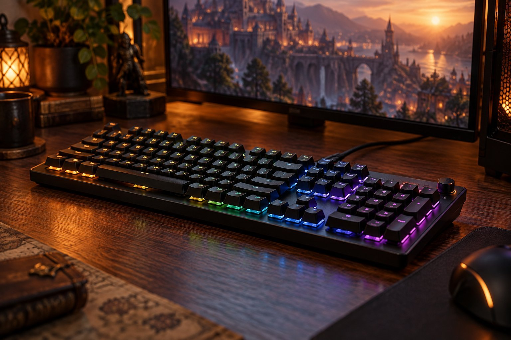

> 가상 예시 사용기입니다. 실제 구매자가 작성한 후기가 아닙니다.

RPG와 MMO를 하면서 Corsair K70 CORE RGB의 CORSAIR MLX Red 축을 두 달 써 봤습니다. 긴 채팅을 치는 시간과 게임 중 음량을 바꾸는 순간이 생각보다 많았습니다. 풀배열과 유선 연결이 제 책상에 맞는지도 함께 봤습니다.

| 연결 | 스위치 | 무게 | 사용 기간 |
|---|---|---|---|
| USB 유선 | CORSAIR MLX Red | 934g | 2개월 |

## 입력의 묵직한 인상

게임에서 자주 쓰는 키를 누를 때 손끝이 지나치게 미끄러지지 않아 좋았습니다. 긴 채팅을 쓸 때도 키가 일정하게 내려가 입력 위치를 놓치지 않았습니다. 이전에 쓰던 가벼운 키보드와 비교하면 손가락에 남는 감각이 조금 더 분명합니다. 이것을 특정 축의 실측 키압이나 모든 사용자의 반응으로 확대하지는 않습니다. 같은 입력을 빠르게 연타하는 사람이라면 이 묵직함을 부담으로 느낄 수 있습니다.

## 소리와 다이얼

다이얼이 있는 상단의 모습은 여러 조작을 한곳에 모아 둔 인상입니다. 외형은 게임 장비답게 존재감이 있지만, 책상 위 다른 물건과 함께 놓았을 때는 본체 폭도 같이 보게 됩니다.

늦게 게임하다 화면 전환을 기다리며 키를 여러 번 눌렀을 때도 속이 빈 울림보다는 정돈된 소리로 들렸습니다. 스피커 음량을 줄일 때 손이 바로 가는 다이얼도 편리합니다. 게임 내 설정 화면을 열지 않고 소리를 바꾸는 동작이 반복되면 별것 아닌 기능이 자주 쓰이게 됩니다. 반면 헤드셋을 쓰는 날에는 타건음의 성격을 잘 느끼지 못할 수 있습니다. 소음 크기를 측정하지 않았으므로 몇 dB라는 표현이나 절대적으로 조용하다는 평가는 피했습니다.

## 프로그램은 따로 평가

검색 결과에서 이름이 비슷한 K70 CORE TKL Wireless를 함께 보게 될 수 있으므로 모델명을 끝까지 확인해야 합니다. 제가 쓴 건 USB 유선 모델입니다. 배열과 연결이 다른 제품이라면 책상 배치부터 다시 판단해야 합니다. 프로그램 사용이 번거로웠지만, 이 경험만으로 제품 전체에 결함이 있다고 말할 수는 없습니다.

게임 중에는 채팅을 길게 남기다가도 곧바로 음량을 줄일 일이 생겼습니다. 그때 화면 설정을 띄우지 않아도 되는 점은 사소하지만 자주 쓰는 편의였습니다. 풀배열은 숫자를 입력할 때 좋았고, 마우스를 크게 움직일 때는 오른쪽 공간을 다시 정리해야 했습니다.

조명 설정을 바꿀 때 전용 프로그램을 다시 열어야 해서 번거로웠습니다. 연결이나 인식 오류까지 겪은 것은 아니어서 프로그램의 동작 자체를 고장으로 보지는 않습니다. 설정을 거의 건드리지 않는 사람이라면 이 부분의 비중이 작을 수도 있습니다. 유선 연결과 풀배열이 책상에 맞고 약간 묵직한 입력을 선호한다면 추천하지만, 빠른 연타만을 최우선으로 삼는 사람에게 같은 결론을 강요하지는 않겠습니다.
