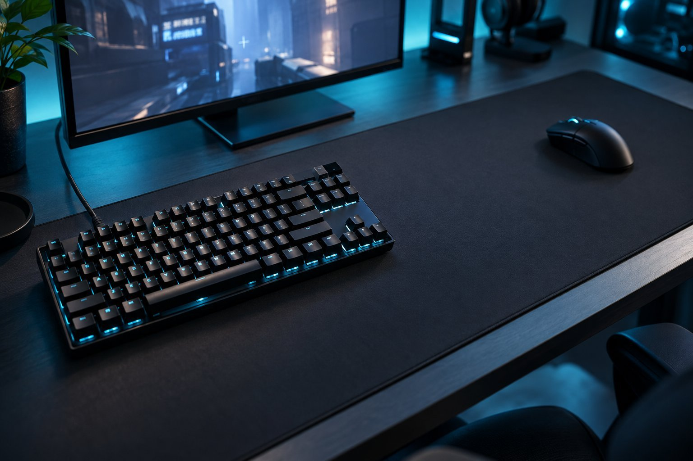

> 가상 예시 사용기입니다. 실제 구매자가 작성한 후기가 아닙니다.

FPS를 하며 SteelSeries Apex Pro TKL Gen 3 유선 모델을 6주 써 봤습니다. 텐키리스라 마우스 쪽 여유가 생기고, OmniPoint 3.0의 입력 지점과 래피드 트리거를 직접 맞춰 보는 재미가 있습니다. 다만 설정을 바꿨다고 게임 실력이 곧바로 달라지는 건 아니었습니다.

| 연결 | 스위치 | 래피드 트리거 | 사용 기간 |
|---|---|---|---|
| USB 유선 | OmniPoint 3.0 | 있음 | 6주 |

## 좁아진 키보드 폭

텐키리스 본체의 외형은 책상 가운데에 놓았을 때 비교적 간결해 보입니다. 키와 마우스 패드 사이가 트여 보이는 모습도 이 장치에 관심을 갖게 한 이유입니다.

마우스를 크게 움직이는 게임에서는 키보드 오른쪽 끝이 어디까지 오는지 먼저 체감합니다. 전에 쓰던 풀배열 키보드보다 마우스 패드 쪽에 여유가 생겼습니다. 낮은 감도로 좌우를 넓게 움직이는 순간에 팔꿈치를 덜 접어도 되는 배치가 편합니다. 숫자 키패드가 없어 평소엔 아쉽지만, 게임할 때는 마우스 공간을 우선하게 됩니다. 본체가 책상 위에서 쉽게 흔들리지 않는 점도 마음에 들었습니다.

## 입력 지점의 선택

연습 모드에서 이동 키의 입력 지점을 조정하고 익숙한 동작과 무엇이 다른지 하나씩 확인했습니다. 래피드 트리거를 켠 직후에는 손끝을 조금 떼는 타이밍까지 의식하게 됩니다. 설정을 바꿨다고 게임 결과까지 좋아졌다고 보지는 않습니다. 이전 키보드에서 고정된 감각에 익숙했다면 스스로 조절할 수 있다는 점이 재미있지만, 설정 항목을 모두 이해해야 한다는 부담도 생깁니다. 게임을 바꿀 때마다 어떤 값이 편했는지 메모하게 됐습니다.

## 처음에는 오히려 느려지는 선택

값을 바꿀 때는 한 번에 한 항목만 조정해야 이전 상태와 비교하기 쉽습니다. 손이 익숙해진 뒤에도 게임이 바뀌면 설정을 다시 살펴볼 수 있습니다. 게임을 자동으로 더 잘하게 해 주는 건 아니지만, 입력 방식을 직접 조절할 수 있다는 점은 좋습니다. 준비와 학습에 드는 시간을 함께 생각해야 기능 설명이 과장되지 않습니다.

처음 며칠은 입력 지점을 얕게 하면 무조건 좋을 줄 알았는데, 메뉴를 열거나 채팅을 칠 때 뜻하지 않은 입력도 생겼습니다. 자주 쓰는 이동 키부터 조정하니 어떤 변화가 손에 맞는지 더 알기 쉬웠습니다. 기능을 많이 쓰려면 설정을 배우는 시간도 사용 경험의 일부였습니다.

가장 얕은 값을 바로 고집하지 않고 실수 입력이 나는지부터 확인합니다. 한 번에 여러 항목을 바꾸면 무엇 때문에 달라졌는지 알기 어렵기 때문입니다. 설정을 거의 건드리지 않는 분이라면 이 과정이 번거로울 수도 있겠습니다. 저는 마우스 공간과 입력 조절 가능성이 중요해 추천하는 편입니다. 다만 구매 이유를 '반응이 몇 ms 개선된다'로 단정하지 않고, 설정을 배우는 시간을 포함한 선택으로 설명합니다.
