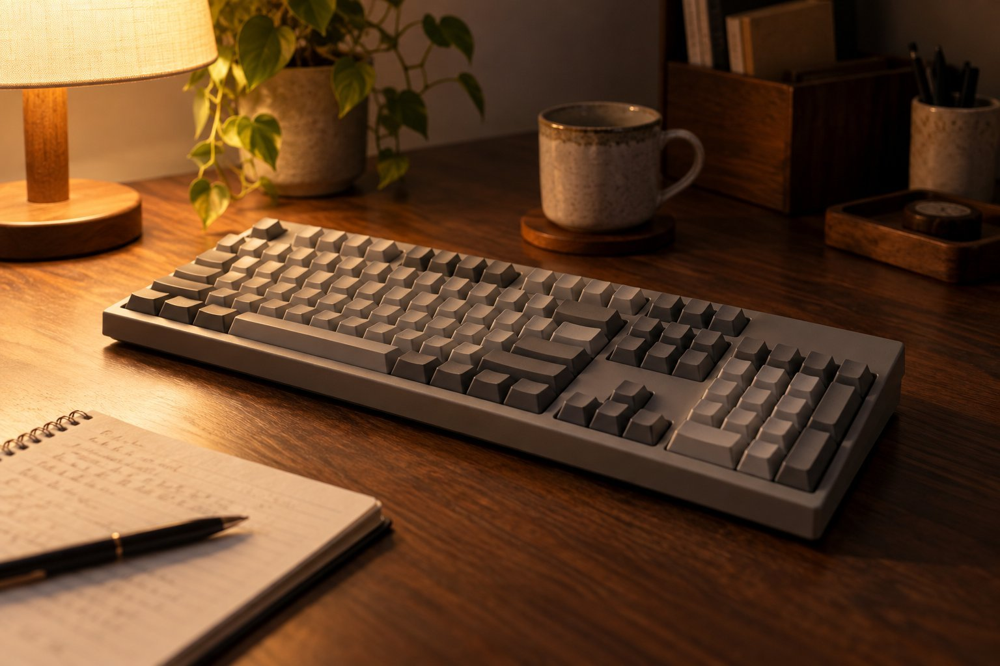

> 가상 예시 사용기입니다. 실제 구매자가 작성한 후기가 아닙니다.

아이가 잠든 뒤 짧게 게임을 하거나 웹을 볼 때 Leopold FC900RBT MX2A 저소음 적축을 두 달 써 봤습니다. 같은 모델이라도 청축과 소리는 다를 테니, 밤에 제가 쓰는 이 옵션만 이야기하려고 합니다. 어두운 책상에서 키를 찾는 일도 생각보다 자주 있었습니다.

| 연결 | 스위치 | 무게 | 사용 기간 |
|---|---|---|---|
| USB·Bluetooth | 저소음 적축 | 1,100g | 2개월 |

## 문을 닫은 뒤의 입력

장식을 앞세우지 않은 외형은 밤에 사용하는 책상에 차분하게 어울린다고 느낍니다. 이 절제된 모습은 마음에 들지만 불이 꺼졌을 때 키가 잘 보이는지와는 다른 이야기입니다.

조용히 해야 하는 시간에는 키를 한 번 누르는 소리보다 연속으로 누를 때의 인상이 중요합니다. 저소음 적축의 부드러운 입력은 밤에 키를 누를 때 부담을 덜어 줬습니다. 짧은 검색어를 칠 때도 손끝에 거친 걸림이 남지 않습니다. 이전에 쓰던 소리가 큰 키보드와 비교하면 방문을 닫고 입력할 때 신경 쓰는 횟수가 줄어드는 느낌입니다. 다만 옆방에서 실제로 어느 정도 들리는지는 집 구조와 문 상태에 따라 달라질 수 있어, 무음이라고 주장하지 않습니다.

## 게임보다 생활 소리

게임 중 채팅을 길게 입력할 때는 키를 빠르게 누르게 됩니다. 그때도 저는 또렷한 클릭음보다 부드러운 소리가 좋았습니다. USB로 연결해 쓰다가 기기를 바꿀 때 Bluetooth를 선택할 수 있다는 점은 편리합니다. 본체가 가벼운 편은 아니라 한 자리에 두는 사용에 더 어울리지만, 여기서는 자주 들고 다니지 않습니다. 숫자 키패드가 필요한 입력을 할 때 풀배열이 주는 안정감도 긍정적입니다. 누군가에게는 손가락에 남는 느낌이 지나치게 가볍다고 느껴질 수도 있겠습니다.

## 불빛이 없을 때

조용하다는 평가는 축을 빼놓고 전하면 의미가 바뀝니다. 같은 모델의 청축을 고른다면 밤 소리는 제 사용감과 다를 겁니다. 실제로는 키보드와 책상 사이의 울림, 입력 세기, 옆방과의 거리도 함께 영향을 줍니다. 저소음 적축을 고르고 문을 닫은 제 방에서는 만족스러웠습니다.

조명을 끈 뒤에는 백라이트가 없다는 점이 곧바로 아쉬움이 됩니다. 손이 익숙한 문자 키는 찾지만 평소 덜 누르는 기능 키 앞에서는 잠깐 화면과 키보드 사이를 번갈아 봅니다. 작은 스탠드를 켜면 해결되더라도 조용한 야간 사용을 위해 조명까지 함께 생각해야 합니다. 그래서 좋은 점은 소리와 입력감, 아쉬운 점은 어두운 곳의 키 확인으로 나누었습니다. 이 조건에서는 저소음 적축을 선택한 FC900RBT MX2A를 추천하되, 청축 모델까지 같은 평가를 옮기지 않습니다.
