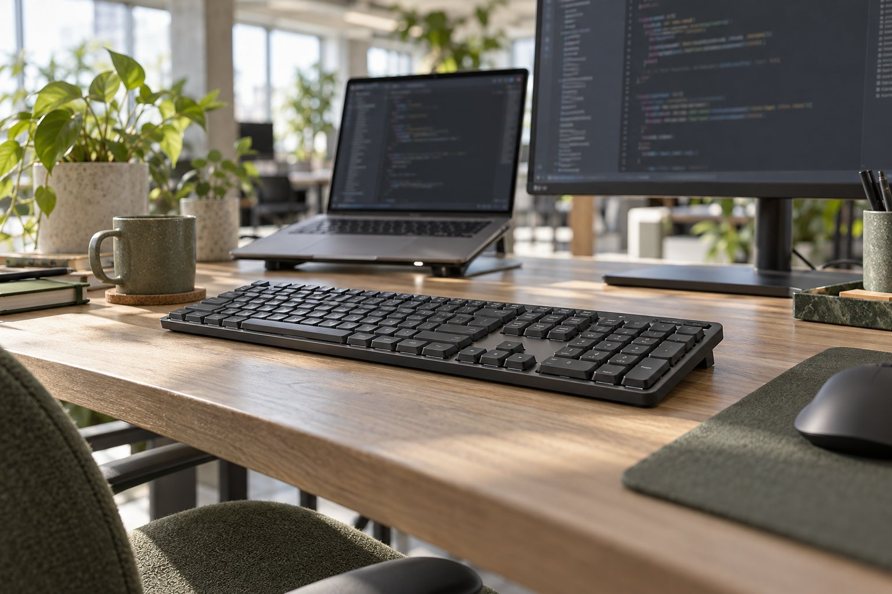

> 가상 예시 사용기입니다. 실제 구매자가 작성한 후기가 아닙니다.

칸막이가 없는 사무실에서 개발 일을 하며 Logitech MX Mechanical Tactile Quiet를 석 달 써 봤습니다. 낮은 키 높이는 반가웠고, 여러 기기를 오갈 때도 손을 계속 같은 키보드에 둘 수 있었습니다. 다만 조용하다는 이름만 보고 타건음을 전혀 신경 쓰지 않아도 되는 건 아니었습니다.

| 연결 | 스위치 | 무게 | 사용 기간 |
|---|---|---|---|
| USB 수신기·Bluetooth | Tactile Quiet | 828g | 3개월 |

## 긴 코드를 입력할 때

낮은 본체의 옆모습은 화면 아래를 답답하게 가리지 않아 깔끔해 보입니다. 이 외형을 좋아하더라도 손에 맞는 키 위치와 소리는 별도로 판단해야 합니다.

코드를 쓰고 터미널 명령을 반복할 때 키가 깊지 않아 손을 크게 들어 올리지 않아도 됐습니다. 손끝에는 약한 구분이 남아 입력이 끝난 위치를 알아차리기 좋습니다. 이전에 쓰던 높은 기계식 키보드와 비교하면 손목을 책상에 두는 자세가 조금 더 편하다는 인상입니다. 그러나 손목 통증을 치료하거나 예방한다는 의학적 주장으로 바꾸지 않았습니다. 하루 작업이 길수록 키감 하나보다 의자, 책상, 쉬는 시간도 함께 영향을 줍니다.

## 열린 사무실에서의 소리

옆자리 사람이 통화할 때 짧은 메모를 남겨도 타건음이 크게 튀지 않았습니다. 그렇다고 조용한 사무실에서 완전히 들리지 않는다는 뜻은 아닙니다. 제가 쓴 건 Clicky가 아닌 Tactile Quiet 옵션입니다. 회의실 문이 열린 시간에는 손가락을 빠르게 움직일수록 소리가 달라질 수 있어, 사용 환경을 설명 없이 '무소음'으로 요약하지 않았습니다.

## 기기를 바꾸는 작은 절차

오래 쓰는 장치일수록 첫날보다 익숙한 단축키가 어디에 있는지가 중요해집니다. 코드 편집기의 키 조합을 몇 번 틀리면 입력감이 아무리 좋아도 작업이 끊기기 때문입니다. 키 위치에 익숙해진 뒤에는 편했지만 처음 며칠은 달랐습니다. Tactile Quiet의 소리를 다른 축의 평으로 대체하지 않는 것도 검수 포인트입니다.

회의가 이어지는 오후에는 손을 키보드에 얹고 짧게 메모할 때가 많았습니다. 낮은 키라 입력 동작은 편했지만, 단축키 위치를 잘못 누르면 흐름이 끊겼습니다. 자주 쓰는 명령부터 다시 익히니 편해졌고, 옆자리 통화 중에는 연속으로 길게 타이핑하지 않으려 했습니다.

회사 노트북에서 개인 기기로 넘어갈 때 무선 연결 선택지는 유용합니다. 입력 대상을 바꾼 직후에는 커서가 맞는 화면에 있는지 확인합니다. 일부 키 위치가 이전 배열과 달라 처음에는 단축키를 잘못 누르기도 했습니다. 키 배치에 덜 민감하다면 저보다 쉽게 적응할 수도 있겠습니다. 낮은 높이와 조용한 축, 여러 기기 사용이 맞물려 추천하지만, 익숙한 키 위치가 가장 중요한 사람이라면 손에 올려 보고 결정해야 합니다.
