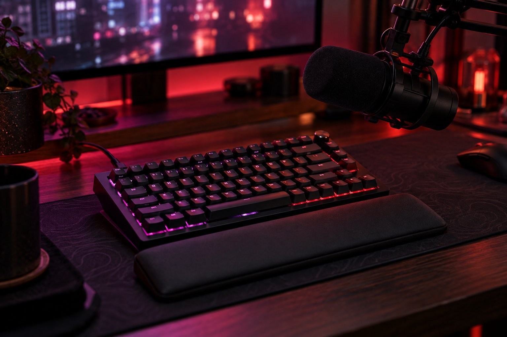

> 가상 예시 사용기입니다. 실제 구매자가 작성한 후기가 아닙니다.

게임 방송을 켜 둔 채 Razer BlackWidow V4 75%를 6주 써 봤습니다. Razer Orange Mechanical Gen-3의 또렷한 입력감은 좋지만 마이크가 켜져 있으면 소리도 함께 들어갈까 신경 쓰입니다. 게임할 때는 마음에 들었지만 방송을 켜면 같은 키 소리가 신경 쓰였습니다.

| 연결 | 스위치 | 무게 | 사용 기간 |
|---|---|---|---|
| USB 유선 | Razer Orange Mechanical Gen-3 | 815g | 6주 |

## 게임 중 손이 가는 곳

볼륨을 갑자기 낮춰야 할 때 노브에 손이 자주 갔습니다. 게임 메뉴를 열거나 다른 창으로 이동하지 않고 소리를 조금씩 조절할 수 있어 진행 흐름이 덜 끊깁니다. 전에는 화면의 음량 표시를 찾아 클릭했는데, 키보드 쪽에서 해결하니 편했습니다. 75% 크기는 마우스가 움직일 자리도 남깁니다. 빠르게 장면을 넘길 때 키의 구분감이 확실하다는 인상 역시 긍정적입니다.

## 마이크가 켜져 있으면

혼자 들을 때 정돈된 소리라도 실시간 음성 대화에서는 또렷한 타건음이 들어갈 수 있습니다. 채팅을 길게 쓰기 전 마이크 상태를 살피는 동작이 생깁니다. 특히 설명을 하면서 동시에 여러 키를 누르면 소리의 존재가 더 신경 쓰입니다. 이것을 장치의 불량이나 마이크 품질 문제로 단정하지 않았습니다. 입력 장치와 마이크가 놓인 거리, 소리 설정이 함께 만드는 결과이기 때문입니다. 실제 음량을 측정하지 않았으므로 소음 수치를 붙이지 않습니다.

## 설정과 조건부 결론

방송 장비를 바꾸기 전에 마이크를 현재 위치에 둔 채 타건음을 짧게 녹음해 보는 방법이 있습니다. 직접 녹음해서 수치를 비교한 건 아니니 마이크에 얼마나 들어가는지까지 단정하긴 어렵습니다. 입력을 자주 하는 방송인지, 음성 설명이 중심인지에 따라서도 같은 키의 소리가 차지하는 비중은 달라집니다.

게임 중 음량을 낮추고 다시 채팅에 답할 때는 키보드의 조작이 편했습니다. 그러나 마이크를 켠 채 빠르게 입력하면 제 귀에는 평소보다 키 소리가 크게 의식됐습니다. 녹음 파일을 비교한 건 아니라 상대에게 얼마나 전달되는지 단정하지 않지만, 방송 환경에서는 확인해 볼 만한 부분입니다.

조명 설정을 바꾸는 과정에서 프로그램을 다시 확인하는 일이 번거로울 수 있습니다. 사용 중 프로그램 오류를 겪은 것은 아니어서 고장 문제로 평가하진 않았습니다. 마이크를 쓰지 않는다면 타건음이 덜 신경 쓰일 수도 있겠습니다. 방송 중 음량 조절과 공간 이점은 좋고, 마이크에 전달될 수 있는 소리는 아쉽습니다. 구매 전 본인의 마이크 위치에서 소리를 확인한다는 조건을 붙여 평가합니다.
