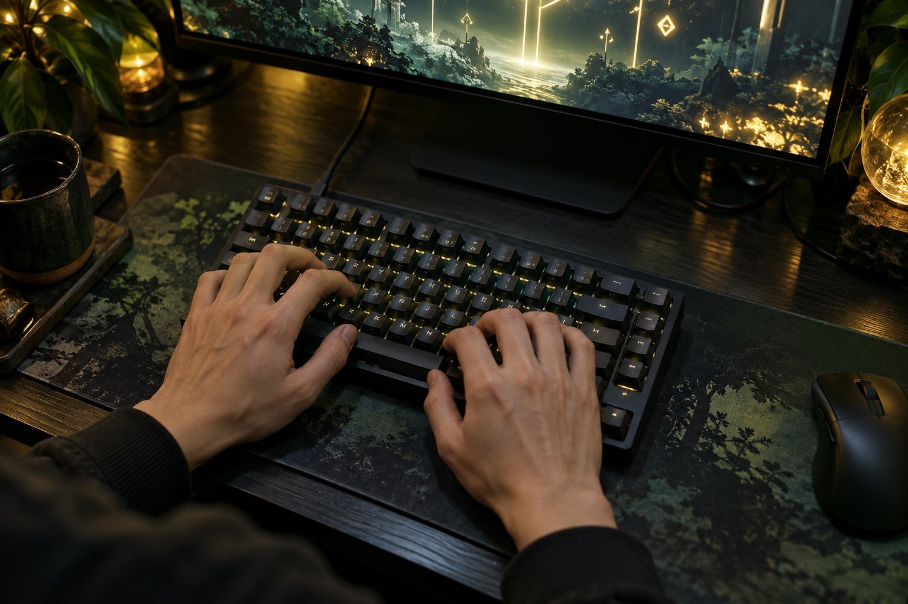

> 가상 예시 사용기입니다. 실제 구매자가 작성한 후기가 아닙니다.

리듬 게임과 FPS를 번갈아 하며 DrunkDeer A75 Pro Magnetic Switch를 두 달 써 봤습니다. 래피드 트리거와 입력 지점을 조절하는 과정이 재미있지만, 편한 값을 찾는 데는 시간이 들었습니다. 숫자로 확인한 승률 변화보다 손끝에서 맞는 설정을 찾는 일이 중요했습니다.

| 연결 | 스위치 | 래피드 트리거 | 사용 기간 |
|---|---|---|---|
| USB 유선 | Magnetic Switch | 있음 | 2개월 |

## 키마다 바꾸는 입력

연습 모드에서 반복해서 누르는 키와 길게 누르는 키를 나눠 설정해 봤습니다. 처음부터 모든 키를 얕게 맞추기보다 자주 쓰는 키 몇 개만 바꿔 보고 오타가 나는지 살핍니다. 이전의 고정형 키보드와 비교하면 같은 제품 안에서 손에 맞는 값을 찾는 과정 자체가 새롭습니다. 연타가 편하게 느껴졌어도 실제 판정 성공률이 올랐는지는 모르겠습니다. 게임 설정과 손의 익숙함은 함께 변하기 때문입니다.

## 좋아하는 소리와 책상 배치

폭이 짧은 본체는 마우스 패드 옆에서 간결해 보이지만, 옆에서 본 높이는 제법 존재감이 있습니다. 외형을 좋아하는 것과 손목을 편히 놓는 문제는 나누어 평가했습니다.

Magnetic Switch를 누를 때 소리가 제 귀에는 과하게 날카롭지 않았습니다. 긴 채팅을 칠 때와 게임 중 짧게 누를 때의 소리도 다르게 느껴질 수 있습니다. 키보드 폭 340.9mm는 마우스를 옆에 두기 좋은 배치를 만듭니다. 본체 높이 46.7mm 때문에 오래 입력하는 날에는 손목 위치를 다시 잡게 됐습니다. 소리 크기나 입력 지연을 재 본 것은 아니니 느낌 이상의 평가는 어렵습니다.

## 설정을 배우는 시간

Magnetic Switch와 Magnetic Silent Switch는 이름이 비슷하지만 같은 옵션이 아닙니다. 저소음 축의 밤 사용감과 제 일반 Magnetic Switch 평가는 다를 겁니다. 설정값 역시 기기만의 고정된 성능보다 사용자 손동작에 맞춰 찾는 선택입니다. 편한 설정을 찾는 과정 없이 단순히 '빠른 키보드'라고 말하기는 어렵습니다.

처음엔 여러 키의 입력 지점을 한 번에 바꾸고 싶었지만, 그러면 어떤 설정이 편한지 구분하기 어려웠습니다. 자주 누르는 키부터 조금씩 조정하고 이전 값을 적어 두는 편이 나았습니다. 게임의 판정 결과보다 실수 입력이 줄었는지를 먼저 살피게 됐습니다.

처음에는 입력 지점과 래피드 트리거 항목을 동시에 바꾸면 무엇 때문에 감각이 달라졌는지 알기 어렵습니다. 그래서 값을 하나씩 조정하고 이전 값으로 돌아갈 수 있게 메모했습니다. 설정을 거의 만지지 않는 분이라면 이 기능의 가치가 작을 수도 있겠습니다. 기능과 책상 공간은 마음에 들지만 학습 비용이 있다는 결론입니다. 저는 그 시간을 들이더라도 입력을 조절하고 싶어서 추천합니다.
