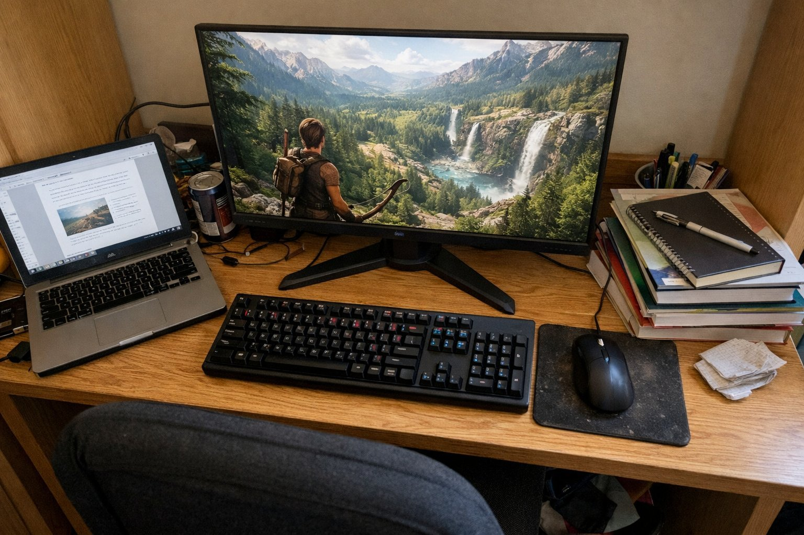

> 가상 예시 사용기입니다. 실제 구매자가 작성한 후기가 아닙니다.

기숙사 2인실 쓰는 대학생이에요. 과제하고 롤 하는 데 하루 네 시간쯤 모니터를 켜 두는데, 원래 쓰던 노트북 화면이 너무 답답해서 7월 초에 큰맘 먹고 27인치로 넘어왔어요. 책상이 좁아서 눈이랑 화면 사이가 50cm 정도밖에 안 나와요. 방은 그냥 형광등 켜 둔 보통 밝기고요.

화면은 진짜 마음에 드는데, 제 책상에는 좀 버거운 부분이 있어서 그 얘기를 솔직하게 적어 볼게요.

| 화면 | 주사율 | 패널 | 사용 기간 |
|---|---|---|---|
| 27인치 · 2560×1440 | 165Hz(DP) · HDMI 144Hz | IPS · 1ms · 400nit | 3주 · 과제와 롤 |

## 화면 자체는 만족이에요

노트북 화면보다 훨씬 넓으니까 과제할 때 왼쪽에 강의 자료, 오른쪽에 문서를 띄워 놓고 쓸 수 있어서 너무 편해요. 글자도 깨끗하게 나오고, 색도 쨍한 편이라 영상 볼 때 기분이 좋아요. 롤 할 때는 화면 전환이 부드러워서 한타 때 스킬 이펙트가 겹쳐도 덜 정신없어요. 밤에 룸메가 먼저 자면 밝기를 확 낮추고 쓰는데, 낮춰도 색이 칙칙해지지 않아서 좋았어요. 시야각도 넓어서 침대에 걸터앉아 화면을 봐도 색이 별로 안 변해요.

과제 마감 전날처럼 몇 시간씩 붙어 있을 때도 글자가 깨끗해서 자료 읽기가 편했어요.

## 받침이 깊어서 키보드 자리가 없어요

제일 아쉬운 게 스탠드예요. 튼튼한 건 좋은데 받침이 앞뒤로 깊어서 좁은 책상에 올리면 앞쪽 공간을 꽤 먹어요. 처음 설치했을 때 키보드를 받침 앞에 놓으니까 손목이 책상 끝에 걸렸어요 ㅠ 결국 키보드를 받침 위로 살짝 걸쳐 놓고 쓰고 있어요. 모니터암을 달면 해결될 수도 있는데 기숙사 책상이 클램프를 달 수 있는 구조인지 아직 확인을 못 했어요.

디자인은 앞에서 보면 베젤이 얇아서 깔끔하고, 뒷면은 게이밍 느낌이 조금 나요. 룸메가 보더니 생각보다 튀지 않는다고 하더라고요 ㅎㅎ

## HDMI로는 144Hz까지

책상 뒤가 벽이라 선 정리가 어려워서, 처음엔 노트북 때 쓰던 HDMI 선을 그대로 꽂았어요. 그랬더니 144Hz까지만 잡히더라고요. 165Hz는 DP로 연결해야 나와요. 저는 DP 선을 새로 구해서 바꿨는데, 롤 정도에서는 144Hz와 165Hz 차이가 크게 느껴지진 않았어요. 포트가 HDMI 2개, DP 1개라 남는 HDMI에는 가끔 노트북을 꽂아서 과제 자료를 띄워요. FPS를 하는 사람이라면 차이를 더 느낄 수도 있을 것 같아요.

정리하면, 화면은 확실히 좋은데 책상 깊이가 넉넉하지 않으면 받침 때문에 고생할 수 있어요. 책상이 좁은 분들은 모니터암까지 생각하고 고르시는 걸 추천해요.
