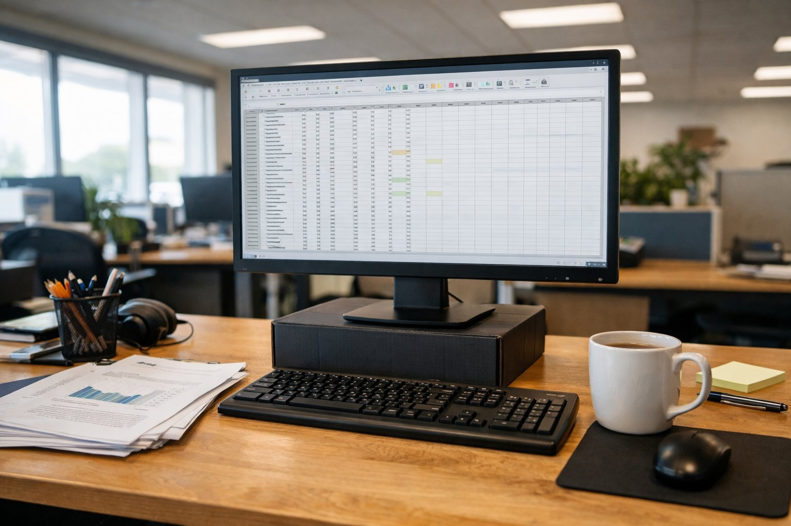

> 가상 예시 사용기입니다. 실제 구매자가 작성한 후기가 아닙니다.

사무실 자리 모니터를 바꾼 지 석 달이 되었습니다. 8월 말부터 썼습니다. 업무는 엑셀과 문서가 대부분입니다. 하루 여덟 시간 정도 숫자를 입력합니다.

공유 사무실이라 천장 조명이 밝습니다. 화면과 눈 사이는 60cm 정도입니다. 업무용으로 고른 이유와 써 본 느낌을 짧게 정리합니다.

| 화면 | 주사율 | 패널 | 사용 기간 |
|---|---|---|---|
| 27인치 · 2560×1440 | 75Hz | IPS · 5ms · 350nit | 3개월 · 엑셀·문서 |

## 엑셀이 넓게 보입니다

가장 만족하는 부분입니다. 전에 쓰던 24인치 FHD 모니터보다 한 화면에 보이는 행과 열이 확실히 많습니다. 월말 정산 표를 볼 때 좌우로 스크롤하는 일이 많이 줄었습니다. 두 파일을 나란히 띄워 놓고 대조하는 것도 무리가 없습니다.

글자도 선명합니다. 작은 숫자가 뭉개지지 않습니다. 소수점과 쉼표가 또렷하게 구분됩니다. 오타를 찾을 때 덜 피곤합니다. 숫자 입력이 많은 날은 셀 테두리를 오래 봅니다. 테두리 선이 흐리지 않아 행을 잘못 읽는 일이 줄었습니다. 색은 자연스러운 편이라 보고서 그래프도 과하지 않게 보입니다.

## 밝은 사무실에서도 잘 보입니다

천장 조명 바로 아래 자리입니다. 오후에 블라인드를 올려도 화면이 흐려지지 않았습니다. 밝기는 기본에서 조금만 올려 썼습니다. 퇴근 무렵 블라인드를 내린 뒤에도 밝기를 다시 바꿀 필요는 없었습니다. 하루 종일 같은 설정으로 씁니다. 저녁쯤 눈이 뻑뻑한 정도도 전보다 덜합니다.

메뉴 조작은 쉬운 편입니다. 밝기도 메뉴에서 바로 바꿀 수 있습니다. 처음 설정할 때 설명서를 볼 필요가 없었습니다.

포트는 HDMI 2개, DP 1개입니다. 회사 데스크톱은 HDMI로 연결했습니다. 75Hz라 이전 모니터보다 마우스 움직임이 조금 더 매끄럽게 느껴집니다. 업무에는 이 정도면 충분합니다.

## 스탠드 높이가 아쉽습니다

아쉬운 점은 스탠드입니다. 높이 조절이 되지 않습니다. 기본 높이는 저에게 낮았습니다. 오전 업무만 해도 목이 앞으로 숙여졌습니다. 그래서 모니터 받침대를 따로 깔았습니다. 지금은 화면 위쪽이 눈높이에 맞습니다. 키가 큰 분이라면 받침대 하나로도 부족할 수 있습니다.

겉모습은 단정합니다. 베젤이 얇아 사무실 책상에 잘 어울립니다. 뒷면도 튀는 장식이 없어 업무 공간에 무난합니다. 손이 닿는 부분도 매끈하게 마감되어 있습니다.

정리합니다. 엑셀과 문서 위주의 업무에는 추천합니다. 다만 높이 조절이 안 되니 받침대나 모니터암을 함께 생각하시기 바랍니다.
