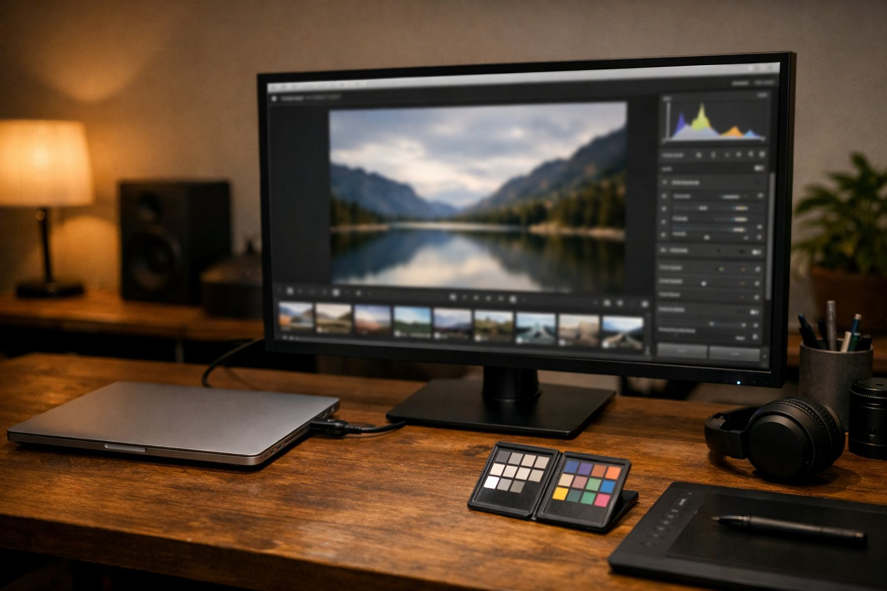

> 가상 예시 사용기입니다. 실제 구매자가 작성한 후기가 아닙니다.

사진과 영상 편집을 하루 여섯 시간가량 하는 작업실에 이 모니터를 들인 지 넉 달이 되었습니다. 3월 중순부터 맥북을 연결해 쓰고 있습니다. 작업실은 조용하고, 색을 볼 때 방해가 되지 않도록 조명을 늘 낮춰 둡니다. 의자에 앉으면 화면까지 80cm 정도 떨어져 있습니다.

| 화면 | 주사율 | 패널 | 사용 기간 |
|---|---|---|---|
| 31.5인치 · 3840×2160 | 60Hz | IPS(IPS Black) · 5ms · 400nit | 4개월 · 사진·영상 편집 |

## 선 하나로 끝나는 책상

가장 먼저 달라진 것은 책상 위입니다. USB-C 선 하나를 맥북에 꽂으면 화면이 켜지고 충전까지 함께 됩니다. 예전에는 전원 어댑터와 영상 변환 젠더를 따로 챙겨야 해서 아침마다 선을 두세 개씩 꽂았는데, 이제는 맥북을 내려놓고 선 하나만 연결하면 바로 작업을 시작합니다. 촬영을 다녀와 저녁에 급히 사진을 골라야 할 때도 이 간편함이 크게 느껴졌습니다.

겉모습도 작업실과 잘 어울립니다. 테두리가 얇고 장식이 없어 화면 속 사진에만 눈이 갑니다.

## 과장 없는 색, 넓은 작업 공간

색은 과장되지 않고 차분합니다. 노을 사진을 열어도 주황빛이 들뜨지 않고 따뜻한 정도에서 멈추며, 피부색도 실제 촬영 현장에서 본 느낌에 가깝습니다. 맥북 화면과 나란히 두고 같은 사진을 띄웠을 때 두 화면의 인상이 크게 어긋나지 않아, 보정 결과를 믿고 넘길 수 있었습니다. 어두운 사진의 그림자 부분도 뭉개지지 않고 단계가 살아 있습니다. 흰 바탕도 차갑게 들뜨지 않고 종이처럼 담담하게 보여, 긴 시간 들여다봐도 눈이 덜 지칩니다.

32인치 4K라 작업 공간이 넉넉합니다. 영상 편집 프로그램의 타임라인을 길게 펼치고 위쪽에 미리보기 창을 크게 띄워도 여유가 남습니다. 전에 쓰던 27인치 QHD 모니터에서는 패널을 접었다 펼쳤다 했는데 그런 일이 거의 사라졌습니다.

## 낮춘 조명에서 보이는 모서리

아쉬운 점은 하나입니다. 조명을 낮춘 방에서 검은 바탕의 영상을 띄우면 아래쪽 모서리가 약간 밝게 번져 보입니다. 밤에 영상의 어두운 장면을 확인할 때 가장 잘 드러나고, 밝은 사진을 볼 때는 거의 느끼지 못합니다. 작업에 방해가 될 정도는 아니지만, 완전히 불을 끈 방에서 쓰는 분이라면 조금 더 눈에 띌 수 있겠습니다. 밝기는 낮은 조명에 맞춰 많이 내려 쓰는데, 그래도 어두운 회색의 단계가 무너지지 않아 이런 방에서의 작업에 오히려 잘 맞는다는 생각이 듭니다.

정리하면, 맥북으로 사진과 영상을 다루는 작업실에 추천합니다. 선 하나의 편리함과 차분한 색이 모서리의 아쉬움을 충분히 덮어 줍니다.
