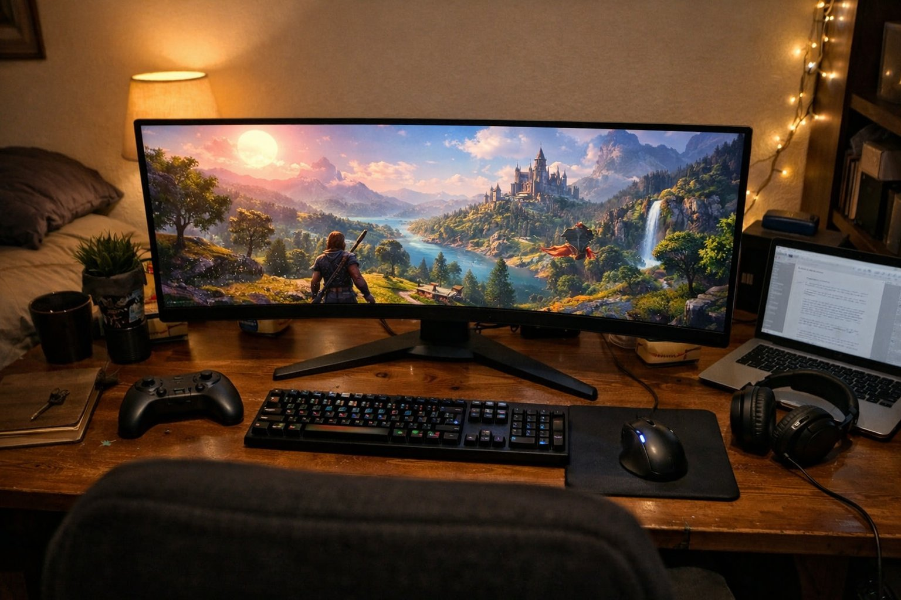

> 가상 예시 사용기입니다. 실제 구매자가 작성한 후기가 아닙니다.

8월 말에 들였으니 딱 3개월 됐어요. 혼자 사는 원룸이라 책상 하나에서 게임도 하고 영화도 봐요. 퇴근하고 RPG랑 MMO를 서너 시간 하고, 자기 전에 영상 좀 보는 게 하루 일과예요. 화면은 80cm쯤 떨어져서 보고, 방 조명은 그냥 평범한 형광등이에요.

목적은 하나였어요. 화면에 빨려 들어가는 느낌. 그거 하나 보고 샀는데 결과는 만족이에요. 원룸이라 책상 말고는 마땅히 영화 볼 데가 없어서, 게임 모니터 겸 영화관 역할까지 기대했거든요. 둘 다 기대만큼 해 주더라고요.

| 화면 | 주사율 | 패널 | 사용 기간 |
|---|---|---|---|
| 34인치 · 3440×1440 · 곡면 | 160Hz(DP) · HDMI 85~100Hz | VA · 5ms · 300nit | 3개월 · RPG·MMO, 영화 |

## 넓은 화면이 다 하더라고요

전에 쓰던 27인치 평면 모니터보다 옆으로 확 넓어요. MMO 할 때 왼쪽엔 채팅, 오른쪽엔 파티창을 띄워도 가운데 필드가 안 가려지더라고요. 오픈월드에서 말 타고 달릴 때는 진짜 풍경 속에 있는 느낌이에요. 영화도 좋아요. 가로로 긴 영화는 위아래 검은 띠가 거의 없어서 화면을 꽉 채워요. 주말 밤에 액션 영화 한 편 틀면 시간 가는 줄 몰라요.

곡면이 생각보다 중요하더라고요. 80cm에서 보면 양 끝이 살짝 안쪽으로 감겨 있어서 고개를 많이 안 돌려도 구석까지 눈에 들어와요. 색은 진한 편이에요. 저는 원래 진한 색을 좋아해서 기본 설정 그대로 써요. 밤에 던전 같은 어두운 장면에서도 검은색이 꽤 깊게 깔려요.

## 160Hz는 DP로 연결해야 나와요

처음엔 집에 굴러다니던 HDMI 선을 꽂았는데 주사율이 100Hz까지만 잡히더라고요. DP 선으로 바꾸고 나서야 160Hz가 떴어요. 꼭 DP로 연결하세요. 바꾸고 나니 시점 돌릴 때 화면이 훨씬 매끄러워요. 보스 패턴 피할 때 움직임이 덜 뭉개지는 게 느껴지더라고요.

밝기는 형광등 켠 방에서는 충분했어요. 대낮에 햇빛 드는 방이라면 조금 어둡게 느껴질 수도 있을 것 같아요.

## 아쉬운 건 받침 하나

받침이 넓어요. 책상 앞쪽까지 다리가 뻗어 나와서 키보드를 원래 자리보다 앞으로 당겨야 했어요. 제 책상은 깊이가 넉넉한 편인데도 그렇더라고요. 대신 높이 조절은 잘 돼요. 화면 가운데를 눈높이에 맞추니까 서너 시간 게임해도 목이 덜 뻐근하더라고요.

겉모습은 깔끔해요. 장식 없이 단순해서 원룸 책상에 올려 놔도 튀지 않고, 켜 놓으면 화면만 크게 떠 있는 느낌이에요.

정리하면 몰입감 보고 사는 분께는 추천해요. 책상 깊이만 미리 재 보세요.
