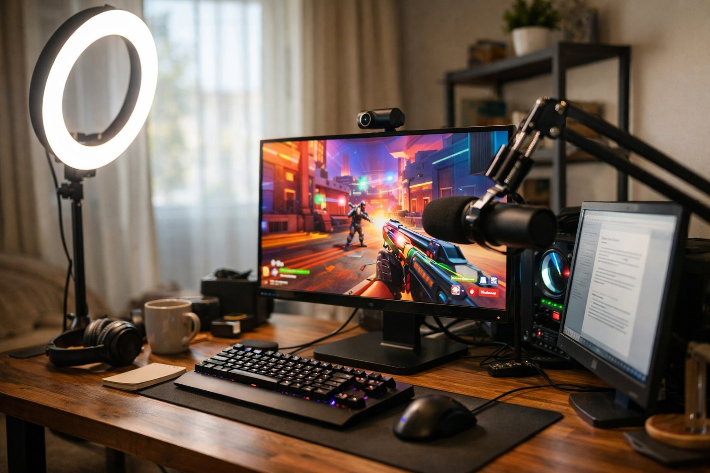

> 가상 예시 사용기입니다. 실제 구매자가 작성한 후기가 아닙니다.

저녁마다 게임 방송을 4시간 정도 켜는 사람이에요. 5월 초에 메인 모니터를 이걸로 바꿨으니 이제 석 달 됐네요. 방송 중엔 얼굴 조명을 켜 두기 때문에 방이 꽤 밝은 편이고, 화면과는 70cm쯤 떨어져 앉아요. 주로 하는 건 경쟁 FPS라 주사율이 제일 중요했어요. 방송하는 사람은 화면을 보면서 채팅도 읽고 송출 프로그램도 만져야 해서, 27인치에 QHD면 창을 이리저리 놓기에 딱 적당하더라고요.

| 화면 | 주사율 | 패널 | 사용 기간 |
|---|---|---|---|
| 27인치 · 2560×1440 | 165Hz(DP, USB-C) · HDMI 144Hz | IPS · 1ms · 300nit | 3개월 · 경쟁 게임 방송 |

## 색이 화사해서 게임 화면이 살아나요

처음 켜자마자 "어 색 진하다" 소리가 나왔어요. 전에 쓰던 24인치 FHD 게이밍 모니터는 좀 물 빠진 느낌이었는데, 이건 하늘이나 이펙트 색이 쨍하게 올라와요. 방송 보던 시청자 몇 분이 채팅으로 "화면 바꿨냐"고 물어볼 정도였어요. 물론 송출 화면은 모니터랑 상관없지만, 제가 보는 화면이 예쁘니까 리액션도 저절로 커지더라고요. 조명을 켜 둔 방에서도 300nit로 밝기가 모자란다는 느낌은 없었어요.

165Hz는 DP로 연결해서 쓰고 있어요. 교전 중에 시점을 휙 돌릴 때 화면이 끊기지 않고 따라와서 적 위치를 놓치는 일이 줄었어요. 랭크 판 할 때 확실히 손이 편해요. 콘솔을 HDMI로 물려서 잠깐 해 봤을 때는 144Hz까지였는데, 그것도 충분히 부드러웠어요. 그래도 PC 게임은 꼭 DP로 연결하는 걸 권해요.

## 설정은 프로그램으로 바로 바꿔요

방송 중에 모니터 뒤로 손을 뻗어 버튼을 찾는 게 은근히 번거로운데, 이건 PC에서 프로그램으로 밝기나 화면 모드를 바로 바꿀 수 있어요. 낮에 녹화할 땐 밝게, 밤 방송 땐 살짝 낮추는 식으로 마우스 몇 번이면 끝나요. 이 부분 때문에 다른 모델로 못 돌아갈 것 같아요.

디자인은 게이밍 모니터치고 얌전한 편이에요. 뒷모습이 과하지 않아서 방송 카메라 각도에 살짝 걸려도 지저분해 보이지 않아요.

## 아쉬운 점: 절전에서 깨어나는 시간

방송 쉬는 시간에 화장실이라도 다녀오는 사이 화면이 절전으로 넘어가면, 다시 켤 때 화면이 들어오기까지 10초쯤 걸려요. 처음엔 고장인 줄 알고 선을 다시 꽂았어요. 방송 재개하려고 기다리는 10초가 생각보다 길게 느껴져서, 요즘은 쉬는 시간에도 절전으로 안 넘어가게 설정을 바꿔 뒀어요. 시청자분들한테 "잠시만요, 화면이 안 켜져서" 하고 말하는 것도 몇 번 하다 보니 민망하더라고요.

방송을 하지 않고 게임만 하는 분이라면 이 대기 시간은 거의 신경 안 쓰일 수도 있을 것 같아요. 색 진한 걸 좋아하고 고주사율이 필요한 분께 추천해요.
