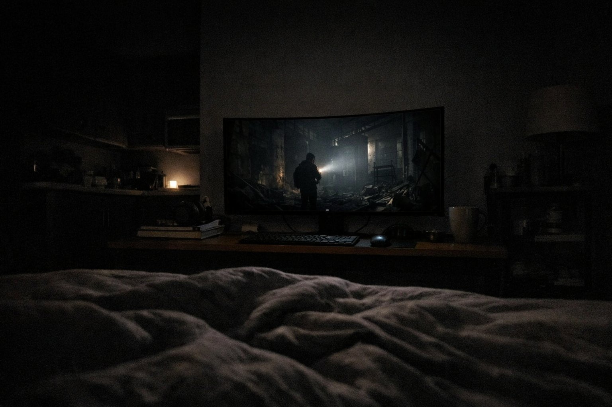

> 가상 예시 사용기입니다. 실제 구매자가 작성한 후기가 아닙니다.

불을 다 끄고 침대에 기대 앉으면, 1m 조금 넘는 거리에 이 화면이 떠 있어요. 원룸에 살면서 밤마다 영화나 드라마를 서너 시간씩 보는 게 하루의 마지막 일과인데, 6월 중순부터 그 시간을 이 모니터와 함께 보내고 있어요. 석 달이 지난 지금, 어두운 장면을 기다리게 됐다는 게 가장 큰 변화예요. 예전엔 무서워서 건너뛰던 밤 장면들을요.

| 화면 | 주사율 | 패널 | 사용 기간 |
|---|---|---|---|
| 31.6인치 · 3840×2160 · 곡면(1700R) | 240Hz | OLED · 0.03ms | 3개월 · 밤 영화·드라마 |

## 어둠이 정말 어둠으로 보여요

예전에 쓰던 27인치 모니터에서는 밤 장면이 늘 잿빛 안개 속 같았어요. 이 화면은 달랐어요. 한밤의 골목을 걷는 장면에서 가로등 불빛만 동그랗게 떠 있고, 그 바깥은 방의 어둠과 경계 없이 이어져요. 불 꺼진 방에서 보면 화면 테두리가 사라지고 장면만 공중에 걸린 느낌이 들어요.

우주 배경 영화를 봤을 때는 별 하나하나가 까만 바탕 위에 또렷이 박혀 있었어요. 촛불 하나만 켜진 방 장면에서는 얼굴 반쪽에 드리운 그림자가 뭉개지지 않고 결이 살아 있었고요. 색은 진한 편이라 노을이나 네온사인이 화면 밖으로 번져 나올 듯 짙게 올라와요.

1m 넘게 떨어져 있어도 화면이 작게 느껴지지 않아요. 곡면이 침대 쪽을 살짝 감싸 주는 모양이라 누워서 봐도 양 끝까지 편하게 들어와요.

## HDR 설정은 여전히 헷갈려요

HDR을 켜면 밝은 장면이 한층 눈부시게 살아나요. 문제는 설정 메뉴에 HDR 관련 선택지가 여러 개라는 거예요. 처음 몇 주는 어떤 걸 골라야 하는지 몰라서, 같은 영화를 틀어 놓고 하나씩 바꿔 보며 밤을 꼬박 새운 적도 있어요. 어떤 설정에서는 어두운 장면이 너무 가라앉고, 또 어떤 건 밝은 장면이 하얗게 날아가 버렸어요. 지금은 마음에 드는 조합을 하나 찾아서 그대로 두고 있어요. 그래도 가끔 HDR이 아닌 드라마로 넘어갈 때 화면이 갑자기 달라 보이면, 혹시 설정이 바뀐 건 아닌지 다시 메뉴를 열어 보게 돼요. 설명서를 찬찬히 읽었다면 덜 헤맸을 수도 있겠어요.

## 원룸의 작은 극장

벽이 얇아 소리는 작게 틀 수밖에 없는데, 그만큼 화면이 장면을 끌고 가 줘서 아쉬움이 덜했어요. 곡면 화면이 원룸 한쪽에 서 있으니, 불을 끄면 그 자리가 작은 극장처럼 느껴져요.

게임도 가끔 하는데 240Hz는 제 용도에선 크게 체감할 일이 없었어요. 대신 액션 영화의 빠른 추격 장면에서 화면이 끌리는 느낌 없이 깔끔하게 지나가는 건 좋았어요. 저처럼 어두운 방에서 영화를 주로 본다면 이 화면은 충분히 제 몫을 해 줄 거예요. 추천해요.
