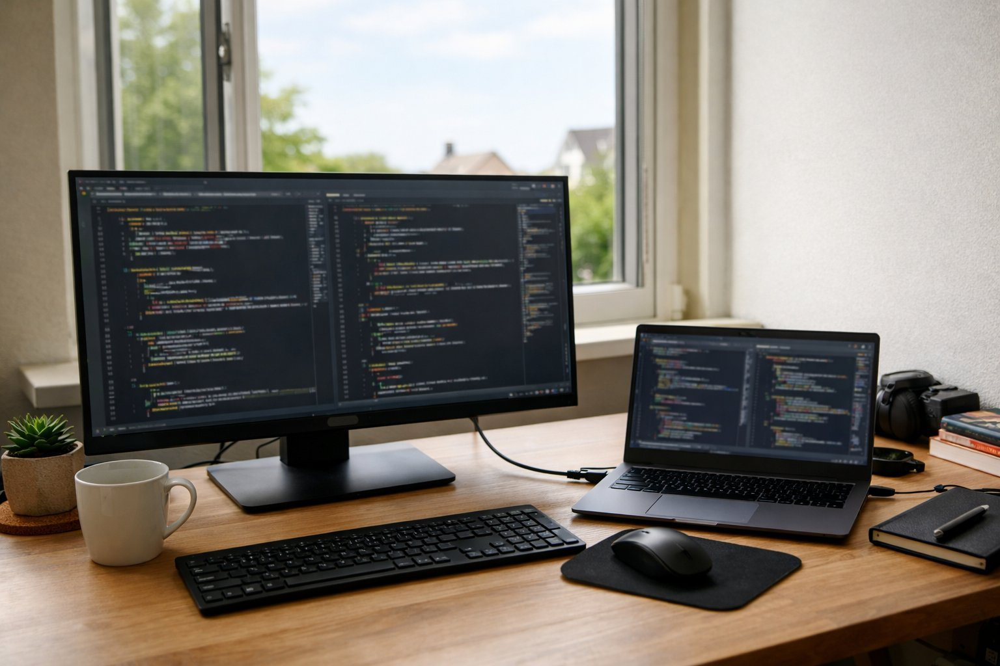

> 가상 예시 사용기입니다. 실제 구매자가 작성한 후기가 아닙니다.

개발 일을 하고, 하루 10시간 가까이 모니터 앞에 있습니다. 칸막이 없는 사무실 창가 자리라 낮에는 꽤 밝고, 화면과 눈 사이는 70cm 정도입니다. 회사 노트북을 꽂아 쓰는 용도로 6월 초부터 넉 달째 쓰고 있어 정리해 둡니다.

| 화면 | 주사율 | 패널 | 사용 기간 |
|---|---|---|---|
| 31.5인치 · 3840×2160 | 60Hz | IPS · 5ms · 250nit | 4개월 · 개발 |

## 글자가 또렷하고 눈이 덜 지칩니다

가장 체감이 큰 건 글자입니다. 에디터 글꼴을 작게 줄여도 획이 뭉개지지 않아서, 에디터 두 개와 터미널, 문서 창을 한 화면에 놓고 일합니다. 전에 쓰던 27인치 QHD 모니터보다 한 번에 보이는 코드 줄 수가 늘어서 파일을 오가며 스크롤하는 일이 줄었습니다. 코드 리뷰처럼 여러 파일을 번갈아 볼 때도 창을 겹치지 않고 나란히 둘 수 있어 편합니다.

눈도 편합니다. 저녁 8시쯤 긴 로그를 따라 읽고 있을 때 예전 같으면 눈이 뻑뻑해 쉬어야 했는데, 이 모니터로 바꾸고는 그런 날이 확실히 줄었습니다. 화면 반사가 적은 편이라 창가 빛이 비쳐도 글자를 읽는 데 방해가 거의 없었습니다. 밝기는 사무실 조명 아래에서 제 기준으로는 부족하지 않았습니다. 다만 흰 배경 문서를 오래 볼 때는 밝기를 오히려 조금 내려 두는 편이 편했습니다.

하루 10시간을 앉아 있으면 오후 늦게 눈이 먼저 지치는데, 요즘은 퇴근 무렵에도 코드 리뷰 코멘트를 끝까지 읽어 낼 여유가 남습니다. 작은 글자가 또렷하니 눈을 가늘게 뜨고 들여다보는 일이 줄어든 덕이라고 생각합니다.

## USB-C 선 하나로 끝납니다

출근해서 노트북에 USB-C 선 하나만 꽂으면 화면과 충전이 같이 됩니다. 어댑터를 따로 챙기지 않아도 돼서 책상 위 선이 하나 줄었고, 회의 갔다 돌아와서 다시 꽂는 것도 금방입니다. 조작 다이얼이 있어 밝기를 바꿀 때 뒤쪽 버튼을 더듬지 않아도 되는 점도 편했습니다. 화면이 반사를 잘 눌러 줘서 오후에 창으로 빛이 들어와도 코드 위에 창틀 그림자가 비치지 않았습니다.

## 처음 연결은 조금 번거로웠습니다

아쉬웠던 건 첫날입니다. 노트북을 USB-C로 꽂았는데 화면이 바로 넘어오지 않아서, 메뉴에 들어가 입력을 직접 USB-C로 골라야 했습니다. 한 번 맞춰 둔 뒤로는 다시 고를 일이 없었지만, 처음 받은 사람은 고장인가 싶을 수 있습니다. 노트북 기종에 따라서는 이 과정이 더 길어질 수도 있겠습니다.

생김새는 장식 없이 수수해서 사무실 책상에 잘 어울립니다. 글자 선명도와 눈 편함, 선 하나 연결이 필요한 개발자라면 추천합니다.
