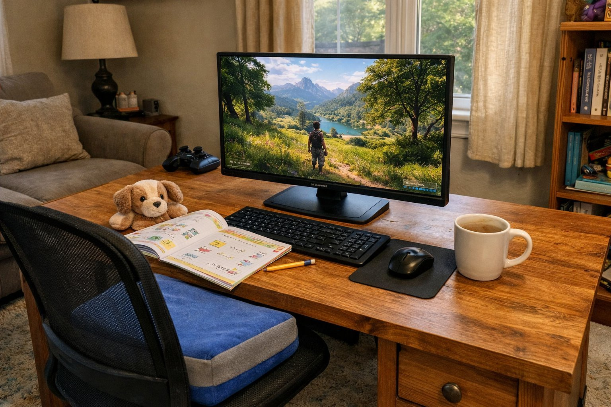

> 가상 예시 사용기입니다. 실제 구매자가 작성한 후기가 아닙니다.

4월 초에 바꾸고 석 달이 지났어요. 아이가 먼저 쓰고, 저녁에는 어른이 이어서 쓰는 식이라 의자에 앉는 사람이 하루에도 몇 번씩 바뀌어요. 하루에 켜 두는 시간은 여럿이 나눠 쓰다 보니 합치면 4~5시간쯤 되는 것 같아요. 좋았던 점이랑 아쉬운 점이 확실해서 정리해 봐요.

| 화면 | 주사율 | 패널 | 사용 기간 |
|---|---|---|---|
| 27인치 · 2560×1440 | 165Hz | IPS · 2ms · 250nit | 3개월 |

## 높이를 맞출 수 있는 게 제일 좋아요

이 모니터를 쓰면서 가장 만족한 건 스탠드예요. 아이와 어른이 번갈아 앉는데, 아이가 앉을 때는 화면을 쭉 내리고 어른이 앉을 때는 다시 올리면 돼요. 내렸다 올리는 데 몇 초면 끝나서, 번갈아 쓰는 게 전혀 귀찮지 않아요. 높이를 바꾸는 것도 손으로 잡고 밀면 부드럽게 움직여서 아이 혼자서도 해요. 화면을 좌우로 살짝 돌릴 수도 있어서, 옆에 앉은 사람 쪽으로 틀어 같이 보기도 해요. 전에 쓰던 높이 고정 모니터는 아이가 고개를 들고 봐야 해서 의자에 쿠션을 두 개씩 깔았는데, 이제 그럴 필요가 없어졌어요. 기울기도 조금씩 바꿀 수 있어서 키가 다른 사람끼리도 각자 편한 각도를 금방 찾아요.

## 화면은 선명하고 움직임도 부드러워요

글자가 또렷해서 아이가 화면 속 작은 글씨를 읽을 때도 얼굴을 들이밀지 않아요. 주말 저녁에 아이랑 같이 가벼운 게임을 할 때는 화면이 매끄럽게 움직여서 아이가 더 재미있어하더라고요. 밝기 정도는 아이도 따라 바꿀 수 있어요.

생김새는 수수한 편이라 어디에 둬도 튀지 않아요. 뒷면이 깔끔해서 뒤쪽이 보이는 자리에 놓아도 지저분해 보이지 않더라고요. 27인치라 둘이 나란히 앉아 같은 화면을 봐도 좁지 않았어요.

## 낮에는 좀 어둡게 느껴져요

아쉬운 건 밝기예요. 낮에는 화면이 어둡게 느껴져서 밝기를 끝까지 올려 두고 써요. 특히 낮에 영상을 틀면 어두운 장면에서 인물 얼굴이 잘 안 보여서 몇 번이나 일시정지하고 화면에 다가가 봤어요. 낮에 아이가 쓸 때도 밝기를 끝까지 올려 줘야 해서, 그때마다 조금 아쉬웠어요. 저녁이 되면 밝기를 낮춰도 충분해서 그때는 불만이 없어요. 오히려 저녁에는 밝기를 절반쯤으로 내려야 눈이 편할 정도예요. 해가 잘 안 드는 곳에 둔다면 낮에도 크게 신경 쓰이지 않을 수 있어요.

정리하면 높이 조절 덕분에 여럿이 같이 쓰기에는 정말 편한데, 낮 밝기는 놓을 자리를 보고 판단하시면 좋겠어요. 제 기준으로는 조건부 추천이에요. 낮보다 저녁에 쓰는 시간이 많다면 아쉬움은 훨씬 줄어들 거예요.
