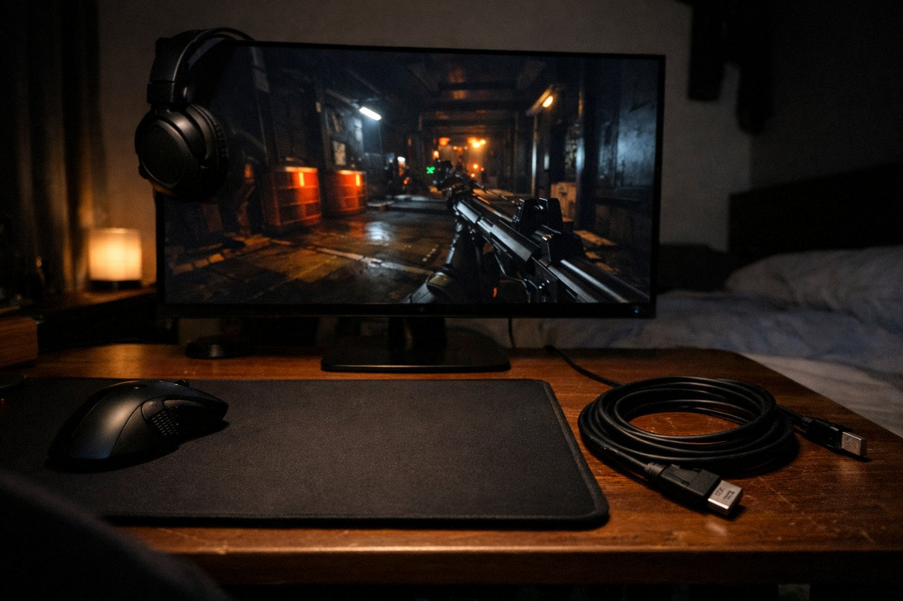

> 가상 예시 사용기입니다. 실제 구매자가 작성한 후기가 아닙니다.

FPS만 하루 3~4시간 해요. 불 끄고 헤드셋 쓰고 혼자 하는 방이고, 화면이랑 눈 사이는 60cm로 붙여 앉아요. 7월 초에 바꿔서 두 달 됐는데, 결론부터 말하면 경쟁 게임용으로는 지금까지 써 본 것 중 제일이에요.

| 화면 | 주사율 | 패널 | 사용 기간 |
|---|---|---|---|
| 26.5인치 · 2560×1440 | 240Hz | OLED · 0.03ms · 275nit | 2개월 · FPS 위주 |

## 240Hz에 잔상이 없어요

전에 쓰던 27인치 IPS 165Hz 모니터랑 비교하면 차이가 바로 보여요. 교전 중에 좌우로 플릭할 때 적 실루엣이 끌리지 않고 딱딱 끊어져서 찍혀요. 이전 모니터는 빠르게 돌면 윤곽에 꼬리가 남아서 에임을 한 박자 늦게 얹는 느낌이었는데, 이건 화면이 손을 바로 따라와요. 프레임이 240 근처로 꾸준히 나오는 게임에서는 트래킹이 확실히 편해졌어요.

어두운 방이라 OLED 검은색이 특히 커요. 그림자 진 구석에 숨은 적이 회색으로 뭉개지지 않고 배경과 갈려서 보여요. 밤에 불 다 끄고 해도 검은 부분이 들뜨지 않아서 눈이 덜 피곤했어요. 연막 속에서 움직이는 실루엣도 대비가 살아 있어서 한 번 더 확인하고 쏠 수 있었어요. 밝기는 이 방 기준으로 남아요. 그래서 밝기는 중간 정도로 내려 두고 해요.

## 처음 케이블로는 깜빡였어요

아쉬웠던 건 첫 주예요. 집에 있던 DP 케이블을 그대로 꽂고 240Hz로 올렸더니, 랭크 한 판 도중에 화면이 순간 꺼졌다 켜지는 게 몇 번 있었어요. 모니터 불량인가 싶었는데 케이블을 새로 바꾸니까 그 뒤로는 한 번도 안 깜빡였어요. 오래된 케이블을 그대로 쓰는 분이라면 같은 증상을 겪을 수 있어요. 바로 의심해 보는 게 시간 아끼는 길이에요.

처음 받자마자 240Hz가 제대로 나오는지 보려면 윈도우 디스플레이 설정에서 주사율이 240으로 잡혔는지부터 확인하는 게 좋아요. 저도 첫날엔 60으로 잡혀 있어서 왜 이렇게 끈적하지 했었거든요. 설정 바꾸고 케이블까지 새로 꽂은 뒤에야 제대로 된 화면을 봤어요.

## 크기와 생김새

26.5인치라 60cm 거리에서 미니맵이랑 킬로그가 고개 안 돌리고 한눈에 들어와요. 경쟁 게임에는 이 크기가 딱 맞아요. 이보다 커지면 구석 정보를 놓칠 것 같아서 일부러 이 크기를 골랐는데, 그 판단은 맞았어요. 베젤이 얇고 뒷면이 날렵하게 빠져서 책상 위가 깔끔해 보이고요.

케이블만 제대로 쓰면 240Hz, 잔상, 검은색 셋 다 만족이에요. 어두운 방에서 FPS 하는 사람한테는 추천이에요. 케이블은 꼭 새로 챙기세요.
