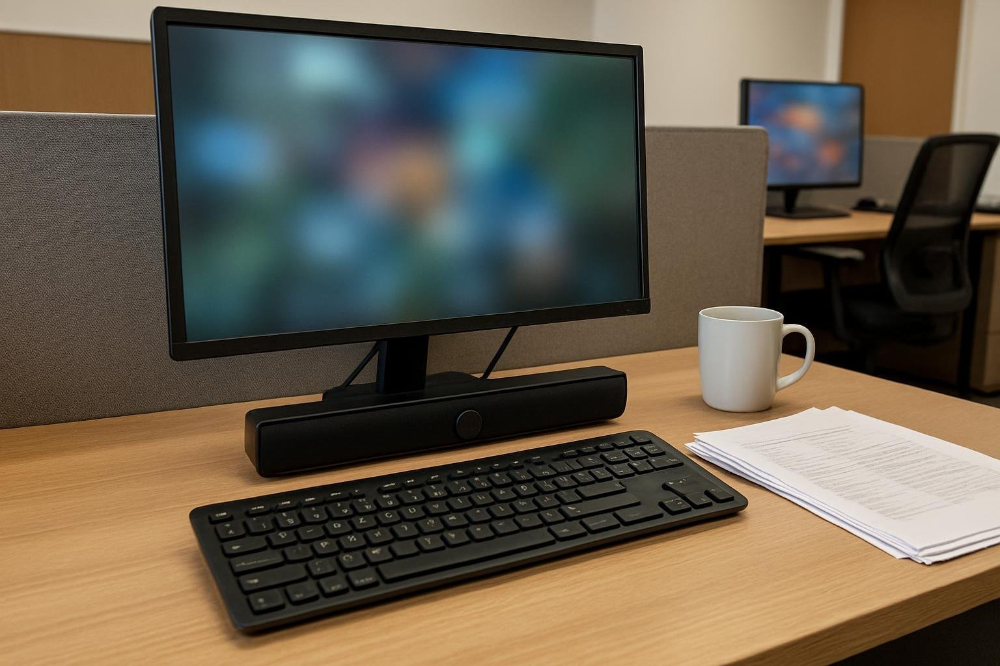

칸막이 하나 사이로 옆자리가 붙어 있는 공유 사무실에서 쓰고 있습니다. 하루 종일 엑셀과 문서 작업을 하고, 스피커로 듣는 건 메신저 알림과 하루 한두 번 있는 화상 통화가 거의 전부라 소리는 정말 작게 틀어 둡니다. 모니터 아래에 들어갈 작은 제품을 찾다가 11월 하순에 BA-R9을 골랐고, 한 달 정도 사용했습니다. 업무용 기준으로 적어 보겠습니다.

| 형태 | 출력 | 연결 · 전원 | 사용 기간 |
|---|---|---|---|
| 사운드바 · 2채널 | 6W (3W×2) | 3.5mm · USB 전원 | 1개월 · 알림·화상 통화 |

## 1. 소리

업무용으로는 부족함이 없었습니다. 볼륨을 거의 최소로 둬도 알림음은 제 자리에서 들리고, 옆자리까지는 크게 퍼지지 않는 것 같습니다. 예전에는 모니터 내장 스피커로 버텼는데, 그때보다 통화 목소리를 알아듣기가 훨씬 쉬워졌습니다.

거래처와 통화하면서 엑셀 화면을 공유하는 날이 많은데, 숫자를 하나씩 불러 주는 대목에서도 다시 여쭤본 적이 없습니다. 말이 빠른 담당자분과 통화할 때도 문장 끝이 흐려지지 않아 받아 적기 편했습니다. 월말 마감 주에는 하루에 서너 번씩 통화가 있었는데, 그 주에도 이어폰을 꺼낸 적이 없습니다. 통화가 끝나고 옆자리 분께 혹시 소리가 넘어가지 않았는지 여쭤봤더니, 통화 중인 줄도 모르셨다고 합니다.

## 2. 다이얼

개인적으로는 제일 자주 손이 가는 부분입니다. 통화가 시작되면 살짝 올리고, 끝나면 다시 내립니다. 손이 작은 편인데 손끝으로 돌리기 알맞은 크기라 숫자 입력하다가 흐름이 끊기지 않습니다. 프로그램 창을 열어 볼륨을 조절하던 때보다 훨씬 빠릅니다. 다이얼이 부드럽게 돌아가서 조용한 사무실에서 조작하는 소리가 나지 않는 점도 마음에 듭니다.

생긴 것도 군더더기 없는 막대형이라 사무실 책상에서 눈에 띄지 않는 편입니다.

## 3. 잡음

아쉬운 점은 하나입니다. 사무실이 유난히 조용한 아침이나 다들 집중하고 있을 때, 아무것도 재생하지 않는데 스피커 쪽에서 아주 약한 잡음이 들립니다. 처음에는 제 귀가 예민한 건가 싶어 옆자리 동료분께 확인을 부탁드렸는데, 귀를 대 보시더니 들린다고 하셨습니다. 다른 USB 포트에도 옮겨 꽂아 봤지만 크게 달라지지 않았습니다.

귀를 가까이 대야 알 정도이긴 합니다. 다만 한 번 의식하면 계속 신경이 쓰여서, 자리를 오래 비울 때는 볼륨을 끝까지 내려 둡니다. 집에서 썼다면 생활 소음에 묻혀 몰랐을지도 모르겠습니다.

알림과 통화용으로는 한 달 동안 이것 하나로 충분했습니다. 개인적으로는 아침의 잡음만 아니었으면 아쉬운 점이 없었을 것 같습니다. 비슷한 환경에서 고민하시는 분께 참고가 되면 좋겠습니다.
