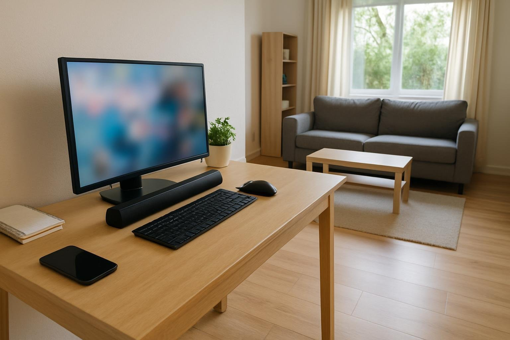

결론부터 말하면 저희 집 거실에는 작았네요. 거실 한쪽에 PC를 두고 저녁마다 두세 시간씩 영화나 음악을 틀어 놓는데, 공간이 넓다 보니 소리를 크게 키워야 하는 편이에요. 설치 간단한 걸로 찾다가 BA-R9을 들였고, 딱 일주일 쓰고 다른 제품을 알아보는 중이에요.

| 형태 | 출력 | 연결 · 전원 | 사용 기간 |
|---|---|---|---|
| 사운드바 · 2채널 | 6W (3W×2) | 3.5mm · USB 전원 | 1주 · 영화·음악 |

## 좋았던 점

설치는 정말 쉬워요. 상자가 작아서 퇴근길에 한 손으로 들고 왔고, 3.5mm 선이랑 USB 선만 PC에 꽂으면 끝이라 5분도 안 걸렸네요. 설명서는 펼쳐 보지도 않았어요. 막대 하나라 모니터 앞에 놓기만 하면 돼서 선 정리도 금방 끝났고요. 디자인도 단순해서 거실 가구 사이에 둬도 튀지 않았어요. 높이가 낮아서 모니터 앞에 둬도 화면을 가리지 않았고요.

받은 날 책상 앞에 앉아서 유튜브랑 게임 소리를 들어 봤을 때는 말소리도 또박또박 들리고 괜찮았어요. 그날 저녁까지만 해도 잘 샀다 싶었죠.

## 아쉬웠던 점

문제는 제가 실제로 듣는 자리가 책상이 아니라 소파라는 거였어요. 저녁에 영화를 틀고 소파로 옮겨 앉으면 소리가 책상 근처에서 맴돌고 거실까지 안 와요. 작은 사운드바라 어느 정도 각오는 했는데 그보다도 작았네요. 원래 거실에 두던 북셸프 스피커는 볼륨 절반이면 방이 울렸는데, 이건 거의 끝까지 올려야 비슷해져요. 일주일 내내 볼륨을 끝에 고정해 놓고 쓴 것 같아요.

그렇게 올리면 이번엔 소리가 먹먹해져요. 보컬은 앞으로 나오는데 심벌이나 현악기 같은 높은 소리가 묻혀서 답답하고, 주말에 본 액션 영화에서는 폭발 장면에서 대사랑 효과음이 한데 뭉쳐 버렸어요. 토요일 낮에 청소기 돌리면서 음악을 틀어 놨을 때는 청소기 소리에 완전히 묻혔고요. 예능을 틀어 둘 때도 웃음소리랑 배경 음악에 진행자 말이 섞여서, 소파에서는 무슨 말인지 놓치는 일이 잦았어요. 가족들도 소리가 작다고 한마디씩 하더라고요.

## 정리

지금은 다시 북셸프 스피커를 꺼내 놓고, 이건 상자에 넣어 둔 상태예요. 설치 편한 것 하나만 보고 고른 게 실수였네요, 하하. 반품하기엔 아까워서 나중에 작은 방 책상에 둘까 생각 중이에요.

책상에 바짝 붙어 앉아 작게 듣는 용도였다면 불만이 없었을 것 같아요. 넓은 거실에서 크게 트는 저한테는 쓰임새가 안 맞았고, 거실용이면 출력 큰 쪽을 보시는 게 나아요.
