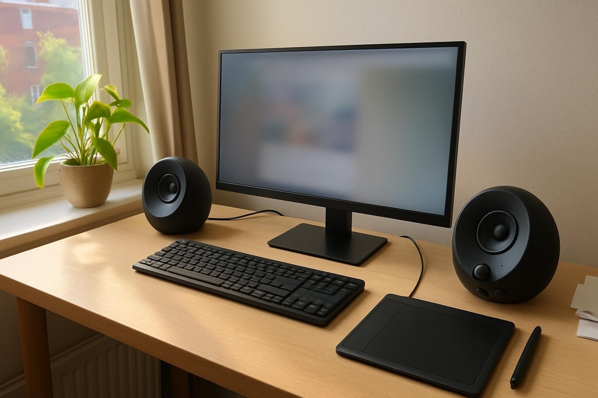

창가 책상에서 쓰려고 5월 말에 PEBBLE V3를 들였고, 두 달쯤 됐습니다. 낮에는 문서랑 이미지 편집을 하면서 음악을 보통 음량으로 틀어 두고, 저녁엔 발로란트를 조금 합니다(혼자 쓰는 방이라 소리 크기는 크게 신경 쓰지 않습니다). 모니터 스피커로만 버티다가 처음 산 PC 스피커라 기대 반 걱정 반이었습니다.

| 형태 | 출력 | 연결 · 전원 | 사용 기간 |
|---|---|---|---|
| 새틀라이트 · 2채널 | 8W | USB · 3.5mm · 블루투스 / USB 전원 | 2개월 · 작업 중 음악 |

## 소리

책상 양 끝에 하나씩 두고, 제 자리 쪽으로 살짝 안쪽으로 돌려 놓았습니다(정면으로 두는 것보다 보컬이 가운데로 모입니다). 앉은 자리에서 들으면 보컬이 흐려지지 않고, 보정 작업 중에 강의 영상을 켜도 말이 또박또박 들립니다. 크기만 보고 가벼운 소리를 예상했는데, 막상 들어 보니 꽤 단단했습니다. 모니터 내장 스피커만 쓰던 때와 비교하면 소리가 어디서 나오는지 분명해서 훨씬 듣기 편합니다.

작업할 때는 같은 플레이리스트를 몇 시간씩 반복해 틀어 두는 날이 많은데, 귀가 쉽게 지치지 않았습니다. 오후에 창문을 열어 두면 바깥 차 소리가 꽤 들어오는데, 그때도 노래가 묻히지 않았습니다. 참고로 처음 일주일은 신기해서 예전에 즐겨 듣던 앨범을 처음부터 다시 돌려 듣기도 했습니다. 주말 오후엔 라디오 앱을 틀어 두는데, 진행자 목소리도 편하게 들립니다.

## 설치와 디자인

USB 선 하나로 전원과 소리가 한 번에 해결돼서 책상 뒤에 어댑터가 늘지 않았습니다. 상자를 열고 책상에 올려 소리가 나기까지 10분도 안 걸렸습니다(그중 절반은 포장 비닐 벗기는 시간이었습니다). 햇빛이 잘 드는 창가 책상에 동그란 스피커 두 개만 올라가 있으니 방 분위기와도 잘 어울립니다. 책상을 닦을 때 한 손으로 들어 옮길 수 있을 만큼 가벼운 것도 편합니다. 친구가 놀러 왔다가 장식품인 줄 알았다고 해서 웃었습니다.

## 저음 설정

처음에 욕심을 내서 저음을 더 키웠다가, 남자 보컬이나 낮은 목소리가 저음에 묻혔습니다. 원래도 저음이 약간 강조된 편이라 그렇습니다. 저녁에 발로란트를 할 때도 발소리보다 배경 울림이 먼저 들려서 거슬렸고, 결국 설정에서 저음을 다시 내리고 나서야 목소리와 효과음이 갈렸습니다. 기본값 그대로 썼다면 아마 몰랐을 문제입니다. 지금은 저음을 기본값보다 한 칸 낮춰 두고 씁니다(이퀄라이저 기준). 작업할 때도 게임할 때도 이 상태가 제일 무난했습니다.

두 달 동안 크기 때문에 아쉬웠던 적은 없었습니다. 저음만 과하게 올리지 않는다면 가까이 두고 듣기 좋은 스피커입니다(혼자 쓰는 작은 방 기준).
