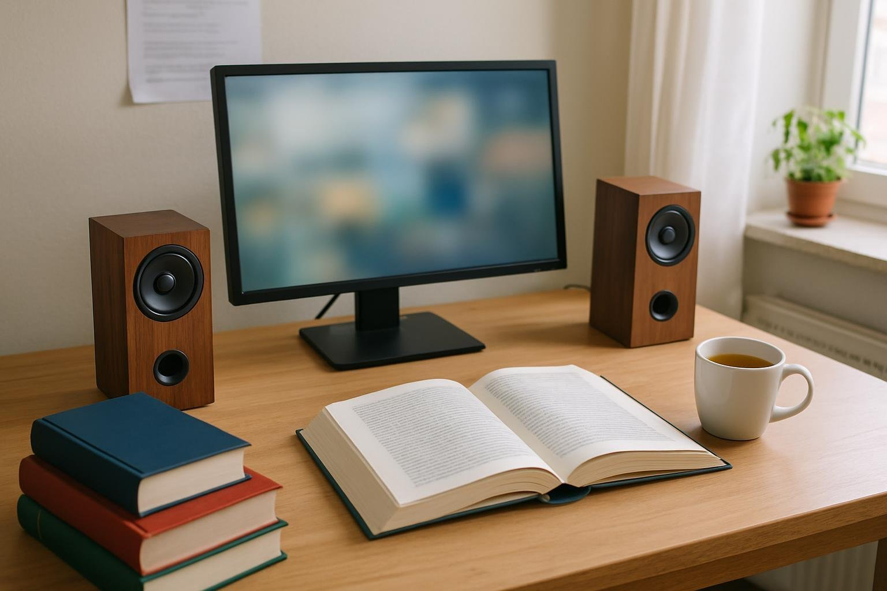

긴 글을 붙잡고 있으면 적막이 오히려 집중을 깨서, 작업 내내 잔잔한 음악을 틀어 둡니다. 혼자 쓰는 작업실에서 하루 대부분을 번역과 문서 작성으로 보내고, 음량은 늘 보통으로 맞춥니다. 1월 초에 Z2100 Pinacle 2를 들여 두 달 정도 썼습니다. 낮에는 방이 밝은 편이라 책상 위 물건이 눈에 잘 띄는데, 그래서 겉모습도 조금은 따지는 편입니다.

| 형태 | 출력 | 연결 · 전원 | 사용 기간 |
|---|---|---|---|
| 북셸프 · 2채널 | 5W (2.5W×2) | 3.5mm · USB 전원 | 2개월 · 작업 중 음악 |

## 소리의 결

중저음 쪽에 무게가 실려 있어서 소리가 날카롭지 않고 따뜻합니다. 피아노나 첼로가 중심인 곡을 틀어 두면 배경에 은은하게 깔려서, 문장을 고르는 동안 거슬리지 않습니다. 이전 스피커도 깨끗하고 듣기 편했지만 저음이 가벼워서 첼로의 울림이 얇게 들렸는데, 이 스피커는 그 울림이 채워집니다.

번역은 한 문장을 몇 번씩 고쳐 쓰는 일이라 배경 소리가 조금만 신경을 건드려도 흐름이 끊깁니다. 이 스피커는 보통 음량에서 소리가 한 걸음 물러나 있어서, 음악이 있다는 걸 잊고 일하게 됩니다. 마감을 앞둔 늦은 오후에도 음악을 끄지 않고 그대로 두었고, 오히려 그 덕에 마지막 교정까지 집중이 이어졌습니다.

요즘은 클래식 기타 연주 앨범을 자주 트는데, 줄을 튕기는 소리가 차갑지 않게 들려서 오래 들어도 편합니다.

## 오래 켜 둘 때

오전에 원고를 넘기고 오후에 교정을 볼 때까지 거의 쉬지 않고 켜 두는데, 귀가 지친 적이 없습니다. 점심을 먹고 돌아와서 다시 앉을 때도 볼륨을 만질 일이 없었습니다. 원고가 막힐 때는 잠깐 볼륨을 올려 한 곡을 제대로 듣고 다시 내리는데, 그 정도 쉬는 용도로도 충분합니다.

목재 상자 겉면이 차분해서 책상 위에서 장난감처럼 보이지 않고, 세로로 길쭉해 모니터 양옆에 세워도 자리를 많이 차지하지 않습니다. 사전과 원서를 펼쳐 둘 자리가 그대로 남은 게 다행이었습니다. USB 전원이라 PC와 같이 켜지는 것도 편합니다.

## 음량의 한계

주말에 좋아하는 앨범을 제대로 들어 보려고 볼륨을 올렸더니 금방 한계에 닿았습니다. 그 이상은 커지기보다 답답하게 뭉칩니다. 그날은 결국 헤드폰을 꺼내서 마저 들었습니다. 보통 음량의 작업 배경음으로는 전혀 문제가 없지만, 큰 소리로 음악을 즐기는 사람에게는 출력이 모자랄 듯합니다.

책상에 오래 앉아 음악을 곁들이는 용도라면 권할 만합니다.
