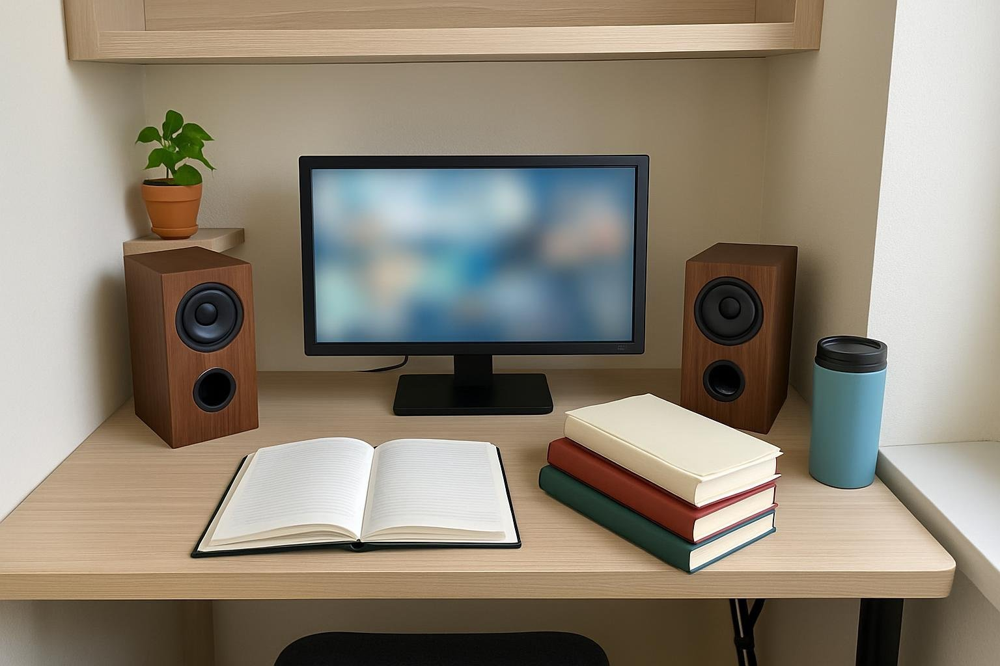

3월에 개강하면서 책상 양옆에 세울 스피커로 Z2100 Pinacle 2 골랐어요. 한 달 정도 썼어요. 기숙사 2인실이라 소리는 늘 작게 틀고, 과제하면서 강의 듣거나 저녁에 롤 하면서 하루 서너 시간은 켜 둬요. 책상이 좁아서 모니터 옆 자리가 별로 없는데, 세로로 긴 스피커면 들어가겠다 싶었어요. 용돈 모아서 사는 거라 장바구니에 넣었다 뺐다 진짜 오래 고민했어요ㅋㅋ

| 형태 | 출력 | 연결 · 전원 | 사용 기간 |
|---|---|---|---|
| 북셸프 · 2채널 | 5W (2.5W×2) | 3.5mm · USB 전원 | 1개월 · 과제·롤 |

## 소리

크게 틀 일이 없어서 출력은 오히려 남아요. 밤에 룸메가 공부할 때 볼륨을 한참 낮춰도 강의 목소리 잘 들리고, 소리가 부드러워서 작게 틀어도 귀에 날카롭게 안 꽂혀요. 원래 쓰던 막대형 사운드바는 소리가 가운데 몰려서 좀 납작했는데, 이건 같은 작은 볼륨에서도 더 둥글게 들려요.

룸메한테 소리 거슬리냐고 물어봤더니 자기 자리에선 거의 안 들린대요. 저녁에 롤 할 때도 볼륨 안 올리고 스킬 소리랑 핑 소리 구분 다 됐어요. 중간고사 땐 새벽까지 강의 돌려 봤는데 그때도 작게 틀어 놓고 문제없었고요. 공강 때 룸메가 낮잠 자면 볼륨만 좀 더 내리고 유튜브 봤어요ㅋㅋ 과제 마감 전날 밤엔 로파이 작게 틀어 놓고 버티는데, 그 정도면 룸메도 전혀 신경 안 쓰는 눈치예요.

## 자리

세로로 길쭉해서 바닥 면적을 적게 먹어요. 모니터 양옆에 하나씩 세웠는데 키보드랑 노트 펼칠 자리는 그대로 남았어요. 나무 느낌 나는 상자라 플라스틱 스피커보다 단정해 보이고, 휑하던 기숙사 책상이 좀 사람 사는 책상 같아졌어요ㅋㅋ 무게도 꽤 있어서 책 꺼내다 팔이 스쳐도 안 밀려요. 처음엔 모니터 뒤에 숨기듯 놨는데 소리가 모니터에 막히는 것 같아서, 앞으로 조금 빼고 제 쪽으로 살짝 돌렸더니 훨씬 잘 들렸어요. 룸메도 나무 상자라 예쁘다고 했고요.

## 아쉬운 점

선이 너무 많아요ㅠㅠ 소리 선, 전원 선, 양쪽 스피커 잇는 선까지 나와서 좁은 책상 뒤가 금방 엉켰어요. 처음 며칠은 모니터 받침 뒤에서 꼬여 있다가, 결국 케이블 타이 사 와서 책상 다리 쪽으로 묶어 내렸어요. 30분 정도 걸렸고 그 뒤론 괜찮아요. 정리하고 나니까 책상 밑에 떨어진 펜 찾을 때 선에 손 안 걸리는 것도 좋더라고요. 책상이 넓었으면 이렇게까지 신경 쓰이진 않았을 거예요.

좁은 책상에서 작게 쓸 거면 추천해요. 선 정리할 시간만 따로 잡아 두세요!
