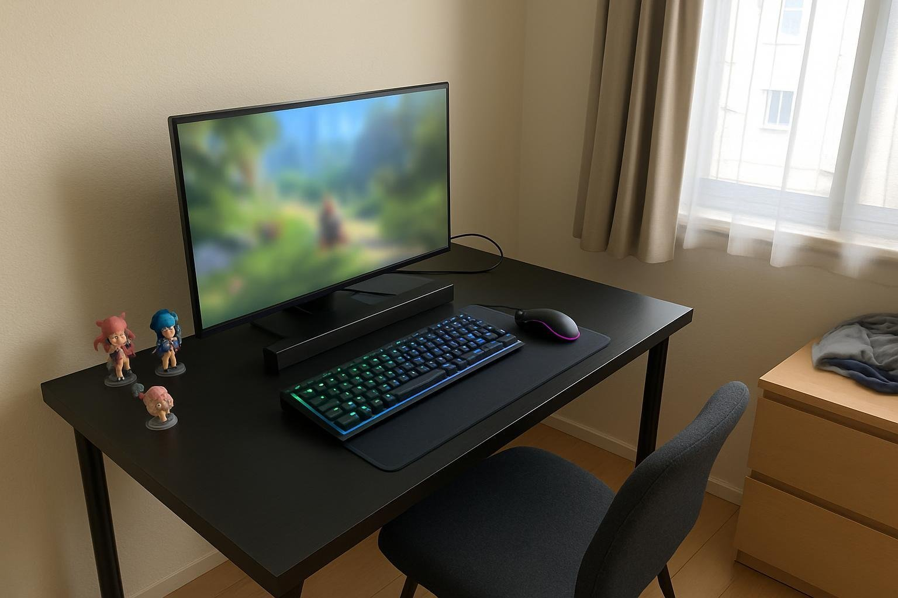

북셸프 스피커가 책상을 너무 차지해서 5월 말에 Leviathan V2 X로 바꿨고, 석 달 정도 썼어요. 혼자 사는 원룸에서 퇴근 후 로아를 서너 시간씩 하고, 쉬는 날엔 영상도 많이 봐요. 혼자라 소리는 크게 틀고, 의자를 뒤로 빼고 좀 떨어져 앉아요. 북셸프가 책상 양옆을 다 차지해서 키보드 놓을 자리가 늘 부족했거든요. 사운드바는 처음이라 저음이 아쉬울까 걱정했는데, 결론은 기우였습니다!

| 형태 | 출력 | 연결 | 사용 기간 |
|---|---|---|---|
| 사운드바 · 2채널 | 65W | USB · 블루투스 | 3개월 · RPG·영상 |

## 좋았던 거

음량 진짜 넉넉해요. 레이드에서 스킬 이펙트가 한꺼번에 터져도 볼륨에 여유가 남고, 떨어져 앉아 크게 들어도 끝까지 올릴 일이 거의 없어요. 쓰던 북셸프는 크기만 컸지 끝까지 올려도 소리가 책상 앞에서 멈췄는데, 이건 원룸 전체가 울려요. 주말에 친구들 놀러 와서 같이 영상 볼 때도 다들 잘 들린다고 하더라고요. 소파가 없어서 침대에 걸터앉아 볼 때도 소리 충분히 오고요. 레이드 공략 영상 틀어 두고 패턴 공부할 때도 설명 목소리가 저음에 안 묻혔고, 볼륨 크게 올려도 소리 찢어지는 거 없었어요.

저음도 확실해요. 보스가 바닥 내리찍을 때 쿵 하는 울림이 제대로 와요. 칼 부딪히는 소리가 가볍게 지나가던 예전이랑 달리, 지금은 타격감이 살아 있어요. 필드 사냥처럼 반복되는 구간도 소리가 풍성하니까 덜 지루하고요. 레이드 클리어하고 나오는 브금이 이렇게 웅장했나 싶었어요. 디코로 같이 레이드 뛰던 친구가 마이크 너머로 넘어간 브금을 듣고 스피커 뭐 쓰냐고 물어볼 정도였어요ㅎㅎ

검은 막대 하나라 생긴 것도 단순하고, 모니터 아래 두니 책상이 정리돼 보여요. 북셸프 치운 자리엔 굿즈를 올려 놨습니다.

## 아쉬운 거

3.5mm 단자가 없어요. 예전에 쓰던 3.5mm 선을 그대로 꽂으려다가 꽂을 데가 없어서 당황했어요. PC는 USB로 연결하면 되니 상관없는데, 콘솔이나 오래된 기기를 선으로 물리려던 계획은 접었어요. 옛날 콘솔 꺼내서 친구들이랑 레트로 게임 하려던 날은 결국 TV 스피커로 했고요. 블루투스 없는 오래된 기기는 방법이 없어서 그건 좀 아쉬웠고, 그 선은 서랍행입니다.

## 한 줄 정리

석 달 동안 레이드 날마다 덕 봤어요. 옆집이랑 벽이 얇은 곳이면 이 저음 때문에 밤마다 눈치 볼 것 같긴 한데, 원룸에서 혼자 크게 틀 거면 확실히 추천! 다음에 이사 가더라도 이건 그대로 들고 갈 거예요.
