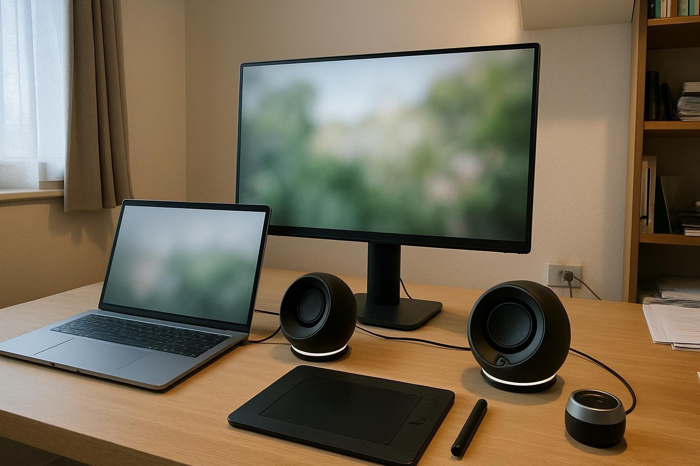

맥북 내장 스피커로는 영상에 깔 음악을 고르기가 어려워서 12월 말에 PEBBLE PRO를 들였어요. 두 달가량 썼어요. 조용한 작업실에서 맥북을 연결해 낮 내내 사진과 영상 편집을 하는데, 그동안 음악을 보통 음량으로 틀어 두고 스피커는 가까이 두는 편이에요. 색을 보는 일이라 방 조명은 낮춰 둬요. 작업실 책상엔 장비가 많아서, 작으면서도 소리가 고른 스피커가 필요했어요.

| 형태 | 출력 | 연결 · 전원 | 사용 기간 |
|---|---|---|---|
| 새틀라이트 · 2채널 | 10W | 3.5mm · USB · 블루투스 / USB 전원 | 2개월 · 작업 중 음악 |

## 소리 균형

저음, 중음, 고음 어느 한쪽이 튀지 않고 고르게 나와요. 색으로 치면 채도를 과하게 올리지 않은 사진 같달까요. 영상에 깔 배경 음악을 고를 때도, 이 스피커로 들은 느낌과 나중에 다른 기기로 들은 느낌이 크게 다르지 않았어요. 맥북 내장 스피커는 저음이 거의 없어서 음악 고를 때마다 판단이 흐려졌는데, 그 문제가 많이 줄었어요. 클라이언트에게 시안을 보내기 전에 음악 크기를 한 번 더 확인하는 습관이 있는데, 그 확인이 훨씬 수월해졌고요. 광고 영상 작업에서는 내레이션과 배경 음악의 크기 비율을 맞추는 일이 많은데, 둘 중 하나가 묻히지 않고 들려서 손이 덜 갔어요.

보정하는 동안 같은 앨범을 반복해서 틀어 두는 일이 많은데, 소리가 한쪽으로 치우치지 않으니 오래 들어도 피로가 적어요. 효과음 크기를 맞출 때도 판단이 한결 쉬워졌어요.

## 가까이서 들을 때

귀와 가까운 거리에 두고 들으면 악기가 하나씩 나뉘어요. 저녁에 작업을 마치고 재즈를 틀면 피아노, 베이스, 드럼이 겹치지 않고 각자 자리에서 들려요. 레이어 정리가 잘된 작업 파일을 여는 기분이랄까요. 하루 작업을 끝내고 조명을 조금 더 낮춘 채 한두 곡 듣는 시간이 생겼어요. 주말에 작업실에 나와 일하다가도 잠깐 쉬면서 앨범 한 장을 다 듣고 가는 날이 늘었고요.

둥글고 매끈한 몸체라 조명을 낮춘 작업실 톤을 해치지 않고, 작아서 태블릿과 색 보정 장비를 올려 둔 책상에서도 자리가 남았어요.

## 전원 문제

처음에는 맥북 USB 단자 하나로 전원과 소리를 받았는데, 볼륨을 많이 올려도 소리가 작았어요. 제품 문제인가 싶어 설정을 한참 들여다봤는데, 전원을 따로 연결해 주고 나서야 음량에 여유가 생겼어요. 선이 하나 늘어난 건 번거롭지만 그 뒤로는 부족함이 없어요. 전원은 서랍에 있던 휴대폰 충전기로 연결했는데 그걸로 충분했고, 덕분에 책상 뒤 선 정리를 한 번 다시 했어요. 데스크톱에 연결했다면 처음부터 겪지 않았을 일일지도 모르겠어요.

맥북에 연결한다면 전원은 처음부터 따로 연결하세요.
