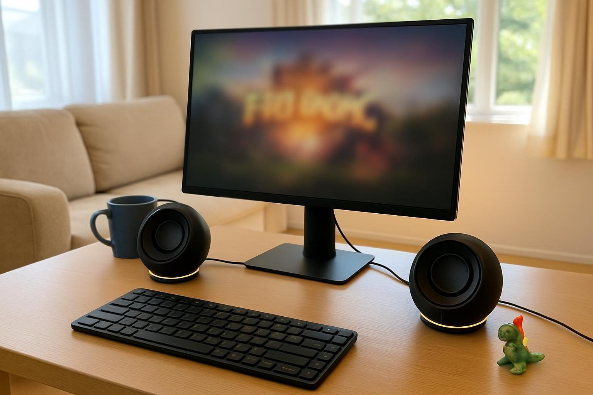

아이가 바로 옆방에서 자요. 그래서 들릴 듯 말 듯하게 틀어도 말이 들리는 스피커가 필요했어요. 5월 말에 PEBBLE PRO를 들여 6주쯤 썼어요. 퇴근하고 아이 재운 뒤에 두 시간 정도 게임하거나 인터넷 하는 게 하루의 낙이에요. PC는 거실에 있고, 밤엔 불 끈 채로 써요. 그동안은 모니터 내장 스피커를 아주 작게 틀거나, 그것도 불안하면 이어폰을 꼈어요.

| 형태 | 출력 | 연결 · 전원 | 사용 기간 |
|---|---|---|---|
| 새틀라이트 · 2채널 | 10W | 3.5mm · USB · 블루투스 / USB 전원 | 6주 · 게임·웹 |

## 작은 소리에서

볼륨을 거의 바닥까지 내려도 게임 속 캐릭터 대사나 영상 말소리가 들려요. 밤에 스토리 게임을 할 때 자막 없이도 대사를 안 놓쳤어요. 모니터 내장 스피커로 버틸 때는 작게 틀면 말이 웅얼거려서 결국 볼륨을 올리게 됐어요. 이건 낮은 볼륨 그대로 들을 수 있어요. 아이 깰 걱정이 줄었어요.

아이가 뒤척이는 소리가 들리면 볼륨을 더 낮춰요. 그래도 말소리가 완전히 사라지진 않아요. 뉴스 영상 틀어 두고 웹 서핑할 때도 작은 소리로 내용을 따라갈 수 있었고요. 밤에 축구 중계를 볼 때도 해설 목소리가 작게 틀어도 분명했어요. 골 장면에서 소리 지를 뻔한 걸 참느라 힘들었던 것만 빼면 완벽했어요. 다른 가족이 먼저 잠든 날에도 거실에서 조용히 영화 한 편을 볼 수 있게 된 게 제일 좋아요.

이어폰을 끼면 아이 우는 소리를 놓칠까 봐 늘 한쪽만 꼈어요. 이제는 이어폰을 안 써도 돼서 마음이 편해요. 주말 낮에는 아이랑 같이 만화 주제가를 틀기도 하는데, 볼륨을 조금 올려도 소리가 깨끗해요.

## 잡음

조용한 밤엔 스피커 잡음도 크게 들리는데, 이건 아무것도 안 틀었을 때 정말 조용해요. 지지직 소리를 들은 적이 없어요. 불 끄고 게임 로딩 화면을 기다릴 때도 스피커 쪽은 조용해요. 에어컨 소리만 나는 여름밤에도요. 켜 둔 채로 잠깐 졸다가 깼을 때도 방 안이 조용해서, 스피커가 켜져 있는 줄도 몰랐어요. 요즘 자주 졸아요.

둥근 모양이 귀여워서 거실 책상에 둬도 집 분위기랑 어울리고, 가족들도 디자인을 마음에 들어 했어요. 불 끄면 어디 있는지도 잘 안 보일 만큼 존재감이 적어요.

## 설치

소리를 세밀하게 조절하려면 제어 프로그램을 따로 깔아야 하는데, 설치하고 장치를 인식시키는 게 꽤 번거로웠어요. 몇 번 다시 연결하고 나서야 프로그램이 스피커를 잡았어요. 아이 재우고 난 뒤 짧은 자유 시간을 설치에 다 써 버렸어요. 그날은 좀 억울했어요. 한 번 설정하면 다시 열 일은 거의 없지만, 컴퓨터에 익숙하지 않은 사람이었다면 중간에 포기했을지도 몰라요. 프로그램에서 저음을 살짝 줄여 두니 밤에 작게 틀 때 소리가 더 정리되는 것 같았어요. 대사를 조금 앞으로 당겨 주는 설정도 있어서, 켜 두니 작게 틀 때 훨씬 편했어요.

밤에 아주 작게 써야 하는 집이면 추천해요.
