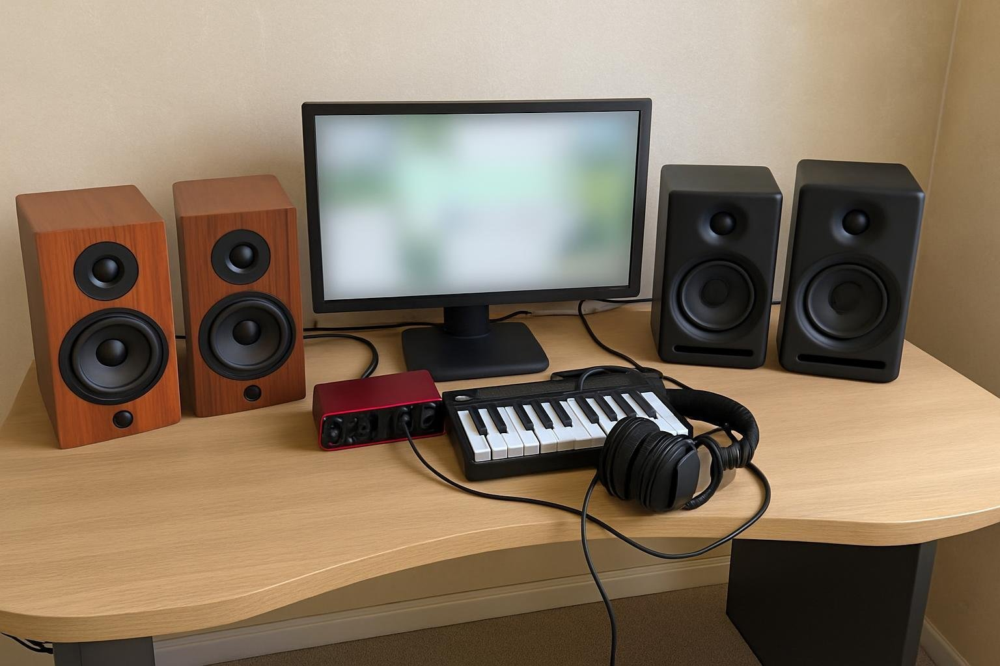

출력이 넉넉한 북셸프를 하나 더 두고 싶어서 7월 초에 R360을 들였고, 한 달 정도 썼습니다. 결론부터 말하면 제 취향과는 맞지 않았습니다. 조용한 방에서 하루 대여섯 시간 음악을 만들고 듣고, 스피커는 가까이 두고 꾸밈없는 소리로 듣는 쪽을 좋아합니다. 저음이 많은 편이라는 평은 보고 샀지만, 직접 들으면 다를 수도 있겠다 싶었습니다. 작업실 책상에는 이미 북셸프가 한 쌍 있어서 자리를 새로 만들어야 했습니다.

| 형태 | 출력 | 연결 · 전원 | 사용 기간 |
|---|---|---|---|
| 북셸프 · 2채널 | 40W (20W×2) | RCA / AC 전원 | 1개월 · 작곡·감상 |

## 음량

출력은 넉넉합니다. 볼륨을 많이 올리지 않아도 힘이 있고, 주말에 오케스트라 곡을 크게 틀었을 때도 끝까지 무너지지 않았습니다. 작은 PC 스피커로 작업하던 시절과는 여유가 비교되지 않습니다. 작업을 마친 저녁에 완성한 곡을 조금 크게 틀어 볼 때도 늘 여유가 남았습니다. 지인들이 작업실에 놀러 오면 완성한 곡을 크게 틀어 주는데, 그럴 때는 이 스피커가 확실히 분위기를 띄워 줍니다. 다들 저음이 좋다고 한마디씩 했습니다.

나무 상자 마감도 단단하고 깔끔해 보입니다. 다만 저는 큰 음량보다 가까이서 작은 음량으로 듣는 시간이 훨씬 깁니다.

## 소리 성향

저음이 많고 고음은 상대적으로 약해서 전체적으로 어둡게 들립니다. 보컬 녹음을 확인할 때 숨소리나 자음 끝이 묻혔습니다. 지금 쓰는 다른 북셸프와 같은 곡을 번갈아 들어 보면, R360 쪽은 고음에 얇은 막이 한 겹 덮인 것 같습니다. 특히 여성 보컬 곡에서 차이가 컸습니다. 고음으로 올라가는 구간에서 목소리가 앞으로 나오지 않고 반 발짝 뒤에 머무는 느낌이라, 가사 발음을 확인하기 어려웠습니다. 볼륨을 낮추면 이 어두운 느낌이 더 강해져서, 제가 주로 듣는 작은 음량에서는 특히 답답했습니다.

어쿠스틱 기타 위주의 곡에서는 줄을 긁는 소리보다 몸통 울림이 먼저 들려서, 같은 녹음인데 더 따뜻하고 둥글게 들렸습니다. 감상용이라면 이걸 좋아하는 사람도 많을 것 같습니다. 영화나 힙합처럼 저음이 중요한 음악을 즐긴다면 오히려 장점일 수 있습니다. 재즈 트리오 앨범에서는 콘트라베이스가 풍성하게 들려서, 작업이 아니라 쉬는 시간이었다면 꽤 좋아했을 것 같습니다.

## 작업용으로는

밤에 믹스를 다듬을 때 이 스피커를 기준으로 하면 저음을 자꾸 줄이고 고음을 올리게 됐고, 다음 날 이어폰으로 확인하면 과했던 경우가 많았습니다. 보컬 작업을 하는 날에는 헤드폰을 따로 꺼내 다시 확인해야 했습니다. 한 곡을 마무리하는 데 확인 단계가 하나 더 붙으니 작업 시간이 길어졌습니다. 처음 일주일은 귀가 적응하면 괜찮아지겠지 싶어서 일부러 이 스피커로만 작업했는데, 그 주에 만든 데모는 결국 다시 손봐야 했습니다. 작업 메모에 'R360 기준 저음 -2' 같은 식으로 보정값을 적어 두고 써 보기도 했는데, 곡마다 기준이 달라서 오래가지 못했습니다.

감상용으로 따로 둘까도 고민했지만, 두 쌍을 나란히 놓으니 책상이 너무 좁아서 한 달 만에 정리했습니다. 저음을 좋아하는 친구에게 넘겼는데, 그 친구는 아주 만족하며 쓰고 있습니다. 제품이 나쁘다기보다 취향 차이입니다. 꾸밈없는 소리를 찾는다면 다른 제품을 먼저 들어 보세요.
